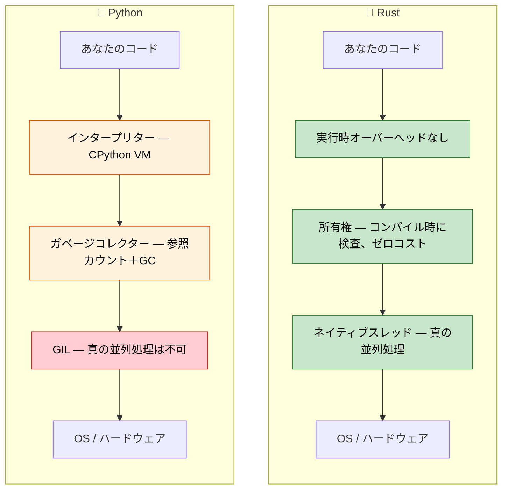

<a id="speaker-intro-and-general-approach"></a>
## 講師の紹介と講義の進め方

- 講師について
    - MicrosoftのSCHIE（Silicon and Cloud Hardware Infrastructure Engineering）チームで主席ファームウェアアーキテクトを務める
    - セキュリティ、システムプログラミング（ファームウェア、OS、ハイパーバイザー）、CPUとプラットフォームのアーキテクチャ、C++システム開発に精通した業界経験者
    - 2017年に（AWS EC2で）Rustのプログラミングを始め、それ以来この言語に魅了されている
- このコースは、できる限り対話的に進めることを目指している
    - 前提：Pythonとそのエコシステムを理解していること
    - Pythonの概念とRustでの対応関係を意識した例を紹介する
    - **いつでも遠慮なく質問してください**

---

<a id="the-case-for-rust-for-python-developers"></a>
## Python開発者にとってRustを学ぶ意義

> **学習内容：** Python開発者がRustを採用する理由、実際の性能向上の例（Dropbox、Discord、Pydantic）、
> Pythonを使い続ける場合との選択基準、そして2つの言語の根本的な設計思想の違い。
>
> **難易度：** 🟢 初級

### 性能：分単位からミリ秒単位へ

PythonはCPU負荷の高い処理が遅いことでよく知られています。Rustなら、高水準言語らしい書き心地を保ちながら、
C言語に匹敵する性能を得られます。

```python
# Python — 1,000万回の呼び出しで約2秒
import time

def fibonacci(n: int) -> int:
    if n <= 1:
        return n
    a, b = 0, 1
    for _ in range(2, n + 1):
        a, b = b, a + b
    return b

start = time.perf_counter()
results = [fibonacci(n % 30) for n in range(10_000_000)]
elapsed = time.perf_counter() - start
print(f"Elapsed: {elapsed:.2f}s")  # ~2s on typical hardware
```

```rust
// Rust — 同じ1,000万回の呼び出しで約0.07秒
use std::time::Instant;

fn fibonacci(n: u64) -> u64 {
    if n <= 1 {
        return n;
    }
    let (mut a, mut b) = (0u64, 1u64);
    for _ in 2..=n {
        let temp = b;
        b = a + b;
        a = temp;
    }
    b
}

fn main() {
    let start = Instant::now();
    let results: Vec<u64> = (0..10_000_000).map(|n| fibonacci(n % 30)).collect();
    println!("Elapsed: {:.2?}", start.elapsed());  // ~0.07s
}
```
> 注：公平に性能を比較するには、Rustをリリースモード（`cargo run --release`）で実行してください。
> **なぜ差が生じるのでしょうか？** Pythonでは、`+`演算のたびに辞書検索を行い、
> ヒープ上のオブジェクトから整数を取り出し、各演算で型を確認します。一方Rustは、
> `fibonacci`を少数のx86 `add`/`mov`命令に直接コンパイルします。これはCコンパイラーが生成するコードと同等です。

### ガベージコレクターなしでメモリー安全性を実現

Pythonの参照カウント方式のGCには、循環参照、予測しにくい`__del__`の実行タイミング、
メモリーの断片化といった既知の課題があります。Rustではこれらの問題をコンパイル時に排除します。

```python
# Python — CPythonの参照カウントでは解放できない循環参照
class Node:
    def __init__(self, value):
        self.value = value
        self.parent = None
        self.children = []

    def add_child(self, child):
        self.children.append(child)
        child.parent = self  # Circular reference!

# この2つのノードは互いを参照しているため、参照カウントが0にならない。
# CPythonの循環参照検出器はいずれ解放するが、
# いつ解放されるかは制御できず、GC停止のオーバーヘッドも発生する。
root = Node("root")
child = Node("child")
root.add_child(child)
```

```rust
// Rust — 所有権の仕組みにより、設計上、循環参照を防ぐ
struct Node {
    value: String,
    children: Vec<Node>,  // Children are OWNED — no cycles possible
}

impl Node {
    fn new(value: &str) -> Self {
        Node {
            value: value.to_string(),
            children: Vec::new(),
        }
    }

    fn add_child(&mut self, child: Node) {
        self.children.push(child);  // Ownership transfers here
    }
}

fn main() {
    let mut root = Node::new("root");
    let child = Node::new("child");
    root.add_child(child);
    // rootが破棄されると、すべての子も破棄される。
    // 解放時期は確定的で、オーバーヘッドもGCもない。
}
```

> **重要なポイント：** Rustでは子が親への参照を保持しません。
> グラフのように相互参照が本当に必要な場合は、`Rc<RefCell<T>>`やインデックスなどの明示的な仕組みを使います。
> そうすることで、複雑さを意図的に、かつ分かりやすく扱えます。

***

<a id="common-python-pain-points-that-rust-addresses"></a>
## Rustが解決するPythonのよくある課題

### 1. 実行時の型エラー

Pythonの本番環境でよく見られるバグの一つは、関数に誤った型の値を渡すことです。
型ヒントは役立ちますが、強制されるわけではありません。

```python
# Python — 型ヒントは提案であり、規則ではない
def process_user(user_id: int, name: str) -> dict:
    return {"id": user_id, "name": name.upper()}

# 呼び出し時にはどれも「通る」が、実行時に失敗する
process_user("not-a-number", 42)        # TypeError: int has no .upper()
process_user(None, "Alice")             # Silently stores None as id — bug hides until downstream code expects int

# mypyを使っていても、型チェックをすり抜ける場合がある：
data = json.loads('{"id": "oops"}')     # Always returns Any
process_user(data["id"], data["name"])  # mypy can't catch this
```

```rust
// Rust — プログラム実行前に、コンパイラーがこれらをすべて検出する
fn process_user(user_id: i64, name: &str) -> User {
    User {
        id: user_id,
        name: name.to_uppercase(),
    }
}

// process_user("not-a-number", 42);     // ❌ コンパイルエラー：i64が必要だが、&strが渡された
// process_user(None, "Alice");           // ❌ コンパイルエラー：i64が必要だが、Optionが渡された
// 余分な引数も常にコンパイルエラーになる。

// JSONのデシリアライズも型安全：
#[derive(Deserialize)]
struct UserInput {
    id: i64,     // Must be a number in the JSON
    name: String, // Must be a string in the JSON
}
let input: UserInput = serde_json::from_str(json_str)?; // Returns Err if types mismatch
process_user(input.id, &input.name); // ✅ Guaranteed correct types
```

### 2. `None`：10億ドルの過ち（Pythonの場合）

値が期待される場所ならどこにでも`None`が入り込む可能性があります。Pythonには、
`AttributeError: 'NoneType' object has no attribute ...`をコンパイル時に防ぐ方法がありません。

```python
# Python — Noneはどこにでも入り込む
def find_user(user_id: int) -> dict | None:
    users = {1: {"name": "Alice"}, 2: {"name": "Bob"}}
    return users.get(user_id)

user = find_user(999)         # Returns None
print(user["name"])           # 💥 TypeError: 'NoneType' object is not subscriptable

# Optionalの型ヒントを使っても、チェックは強制されない：
from typing import Optional
def get_name(user_id: int) -> Optional[str]:
    return None

name: Optional[str] = get_name(1)
print(name.upper())          # 💥 AttributeError — mypy warns, runtime doesn't care
```

```rust
// Rust — 明示的に扱わない限り、Noneを使うことはできない
fn find_user(user_id: i64) -> Option<User> {
    let users = HashMap::from([
        (1, User { name: "Alice".into() }),
        (2, User { name: "Bob".into() }),
    ]);
    users.get(&user_id).cloned()
}

let user = find_user(999);  // Returns None variant of Option<User>
// println!("{}", user.name);  // ❌ コンパイルエラー：Option<User>に`name`フィールドはない

// Noneの場合を必ず処理する：
match find_user(999) {
    Some(user) => println!("{}", user.name),
    None => println!("User not found"),
}

// またはコンビネーターを使う：
let name = find_user(999)
    .map(|u| u.name)
    .unwrap_or_else(|| "Unknown".to_string());
```

### 3. GIL：Pythonの並行処理の上限

Pythonのグローバルインタープリターロック（GIL）により、複数スレッドでPythonコードを並列実行できません。
`threading`が有効なのは主にI/O負荷の高い処理です。CPU負荷の高い処理には、
シリアライズのオーバーヘッドを伴う`multiprocessing`か、C拡張が必要です。

```python
# Python — GILがあるため、スレッドを使ってもCPU処理は速くならない
import threading
import time

def cpu_work(n):
    total = 0
    for i in range(n):
        total += i * i
    return total

start = time.perf_counter()
threads = [threading.Thread(target=cpu_work, args=(10_000_000,)) for _ in range(4)]
for t in threads:
    t.start()
for t in threads:
    t.join()
elapsed = time.perf_counter() - start
print(f"4 threads: {elapsed:.2f}s")  # About the SAME as 1 thread! GIL prevents parallelism.

# multiprocessingなら「動く」が、プロセス間でデータをシリアライズする：
from multiprocessing import Pool
with Pool(4) as p:
    results = p.map(cpu_work, [10_000_000] * 4)  # ~4x faster, but pickle overhead
```

```rust
// Rust — 真の並列処理が可能で、GILもシリアライズのオーバーヘッドもない
use std::thread;

fn cpu_work(n: u64) -> u64 {
    (0..n).map(|i| i * i).sum()
}

fn main() {
    let start = std::time::Instant::now();
    let handles: Vec<_> = (0..4)
        .map(|_| thread::spawn(|| cpu_work(3_000_000)))
        .collect();

    let results: Vec<u64> = handles.into_iter()
        .map(|h| h.join().unwrap())
        .collect();

    println!("4 threads: {:.2?}", start.elapsed());  // ~4x faster than single thread
}
```

> **Rayon**（Rustの並列イテレーターライブラリー）を使うと、並列処理はさらに簡単になります。
> ```rust
> use rayon::prelude::*;
> let results: Vec<u64> = inputs.par_iter().map(|&n| cpu_work(n)).collect();
> ```

### 4. デプロイと配布の悩み

Pythonのデプロイは難しいことで知られています。仮想環境、システムPythonとの競合、
`pip install`の失敗、C拡張のwheel、Pythonランタイム全体を含むDockerイメージなどが課題になります。

```python
# Pythonのデプロイ時に確認する項目：
# 1. Pythonのバージョンは？3.9？3.10？3.11？3.12？
# 2. 仮想環境は？venv、conda、poetry、pipenv？
# 3. C拡張にはコンパイラーが必要か？manylinuxのwheelはあるか？
# 4. システム依存関係は？libssl、libffiなど
# 5. Docker：Python 3.12のフルイメージは1.0 GB
# 6. 起動時間：importの多いアプリでは200～500ミリ秒

# Dockerイメージ：約1 GB
# FROM python:3.12-slim
# COPY requirements.txt .
# RUN pip install -r requirements.txt
# COPY . .
# CMD ["python", "app.py"]
```

```rust
// Rustのデプロイ：単一の静的バイナリーで、ランタイムは不要
// cargo build --release → 約5～20 MBのバイナリーを生成
// どこへでもコピーできる。Python、仮想環境、依存関係は不要

// Dockerイメージ：約5 MB（scratchまたはdistrolessを使用）
// FROM scratch
// COPY target/release/my_app /my_app
// CMD ["/my_app"]

// 起動時間：1ミリ秒未満
// クロスコンパイル：cargo build --target x86_64-unknown-linux-musl
```

***

<a id="when-to-choose-rust-over-python"></a>
## PythonよりRustを選ぶとき

### Rustを選ぶとよい場合：
- **性能が重要**：データパイプライン、リアルタイム処理、計算負荷の高いサービス
- **正しさが重要**：金融システム、安全性が重視されるコード、プロトコル実装
- **デプロイを簡素化したい**：単一バイナリーで、ランタイム依存がない
- **低レベル制御が必要**：ハードウェア連携、OS統合、組み込みシステム
- **真の並列処理が必要**：GIL回避策なしでCPU負荷の高い処理を並列化
- **メモリー効率を高めたい**：メモリー集約型サービスのクラウドコストを削減
- **長時間稼働するサービス**：GC停止がなく、遅延の予測可能性が重要

### Pythonを使い続けるとよい場合：
- **迅速なプロトタイピング**：探索的データ分析、スクリプト、一度きりのツール
- **ML/AIのワークフロー**：PyTorch、TensorFlow、scikit-learnのエコシステム
- **連携用コード**：API接続、データ変換スクリプト
- **チームの専門性**：Rustの学習コストに見合う利点がない場合
- **市場投入までの時間**：実行速度より開発速度を優先する場合
- **対話的な作業**：Jupyter Notebook、REPLを使った開発
- **スクリプト作成**：自動化、システム管理、簡易ユーティリティー

### 両方を使う（PyO3によるハイブリッド方式）：
- **計算負荷の高いコードはRustで実装**：PyO3/maturinを介してPythonから呼び出す
- **ビジネスロジックと処理の調整はPythonで実装**：慣れた言語で生産性を保つ
- **段階的に移行**：性能上のボトルネックを見つけ、Rust拡張に置き換える
- **両方の長所を活用**：PythonのエコシステムとRustの性能を組み合わせる

***

<a id="real-world-impact-why-companies-choose-rust"></a>
## 実社会での効果：企業がRustを選ぶ理由

### Dropbox：ストレージ基盤
- **導入前（Python）**：同期エンジンのCPU使用率が高く、メモリーのオーバーヘッドも大きい
- **導入後（Rust）**：性能が10倍向上し、メモリー使用量が50%減少
- **結果**：インフラコストを数百万ドル削減

### Discord：音声・動画バックエンド
- **導入前（PythonからGoへ）**：GCの停止によって音声が途切れる
- **導入後（Rust）**：低遅延で安定した性能を実現
- **結果**：ユーザー体験が向上し、サーバーコストも削減

### Cloudflare：エッジワーカー
- **Rustを選んだ理由**：WebAssemblyにコンパイルでき、エッジで予測可能な性能を発揮する
- **結果**：ワーカーのコールドスタートがマイクロ秒単位

### Pydantic V2
- **導入前**：Pythonのみの検証処理では、大きなペイロードの処理が遅い
- **導入後**：Rustコア（PyO3経由）により、検証が**5～50倍高速化**
- **結果**：同じPython APIのまま、実行速度が大幅に向上

### Python開発者にとっての意味：
1. **相互補完できるスキル**：RustとPythonは異なる課題を解決する
2. **PyO3による橋渡し**：Pythonから呼び出せるRust拡張を作成できる
3. **性能への理解**：Pythonが遅くなる理由と、ボトルネックの解消方法を学べる
4. **キャリアの成長**：システムプログラミングの専門知識はますます価値が高まる
5. **クラウドコスト**：コードが10倍速くなれば、インフラ支出を大幅に削減できる

***

<a id="language-philosophy-comparison"></a>
## 言語設計思想の比較

<a id="python-philosophy"></a>
### Pythonの設計思想
- **読みやすさを重視**：簡潔な構文、「それを行う明白な方法は一つ」
- **豊富な標準機能**：充実した標準ライブラリーと迅速なプロトタイピング
- **ダックタイピング**：「アヒルのように歩き、アヒルのように鳴くなら……」
- **開発速度を重視**：実行速度ではなく、コードを書く速さを最適化
- **すべてを動的に扱う**：実行時のクラス変更、モンキーパッチ、メタクラス

<a id="rust-philosophy"></a>
### Rustの設計思想
- **妥協のない性能**：ゼロコスト抽象化、実行時オーバーヘッドなし
- **正しさを最優先**：コンパイルが通れば、特定の種類のバグを排除できる
- **暗黙より明示**：隠れた振る舞いや暗黙の型変換がない
- **所有権**：メモリー、ファイル、ソケットなどのリソースには所有者が一つだけ
- **安心して並行処理**：型システムがデータ競合をコンパイル時に防ぐ



***

<a id="quick-reference-rust-vs-python"></a>
## クイックリファレンス：RustとPythonの比較

| **概念** | **Python** | **Rust** | **主な違い** |
|-------------|-----------|----------|-------------------|
| 型付け | 動的（`duck typing`） | 静的（コンパイル時） | 実行前にエラーを検出 |
| メモリー | ガベージコレクション（参照カウント＋循環GC） | 所有権システム | ゼロコストで確定的に解放 |
| None/null | どこでも`None`を使える | `Option<T>` | コンパイル時に`None`を安全に扱う |
| エラー処理 | `raise`/`try`/`except` | `Result<T, E>` | 明示的で、制御フローが隠れない |
| 可変性 | すべて可変 | デフォルトで不変 | 変更するときに明示する |
| 速度 | インタープリター実行（約10～100倍遅い） | コンパイル実行（C/C++並み） | 桁違いの高速化 |
| 並行処理 | GILがスレッドを制限 | GILなし、`Send`/`Sync`トレイト | 標準で真の並列処理が可能 |
| 依存関係 | `pip install` / `poetry add` | `cargo add` | 依存関係管理機能を内蔵 |
| ビルドシステム | setuptools/poetry/hatch | Cargo | 統一された単一ツール |
| パッケージ設定 | `pyproject.toml` | `Cargo.toml` | 宣言的な設定方式は同様 |
| REPL | `python`対話モード | REPLなし（テストや`cargo run`を使用） | コンパイルを前提とした開発 |
| 型ヒント | 任意で、強制されない | 必須で、コンパイラーが強制 | 型は飾りではない |

---

<a id="exercises"></a>
## 練習問題

<details>
<summary><strong>🏋️ 練習問題：考え方の確認</strong>（クリックして展開）</summary>

**課題：** 各Pythonのコード例について、Rustでは何が異なり、どのような制約があるかを予想してください。コードを書く必要はありません。制約を説明してください。

1. `x = [1, 2, 3]; y = x; x.append(4)` — Rustではどうなるでしょうか？
2. `data = None; print(data.upper())` — Rustではどのように防ぐでしょうか？
3. `import threading; shared = []; threading.Thread(target=shared.append, args=(1,)).start()` — Rustでは何が求められるでしょうか？

<details>
<summary>🔑 解答</summary>

1. **所有権の移動**：`let y = x;`で`x`の所有権が移るため、`x.push(4)`はコンパイルエラーになります。`let y = x.clone();`で複製するか、`let y = &x;`で借用します。
2. **nullがない**：`data`を`None`にできるのは`Option<String>`の場合だけです。`match`、`.unwrap()`、`if let`などで扱う必要があり、予期しない`NoneType`エラーは起こりません。
3. **Send + Sync**：コンパイラーは`shared`を`Arc<Mutex<Vec<i32>>>`で包むことを求めます。ロックを忘れると、データ競合ではなくコンパイルエラーになります。

**要点：** Rustは実行時の失敗をコンパイル時のエラーに移します。煩わしく感じる制約は、コンパイラーが実際のバグを検出している証拠です。

</details>
</details>

***
