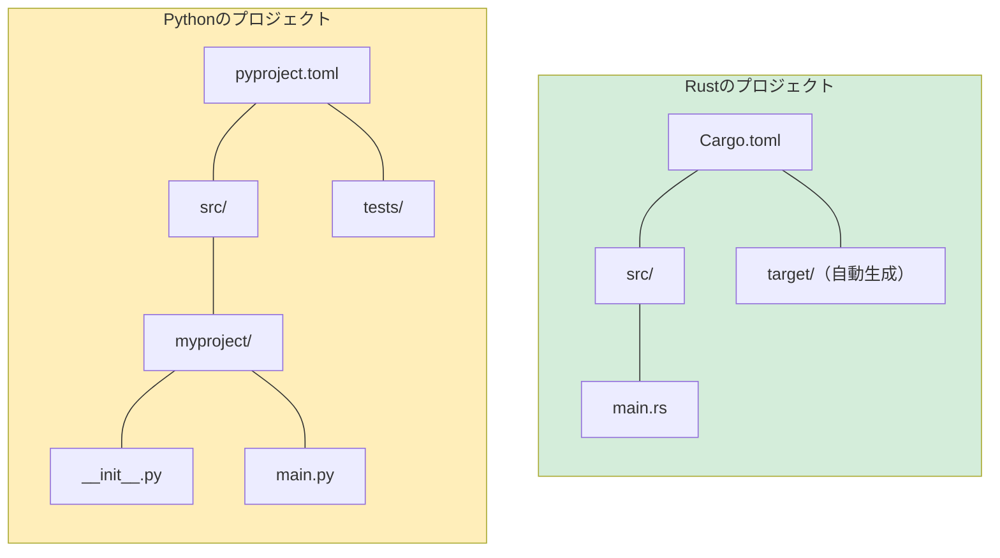

<a id="installation-and-setup"></a>
## インストールと環境設定

> **学習内容：** Rustとツールチェーンのインストール、pip/PoetryとCargoビルドシステムの比較、
> IDEの設定、最初の`Hello, world!`プログラム、Pythonの概念に対応するRustの基本キーワード。
>
> **難易度：** 🟢 初級

<a id="installing-rust"></a>
### Rustのインストール
```bash
# rustupを使ってRustをインストール（Linux/macOS/WSL）
curl --proto '=https' --tlsv1.2 -sSf https://sh.rustup.rs | sh

# インストールを確認
rustc --version     # Rust compiler
cargo --version     # Build tool + package manager (like pip + setuptools combined)

# Rustを更新
rustup update
```

<a id="rust-tools-vs-python-tools"></a>
### RustのツールとPythonのツールの比較

| 用途 | Python | Rust |
|---------|--------|------|
| 言語ランタイム | `python`（インタープリター） | `rustc`（コンパイラー、通常は直接呼び出さない） |
| パッケージマネージャー | `pip` / `poetry` / `uv` | `cargo`（組み込み） |
| プロジェクト設定 | `pyproject.toml` | `Cargo.toml` |
| ロックファイル | `poetry.lock` / `requirements.txt` | `Cargo.lock` |
| 仮想環境 | `venv` / `conda` | 不要（依存関係はプロジェクトごとに管理） |
| フォーマッター | `black` / `ruff format` | `rustfmt`（組み込み：`cargo fmt`） |
| リンター | `ruff` / `flake8` / `pylint` | `clippy`（組み込み：`cargo clippy`） |
| 型チェッカー | `mypy` / `pyright` | コンパイラーに組み込み（常時有効） |
| テストランナー | `pytest` | `cargo test`（組み込み） |
| ドキュメント | `sphinx` / `mkdocs` | `cargo doc`（組み込み） |
| REPL | `python` / `ipython` | なし（`cargo test`またはRust Playgroundを使用） |

<a id="ide-setup"></a>
### IDEの設定

**VS Code**（推奨）：
```text
Extensions to install:
- rust-analyzer        ← Essential: IDE features, type hints, completions
- Even Better TOML     ← Syntax highlighting for Cargo.toml
- CodeLLDB             ← Debugger support

# Pythonでの対応ツール：
# rust-analyzer ≈ Pylance（常に100%の型カバレッジを提供）
# cargo clippy  ≈ ruff（スタイルだけでなく正しさも検査）
```

***

<a id="your-first-rust-program"></a>
## 最初のRustプログラム

<a id="python-hello-world"></a>
### PythonのHello World
```python
# hello.py — そのまま実行できる
print("Hello, World!")

# 実行方法：
# python hello.py
```

<a id="rust-hello-world"></a>
### RustのHello World
```rust
// src/main.rs — 先にコンパイルが必要
fn main() {
    println!("Hello, World!");   // println! is a macro (note the !)
}

// ビルドして実行：
// cargo run
```

<a id="key-differences-for-python-developers"></a>
### Python開発者が知っておきたい主な違い

```text
Python:                              Rust:
─────────                            ─────
- No main() needed                   - fn main() is the entry point
- Indentation = blocks               - Curly braces {} = blocks
- print() is a function              - println!() is a macro (the ! matters)
- No semicolons                      - Semicolons end statements
- No type declarations               - Types inferred but always known
- Interpreted (run directly)         - Compiled (cargo build, then run)
- Errors at runtime                  - Most errors at compile time
```

<a id="creating-your-first-project"></a>
### 最初のプロジェクトを作成する
```bash
# Python                              # Rust
mkdir myproject                        cargo new myproject
cd myproject                           cd myproject
python -m venv .venv                   # 仮想環境は不要
source .venv/bin/activate              # 有効化も不要
# ファイルを手動で作成                 # src/main.rsはすでに作成済み

# Pythonのプロジェクト構成：            Rustのプロジェクト構成：
# myproject/                           myproject/
# ├── pyproject.toml                   ├── Cargo.toml        （pyproject.tomlに相当）
# ├── src/                             ├── src/
# │   └── myproject/                   │   └── main.rs       （エントリーポイント）
# │       ├── __init__.py              └── （__init__.pyは不要）
# │       └── main.py
# └── tests/
#     └── test_main.py
```



> **主な違い：** Rustのプロジェクト構成はよりシンプルです。`__init__.py`も仮想環境も不要で、
> `setup.py`、`setup.cfg`、`pyproject.toml`の使い分けに悩むこともありません。必要なのは`Cargo.toml`と`src/`だけです。

***

<a id="cargo-vs-pippoetry"></a>
## Cargoとpip/Poetryの比較

<a id="project-configuration"></a>
### プロジェクトの設定

```toml
# Python — pyproject.toml
[project]
name = "myproject"
version = "0.1.0"
requires-python = ">=3.10"
dependencies = [
    "requests>=2.28",
    "pydantic>=2.0",
]

[project.optional-dependencies]
dev = ["pytest", "ruff", "mypy"]
```

```toml
# Rust — Cargo.toml
[package]
name = "myproject"
version = "0.1.0"
edition = "2021"          # Rust edition (like Python version)

[dependencies]
reqwest = "0.12"          # HTTP client (like requests)
serde = { version = "1.0", features = ["derive"] }  # Serialization (like pydantic)

[dev-dependencies]
# テスト用依存関係 — `cargo test`のときだけコンパイルされる
# （`cargo test`が組み込まれているため、テスト用の個別設定は不要）
```

<a id="common-cargo-commands"></a>
### よく使うCargoコマンド
```bash
# Pythonでの対応コマンド           # Rust
pip install requests               cargo add reqwest
pip install -r requirements.txt    cargo build           # auto-installs deps
pip install -e .                   cargo build            # always "editable"
python -m pytest                   cargo test
python -m mypy .                   # Built into compiler — always runs
ruff check .                       cargo clippy
ruff format .                      cargo fmt
python main.py                     cargo run
python -c "..."                    # No equivalent — use cargo run or tests

# Rust固有のコマンド：
cargo new myproject                # Create new project
cargo build --release              # Optimized build (10-100x faster than debug)
cargo doc --open                   # Generate and browse API docs
cargo update                       # Update deps (like pip install --upgrade)
```

***


<a id="essential-rust-keywords-for-python-developers"></a>
## Python開発者のためのRust基本キーワード

<a id="variable-and-mutability-keywords"></a>
### 変数と可変性に関するキーワード

```rust
// let — 変数を宣言（Pythonの代入に似ているが、デフォルトで不変）
let name = "Alice";          // Python: name = "Alice" (but mutable)
// name = "Bob";             // ❌ コンパイルエラー！デフォルトで不変

// mut — 可変にすることを明示
let mut count = 0;           // Python: count = 0 (always mutable in Python)
count += 1;                  // ✅ Allowed because of `mut`

// const — コンパイル時定数（Pythonの大文字表記の慣例に似ているが、コンパイラーが強制）
const MAX_SIZE: usize = 1024;   // Python: MAX_SIZE = 1024 (convention only)

// static — グローバル変数（使用は控えめに。Pythonではモジュールレベルのグローバル変数に相当）
static VERSION: &str = "1.0";
```

<a id="ownership-and-borrowing-keywords"></a>
### 所有権と借用に関するキーワード

```rust
// Pythonに対応する概念はなく、Rust固有のもの

// & — 借用（読み取り専用の参照）
fn print_name(name: &str) { }    // Python: def print_name(name: str) — but Python passes ref always

// &mut — 可変借用
fn append(list: &mut Vec<i32>) { }  // Python: def append(lst: list) — always mutable in Python

// move — 所有権を移動（Rustでは暗黙に起きるが、Pythonにはない）
let s1 = String::from("hello");
let s2 = s1;    // s1 is MOVED to s2 — s1 is no longer valid
// println!("{}", s1);  // ❌ コンパイルエラー：値の所有権は移動済み
```

<a id="type-definition-keywords"></a>
### 型定義に関するキーワード

```rust
// struct — PythonのdataclassやNamedTupleに相当
struct Point {               // @dataclass
    x: f64,                  // class Point:
    y: f64,                  //     x: float
}                            //     y: float

// enum — Pythonのenumに似ているが、はるかに強力（データを保持できる）
enum Shape {                 // No direct Python equivalent
    Circle(f64),             // Each variant can hold different data
    Rectangle(f64, f64),
}

// impl — 型にメソッドを実装（クラスにメソッドを定義するのに似ている）
impl Point {                 // class Point:
    fn distance(&self) -> f64 {  //     def distance(self) -> float:
        (self.x.powi(2) + self.y.powi(2)).sqrt()
    }
}

// trait — PythonのABCやProtocol（PEP 544）に相当
trait Drawable {             // class Drawable(Protocol):
    fn draw(&self);          //     def draw(self) -> None: ...
}

// type — 型エイリアス（PythonのTypeAliasに相当）
type UserId = i64;           // UserId = int  (or TypeAlias)
```

<a id="control-flow-keywords"></a>
### 制御フローに関するキーワード

```rust
// match — 網羅的なパターンマッチング（Python 3.10以降のmatchに似ているが、網羅性が強制される）
match value {
    1 => println!("one"),
    2 | 3 => println!("two or three"),
    _ => println!("other"),          // _ = wildcard (like Python's case _:)
}

// if let — 分配束縛と条件分岐（Pythonなら if (m := regex.match(s)): のように書く）
if let Some(x) = optional_value {
    println!("{}", x);
}

// loop — 無限ループ（while True:に相当）
loop {
    break;  // Must break to exit
}

// for — 反復処理（Pythonのforに似ているが、より頻繁に.iter()が必要）
for item in collection.iter() {      // for item in collection:
    println!("{}", item);
}

// while let — 分配束縛を伴うループ
while let Some(item) = stack.pop() {
    process(item);
}
```

<a id="visibility-keywords"></a>
### 可視性に関するキーワード

```rust
// pub — 公開（Pythonには真のprivateがなく、_を使う慣例がある）
pub fn greet() { }           // def greet():  — everything is "public" in Python

// pub(crate) — 同じクレート内でのみ可視
pub(crate) fn internal() { } // def _internal():  — single underscore convention

// （キーワードなし）— モジュール内でのみ可視
fn private_helper() { }      // def __private():  — double underscore name mangling

// Pythonでは「private」は慣例にすぎない。
// Rustではコンパイラーがprivateを強制する。
```

---

<a id="exercises"></a>
## 練習問題

<details>
<summary><strong>🏋️ 練習問題：初めてのRustプログラム</strong>（クリックして展開）</summary>

**課題：** 新しいRustプロジェクトを作成し、次の処理を行うプログラムを書いてください。
1. 自分の名前を持つ変数`name`（型は`&str`）を宣言する
2. 0から始まる可変変数`count`を宣言する
3. 1..=5の範囲で`for`ループを実行し、`count`を増やしながら`"Hello, {name}! (count: {count})"`を出力する
4. ループの後、`match`式を使って`count`が偶数か奇数かを出力する

<details>
<summary>🔑 解答</summary>

```bash
cargo new hello_rust && cd hello_rust
```

```rust
// src/main.rs
fn main() {
    let name = "Pythonista";
    let mut count = 0u32;

    for _ in 1..=5 {
        count += 1;
        println!("Hello, {name}! (count: {count})");
    }

    let parity = match count % 2 {
        0 => "even",
        _ => "odd",
    };
    println!("Final count {count} is {parity}");
}
```

**要点：**
- `let`で宣言した変数はデフォルトで不変（`count`を変更するには`mut`が必要）
- `1..=5`は終端を含む範囲（Pythonの`range(1, 6)`に相当）
- `match`は値を返す式
- `self`も`if __name__ == "__main__"`も不要で、`fn main()`だけでよい

</details>
</details>

***
