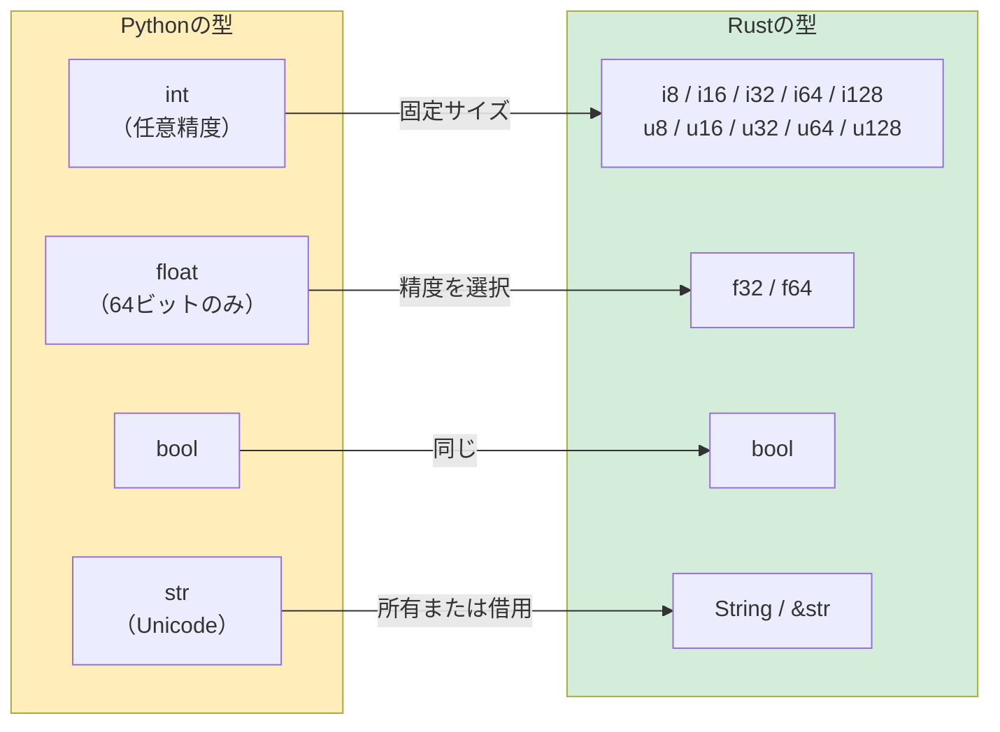

<a id="variables-and-mutability"></a>
## 変数と可変性

> **学習内容：** デフォルトで不変となる変数、明示的な`mut`、Pythonの任意精度`int`とRustの数値プリミティブ型の違い、
> 初学者にとって難関となる`String`と`&str`、文字列の書式設定、Rustで必須となる型注釈。
>
> **難易度：** 🟢 初級

<a id="python-variable-declaration"></a>
### Pythonの変数宣言
```python
# Python — すべて可変で、動的に型付けされる
count = 0          # 可変で、型はintと推論される
count = 5          # ✅ 代入可能
count = "hello"    # ✅ 型も変更できる（動的型付け）

# 「定数」は慣例にすぎない：
MAX_SIZE = 1024    # 後からMAX_SIZE = 999と再代入することもできる
```

<a id="rust-variable-declaration"></a>
### Rustの変数宣言
```rust
// Rust — デフォルトで不変、静的型付け
let count = 0;           // 不変で、型はi32と推論される
// count = 5;            // ❌ コンパイルエラー：不変変数には再代入できない
// count = "hello";      // ❌ コンパイルエラー：整数が必要だが、&strが渡された

let mut count = 0;       // 可変であることを明示
count = 5;               // ✅ 代入可能
// count = "hello";      // ❌ 型も変更できない

const MAX_SIZE: usize = 1024; // 真の定数 — コンパイラーが強制
```

<a id="key-mental-shift-for-python-developers"></a>
### Python開発者が意識したい考え方の転換
```rust
// Python：変数はオブジェクトを指すラベル
// Rust：変数は値を所有する名前付きの記憶領域

// 変数のシャドーイング — Rust独自の便利な機能
let input = "42";              // &str
let input = input.parse::<i32>().unwrap();  // 新しい変数としてi32型になる（名前は同じ）
let input = input * 2;         // さらに新しい変数となり、値は84

// Pythonでは再代入するだけで、以前の型を失う：
# input = "42"
# input = int(input)   # 同じ名前で別の型にできる — Pythonではこれも可能
# Rustでは`let`ごとに新しい束縛が作られ、古い束縛は使えなくなる。
```

<a id="practical-example-counter"></a>
### 実践例：カウンター
```python
# Python version
class Counter:
    def __init__(self):
        self.value = 0
    
    def increment(self):
        self.value += 1
    
    def get_value(self):
        return self.value

c = Counter()
c.increment()
print(c.get_value())  # 1
```

```rust
// Rust version
struct Counter {
    value: i64,
}

impl Counter {
    fn new() -> Self {
        Counter { value: 0 }
    }

    fn increment(&mut self) {     // &mut self = この値を変更する
        self.value += 1;
    }

    fn get_value(&self) -> i64 {  // &self = この値を読み取るだけ
        self.value
    }
}

fn main() {
    let mut c = Counter::new();   // increment()を呼ぶには`mut`が必要
    c.increment();
    println!("{}", c.get_value()); // 1
}
```

> **主な違い：** Rustでは、メソッドのシグネチャにある`&mut self`によって、`increment`がカウンターを変更することを
> 開発者にもコンパイラーにも明示します。Pythonでは、どのメソッドも任意の値を変更できるため、コードを読まなければ分かりません。

***

<a id="primitive-types-comparison"></a>
## プリミティブ型の比較



<a id="numeric-types"></a>
### 数値型

| Python | Rust | Notes |
|--------|------|-------|
| `int`（任意精度） | `i8`, `i16`, `i32`, `i64`, `i128`, `isize` | Rustの整数は固定サイズ |
| `int`（符号なし専用型はない） | `u8`, `u16`, `u32`, `u64`, `u128`, `usize` | 符号なし型を明示する |
| `float`（64ビットIEEE 754） | `f32`, `f64` | Pythonの浮動小数点数は64ビットのみ |
| `bool` | `bool` | 同じ概念 |
| `complex` | 組み込み型なし（`num`クレートを使用） | システムコードではまれ |

```python
# Python — 整数型は一つで、任意精度
x = 42                     # int — 任意の大きさに拡張できる
big = 2 ** 1000            # 桁数が数千に及んでも問題なく扱える
y = 3.14                   # float — 常に64ビット
```

```rust
// Rust — サイズを明示し、オーバーフローはコンパイル時または実行時エラーになる
let x: i32 = 42;           // 32ビット符号付き整数
let y: f64 = 3.14;         // 64ビット浮動小数点数（Pythonのfloatに相当）
let big: i128 = 2_i128.pow(100); // 最大128ビット — 任意精度ではない
// 任意精度の整数には`num-bigint`クレートを使う

// 読みやすさのためのアンダースコア（Pythonの1_000_000と同じ）：
let million = 1_000_000;   // Pythonと同じ構文

// 型サフィックスの構文：
let a = 42u8;              // u8
let b = 3.14f32;           // f32
```

<a id="size-types-important"></a>
### サイズ型（重要）

```rust
// usizeとisize — ポインター幅の整数で、インデックスに使う
let length: usize = vec![1, 2, 3].len();  // .len()はusizeを返す
let index: usize = 0;                     // 配列のインデックスは常にusize

// Pythonではlen()もインデックスもintで、区別はない。
// Rustではi32とusizeを混在させるには明示的な変換が必要：
let i: i32 = 5;
// let item = vec[i];    // ❌ エラー：usizeが必要だが、i32が渡された
let item = vec[i as usize]; // ✅ 明示的な変換
```

<a id="type-inference"></a>
### 型推論

```rust
// Rustは型を推論するが、型は固定される — 動的ではない
let x = 42;          // コンパイラーはi32と推論する（整数のデフォルト型）
let y = 3.14;        // コンパイラーはf64と推論する（浮動小数点数のデフォルト型）
let s = "hello";     // コンパイラーは&strと推論する（文字列スライス）
let v = vec![1, 2];  // コンパイラーはVec<i32>と推論する

// 型はいつでも明示できる：
let x: i64 = 42;
let y: f32 = 3.14;

// Pythonとは異なり、推論後に型を変更することはできない：
let x = 42;
// x = "hello";      // ❌ エラー：整数が必要だが、&strが渡された
```

***

<a id="string-types-string-vs-str"></a>
## 文字列型：`String`と`&str`

これはPython開発者にとって大きな驚きの一つです。Pythonには文字列型が一つありますが、
Rustには主に**二つ**の文字列型があります。

<a id="python-string-handling"></a>
### Pythonでの文字列の扱い
```python
# Python — 文字列型は一つで、不変かつ参照カウント方式
name = "Alice"          # str — 不変で、ヒープに確保される
greeting = f"Hello, {name}!"  # f文字列による書式設定
chars = list(name)      # 文字のリストに変換
upper = name.upper()    # 新しい文字列を返す（不変）
```

<a id="rust-string-types"></a>
### Rustの文字列型
```rust
// Rustには文字列型が二つある：

// 1. &str（文字列スライス）— 借用される不変の型で、文字列データを「見る」もの
let name: &str = "Alice";           // バイナリー内の文字列データを指す
                                     // Pythonのstrに最も近いが、これは参照である

// 2. String（所有する文字列）— ヒープに確保され、拡張可能で、所有権を持つ
let mut greeting = String::from("Hello, ");  // 所有権を持ち、変更可能
greeting.push_str(name);
greeting.push('!');
// greetingは"Hello, Alice!"になった
```

<a id="when-to-use-which"></a>
### どちらをいつ使うか

```rust
// 次のように考える：
// &str  = 「他の誰かが所有する文字列を見ている」（読み取り専用のビュー）
// String = 「この文字列を所有していて、変更できる」（所有するデータ）

// 関数の引数には&strを使う（どちらの型も受け取れる）
fn greet(name: &str) -> String {          // &strと&Stringの両方を受け取れる
    format!("Hello, {}!", name)           // format!は新しいStringを作成する
}

let s1 = "world";                         // &str literal
let s2 = String::from("Rust");            // String

greet(s1);      // ✅ &strはそのまま使える
greet(&s2);     // ✅ &Stringは&strに自動変換される（Deref coercion）
```

<a id="practical-examples"></a>
### 実践例

```python
# Pythonの文字列操作
name = "alice"
upper = name.upper()               # "ALICE"
contains = "lic" in name           # True
parts = "a,b,c".split(",")         # ["a", "b", "c"]
joined = "-".join(["a", "b", "c"]) # "a-b-c"
stripped = "  hello  ".strip()     # "hello"
replaced = name.replace("a", "A") # "Alice"
```

```rust
// Rustでの対応例
let name = "alice";
let upper = name.to_uppercase();           // String — 新しいメモリー確保
let contains = name.contains("lic");       // bool
let parts: Vec<&str> = "a,b,c".split(',').collect();  // Vec<&str>
let joined = ["a", "b", "c"].join("-");    // String
let stripped = "  hello  ".trim();         // &str — メモリー確保なし
let replaced = name.replace("a", "A");     // String

// 重要な点：操作によって、&str（確保なし）を返すものとStringを返すものがある。
// .trim()は元の文字列のスライスを返すため、効率的。
// .to_uppercase()は新しいStringを作成する必要があり、メモリー確保が発生する。
```

<a id="python-developers-think-of-it-this-way"></a>
### Python開発者向けの考え方

```text
Python str     ≈ Rust &str     (you usually read strings)
Python str     ≈ Rust String   (when you need to own/modify)

Rule of thumb:
- Function parameters → use &str (most flexible)
- Struct fields       → use String (struct owns its data)
- Return values       → use String (caller needs to own it)
- String literals     → automatically &str
```

***

<a id="printing-and-string-formatting"></a>
## 出力と文字列の書式設定

<a id="basic-output"></a>
### 基本的な出力
```python
# Python
print("Hello, World!")
print("Name:", name, "Age:", age)    # 空白区切り
print(f"Name: {name}, Age: {age}")   # f文字列
```

```rust
// Rust
println!("Hello, World!");
println!("Name: {} Age: {}", name, age);    // 順序指定の{}
println!("Name: {name}, Age: {age}");       // インライン変数（Rust 1.58以降、f文字列に似ている）
```

<a id="format-specifiers"></a>
### 書式指定子
```python
# Pythonの書式設定
print(f"{3.14159:.2f}")          # "3.14" — 小数点以下2桁
print(f"{42:05d}")               # "00042" — ゼロ埋め
print(f"{255:#x}")               # "0xff" — 16進数
print(f"{42:>10}")               # "        42" — 右寄せ
print(f"{'left':<10}|")          # "left      |" — 左寄せ
```

```rust
// Rustの書式設定（Pythonとよく似ている）
println!("{:.2}", 3.14159);         // "3.14" — 小数点以下2桁
println!("{:05}", 42);              // "00042" — ゼロ埋め
println!("{:#x}", 255);             // "0xff" — 16進数
println!("{:>10}", 42);             // "        42" — 右寄せ
println!("{:<10}|", "left");        // "left      |" — 左寄せ
```

<a id="debug-printing"></a>
### デバッグ出力
```python
# Python — repr()とpprint
print(repr([1, 2, 3]))             # "[1, 2, 3]"
from pprint import pprint
pprint({"key": [1, 2, 3]})         # 見やすく整形して出力
```

```rust
// Rust — {:?}と{:#?}
println!("{:?}", vec![1, 2, 3]);       // "[1, 2, 3]" — Debug形式
println!("{:#?}", vec![1, 2, 3]);      // 整形されたDebug形式

// 独自の型を出力可能にするには、Debugをderiveする：
#[derive(Debug)]
struct Point { x: f64, y: f64 }

let p = Point { x: 1.0, y: 2.0 };
println!("{:?}", p);                   // "Point { x: 1.0, y: 2.0 }"
println!("{p:?}");                     // 同じ内容をインライン構文で出力
```

<a id="quick-reference"></a>
### クイックリファレンス

| Python | Rust | 備考 |
|--------|------|-------|
| `print(x)` | `println!("{}", x)`または`println!("{x}")` | Display形式 |
| `print(repr(x))` | `println!("{:?}", x)` | Debug形式 |
| `f"Hello {name}"` | `format!("Hello {name}")` | `String`を返す |
| `print(x, end="")` | `print!("{x}")` | 改行なし（`print!`と`println!`の違い） |
| `print(x, file=sys.stderr)` | `eprintln!("{x}")` | 標準エラー出力へ出力 |
| `sys.stdout.write(s)` | `print!("{s}")` | 改行なし |

***

<a id="type-annotations-optional-vs-required"></a>
## 型注釈：任意か必須か

<a id="python-type-hints-optional-not-enforced"></a>
### Pythonの型ヒント（任意・強制されない）
```python
# Python — 型ヒントはドキュメントであり、強制されない
def add(a: int, b: int) -> int:
    return a + b

add(1, 2)         # ✅
add("a", "b")     # ✅ Pythonは型を気にせず、"ab"を返す
add(1, "2")       # ✅ 実行時にTypeErrorになるまでは通る

# ユニオン型とOptional
def find(key: str) -> int | None:
    ...

# ジェネリック型
def first(items: list[int]) -> int | None:
    return items[0] if items else None

# 型エイリアス
UserId = int
Mapping = dict[str, list[int]]
```

<a id="rust-type-declarations-required-compiler-enforced"></a>
### Rustの型宣言（必須・コンパイラーが強制）
```rust
// Rust — 型は常に強制される。例外はない。
fn add(a: i32, b: i32) -> i32 {
    a + b
}

add(1, 2);         // ✅
// add("a", "b");  // ❌ コンパイルエラー：i32が必要だが、&strが渡された

// Option<T>で任意の値を表す
fn find(key: &str) -> Option<i32> {
    // Some(value)またはNoneを返す
    Some(42)
}

// ジェネリック型
fn first(items: &[i32]) -> Option<i32> {
    items.first().copied()
}

// 型エイリアス
type UserId = i64;
type Mapping = HashMap<String, Vec<i32>>;
```

> **重要なポイント：** Pythonでは、型ヒントはIDEやmypyの支援に役立ちますが、実行時の動作には影響しません。
> Rustでは型がプログラムの一部です。コンパイラーは型を使ってメモリー安全性を保証し、
> データ競合を防ぎ、nullポインターエラーを排除します。
>
> 📌 **関連項目：** [第6章：enumとパターンマッチング](ch06-enums-and-pattern-matching.md)では、Rustの型システムがPythonの`Union`型と`isinstance()`による判定をどのように置き換えるかを説明します。

---

<a id="exercises"></a>
## 練習問題

<details>
<summary><strong>🏋️ 練習問題：温度変換</strong>（クリックして展開）</summary>

**課題：** 関数`celsius_to_fahrenheit(c: f64) -> f64`と、温度のしきい値に応じて`"cold"`、`"mild"`、`"hot"`を返す関数`classify(temp_f: f64) -> &'static str`を書いてください。摂氏0度、20度、35度の結果を文字列書式設定を使って出力してください。

<details>
<summary>🔑 解答</summary>

```rust
fn celsius_to_fahrenheit(c: f64) -> f64 {
    c * 9.0 / 5.0 + 32.0
}

fn classify(temp_f: f64) -> &'static str {
    if temp_f < 50.0 { "cold" }
    else if temp_f < 77.0 { "mild" }
    else { "hot" }
}

fn main() {
    for c in [0.0, 20.0, 35.0] {
        let f = celsius_to_fahrenheit(c);
        println!("{c:.1}°C = {f:.1}°F — {}", classify(f));
    }
}
```

**要点：** Rustでは`f64`を明示する必要があり（整数から浮動小数点数への暗黙変換はありません）、`for`で配列を直接反復できます（`range()`は不要）。また、`if/else`ブロックは式です。

</details>
</details>

***
