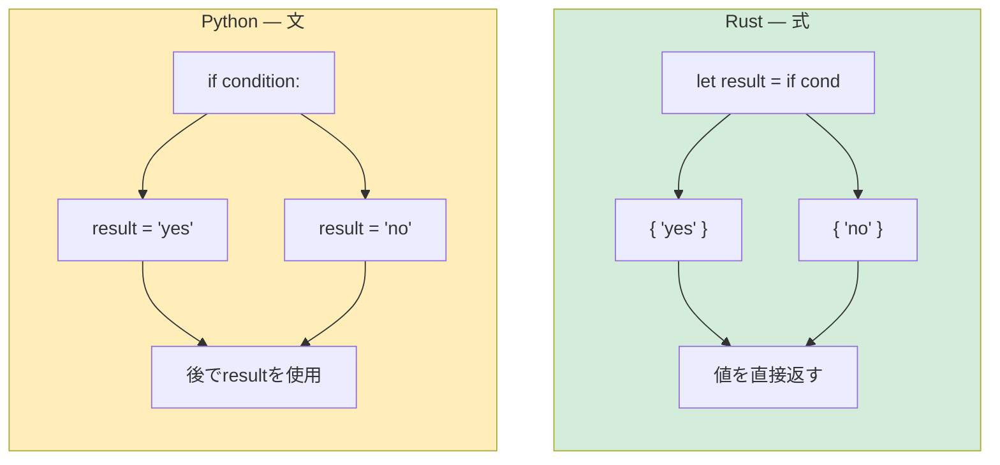

<a id="conditional-statements"></a>
## 条件分岐

> **学習内容：** 括弧は不要だが波括弧を使う`if`/`else`、Pythonの反復モデルとRustの`loop`/`while`/`for`、
> 値を返す式ブロック、戻り値の型が必須となる関数シグネチャ。
>
> **難易度：** 🟢 初級

<a id="ifelse"></a>
### if/else

```python
# Python
if temperature > 100:
    print("Too hot!")
elif temperature < 0:
    print("Too cold!")
else:
    print("Just right")

# 三項演算子
status = "hot" if temperature > 100 else "ok"
```

```rust
// Rust — 波括弧が必要で、コロンは使わず、`elif`ではなく`else if`
if temperature > 100 {
    println!("Too hot!");
} else if temperature < 0 {
    println!("Too cold!");
} else {
    println!("Just right");
}

// ifは式で、値を返す（Pythonの三項演算子に似ているが、より強力）
let status = if temperature > 100 { "hot" } else { "ok" };
```

<a id="important-differences"></a>
### 主な違い
```rust
// 1. 条件はboolでなければならず、真偽値として扱われる値はない
let x = 42;
// if x { }          // ❌ エラー：boolが必要だが、整数が渡された
if x != 0 { }        // ✅ 明示的な比較が必要

// Pythonでは次の値はすべて偽として扱われる：
// if []:      → False    （空のリスト）
// if "":      → False    （空の文字列）
// if 0:       → False    （ゼロ）
// if None:    → False

// Rustではboolだけが条件として使える：
let items: Vec<i32> = vec![];
// if items { }           // ❌ エラー
if !items.is_empty() { }  // ✅ 明示的に確認

let name = "";
// if name { }             // ❌ エラー
if !name.is_empty() { }    // ✅ 明示的に確認
```

***

<a id="loops-and-iteration"></a>
## ループと反復処理

<a id="for-loops"></a>
### forループ
```python
# Python
for i in range(5):
    print(i)

for item in ["a", "b", "c"]:
    print(item)

for i, item in enumerate(["a", "b", "c"]):
    print(f"{i}: {item}")

for key, value in {"x": 1, "y": 2}.items():
    print(f"{key} = {value}")
```

```rust
// Rust
for i in 0..5 {                           // range(5)に相当 → 0..5
    println!("{}", i);
}

for item in ["a", "b", "c"] {             // 直接反復
    println!("{}", item);
}

for (i, item) in ["a", "b", "c"].iter().enumerate() {  // enumerate()に相当
    println!("{}: {}", i, item);
}

// HashMapの反復処理
use std::collections::HashMap;
let map = HashMap::from([("x", 1), ("y", 2)]);
for (key, value) in &map {                // &でmapを借用
    println!("{} = {}", key, value);
}
```

<a id="range-syntax"></a>
### 範囲の構文
```rust
Python：              Rust：              備考：
range(5)             0..5                終端を含まない範囲
range(1, 10)         1..10               終端を含まない範囲
range(1, 11)         1..=10              終端を含む範囲
range(0, 10, 2)      (0..10).step_by(2)  ステップ幅（構文ではなくメソッド）
```

<a id="while-loops"></a>
### whileループ
```python
# Python
count = 0
while count < 5:
    print(count)
    count += 1

# 無限ループ
while True:
    data = get_input()
    if data == "quit":
        break
```

```rust
// Rust
let mut count = 0;
while count < 5 {
    println!("{}", count);
    count += 1;
}

// 無限ループ — `while true`ではなく`loop`を使う
loop {
    let data = get_input();
    if data == "quit" {
        break;
    }
}

// loopは値を返せる！（Rust独自の機能）
let result = loop {
    let input = get_input();
    if let Ok(num) = input.parse::<i32>() {
        break num;  // 値を伴う`break` — ループに対するreturnのようなもの
    }
    println!("Not a number, try again");
};
```

<a id="list-comprehensions-vs-iterator-chains"></a>
### リスト内包表記とイテレーターチェーンの比較
```python
# Python — リスト内包表記
squares = [x ** 2 for x in range(10)]
evens = [x for x in range(20) if x % 2 == 0]
pairs = [(x, y) for x in range(3) for y in range(3)]
```

```rust
// Rust — イテレーターチェーン（.map、.filter、.collect）
let squares: Vec<i32> = (0..10).map(|x| x * x).collect();
let evens: Vec<i32> = (0..20).filter(|x| x % 2 == 0).collect();
let pairs: Vec<(i32, i32)> = (0..3)
    .flat_map(|x| (0..3).map(move |y| (x, y)))
    .collect();

// これらは遅延評価され、.collect()するまで実行されない。
// Pythonの内包表記は即時評価される（その場で実行される）。
// Rustのイテレーターは、大きなデータセットでより効率的な場合がある。
```

***

<a id="expression-blocks"></a>
## 式ブロック

Rustではすべてが式であるか、式として扱えます。これは、`if`や`for`が文であるPythonとは大きく異なる点です。

```python
# Python — ifは文（三項演算子を除く）
if condition:
    result = "yes"
else:
    result = "no"

# または三項演算子（式一つに限られる）：
result = "yes" if condition else "no"
```

```rust
// Rust — ifは式で、値を返す
let result = if condition { "yes" } else { "no" };

// ブロックは式 — 最後の行（セミコロンなし）が戻り値になる
let value = {
    let x = 5;
    let y = 10;
    x + y    // セミコロンなし → これがブロックの値（15）
};

// matchも式
let description = match temperature {
    t if t > 100 => "boiling",
    t if t > 50 => "hot",
    t if t > 20 => "warm",
    _ => "cold",
};
```

次の図は、文ベースのPythonと式ベースのRustにおける制御フローの根本的な違いを示しています。



> **セミコロンのルール：** Rustでは、ブロックの最後にある式にセミコロンを付けないと、
> その式がブロックの戻り値になります。セミコロンを付けると文になり、`()`を返します。
> 暗黙の`return`のような仕組みなので、Python開発者は最初戸惑うことがあります。

***

<a id="functions-and-type-signatures"></a>
## 関数と型シグネチャ

<a id="python-functions"></a>
### Pythonの関数
```python
# Python — 型は任意で、動的ディスパッチ
def greet(name: str, greeting: str = "Hello") -> str:
    return f"{greeting}, {name}!"

# デフォルト引数、*args、**kwargs
def flexible(*args, **kwargs):
    pass

# 第一級関数
def apply(f, x):
    return f(x)

result = apply(lambda x: x * 2, 5)  # 10
```

<a id="rust-functions"></a>
### Rustの関数
```rust
// Rust — 関数シグネチャでは型が必須で、デフォルト引数はない
fn greet(name: &str, greeting: &str) -> String {
    format!("{}, {}!", greeting, name)
}

// デフォルト引数はない — ビルダーパターンまたはOptionを使う
fn greet_with_default(name: &str, greeting: Option<&str>) -> String {
    let greeting = greeting.unwrap_or("Hello");
    format!("{}, {}!", greeting, name)
}

// *args/**kwargsはない — スライスまたは構造体を使う
fn sum_all(numbers: &[i32]) -> i32 {
    numbers.iter().sum()
}

// 第一級関数とクロージャー
fn apply(f: fn(i32) -> i32, x: i32) -> i32 {
    f(x)
}

let result = apply(|x| x * 2, 5);  // 10
```

<a id="return-values"></a>
### 戻り値
```python
# Python — returnは明示し、Noneは暗黙
def divide(a, b):
    if b == 0:
        return None  # または例外を送出
    return a / b
```

```rust
// Rust — 最後の式が戻り値になる（セミコロンなし）
fn divide(a: f64, b: f64) -> Option<f64> {
    if b == 0.0 {
        None              // 早期リターン（`return None;`とも書ける）
    } else {
        Some(a / b)       // 最後の式 — 暗黙の戻り値
    }
}
```

<a id="multiple-return-values"></a>
### 複数の戻り値
```python
# Python — タプルを返す
def min_max(numbers):
    return min(numbers), max(numbers)

lo, hi = min_max([3, 1, 4, 1, 5])
```

```rust
// Rust — タプルを返す（同じ考え方）
fn min_max(numbers: &[i32]) -> (i32, i32) {
    let min = *numbers.iter().min().unwrap();
    let max = *numbers.iter().max().unwrap();
    (min, max)
}

let (lo, hi) = min_max(&[3, 1, 4, 1, 5]);
```

<a id="methods-self-vs-self-vs-mut-self"></a>
### メソッド：`self`、`&self`、`&mut self`の違い
```rust
// Pythonでは、`self`は常にオブジェクトへの可変参照。
// Rustでは使い分ける：

impl MyStruct {
    fn new() -> Self { ... }                // selfなし — 「静的メソッド」/「classmethod」
    fn read_only(&self) { ... }             // &self — 不変で借用（変更不可）
    fn modify(&mut self) { ... }            // &mut self — 可変で借用（変更可能）
    fn consume(self) { ... }                // self — 所有権を取得（オブジェクトが移動）
}

// Pythonでの対応例：
// class MyStruct:
//     @classmethod
//     def new(cls): ...                    # インスタンスは不要
//     def read_only(self): ...             # Pythonでは次の3つは同じ：
//     def modify(self): ...                # Pythonのselfは常に可変
//     def consume(self): ...               # Pythonではselfを「消費」しない
```

---

<a id="exercises"></a>
## 練習問題

<details>
<summary><strong>🏋️ 練習問題：式を使ったFizzBuzz</strong>（クリックして展開）</summary>

**課題：** Rustの式ベースの`match`を使って、1..=30のFizzBuzzを書いてください。各数について`"Fizz"`、`"Buzz"`、`"FizzBuzz"`または数値を出力します。`match (n % 3, n % 5)`を式として使ってください。

<details>
<summary>🔑 解答</summary>

```rust
fn main() {
    for n in 1..=30 {
        let result = match (n % 3, n % 5) {
            (0, 0) => String::from("FizzBuzz"),
            (0, _) => String::from("Fizz"),
            (_, 0) => String::from("Buzz"),
            _ => n.to_string(),
        };
        println!("{result}");
    }
}
```

**要点：** `match`は値を返す式なので、`if/elif/else`を連ねる必要はありません。ワイルドカード`_`はPythonの既定ケース`case _:`に相当します。

</details>
</details>

***
