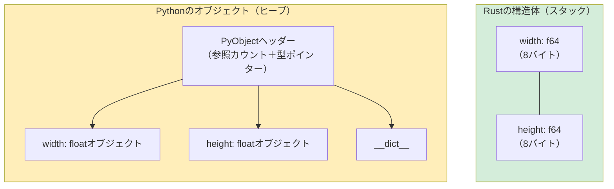

<a id="tuples-and-destructuring"></a>
## タプルと分配束縛

> **学習内容：** RustとPythonのタプル、配列とスライス、クラスに代わるRustの構造体、
> `Vec<T>`と`list`、`HashMap<K,V>`と`dict`の比較、ドメインモデリングのためのnewtypeパターン。
>
> **難易度：** 🟢 初級

<a id="python-tuples"></a>
### Pythonのタプル
```python
# Python — タプルは不変のシーケンス
point = (3.0, 4.0)
x, y = point                    # Unpacking
print(f"x={x}, y={y}")

# タプルには異なる型の値を格納できる
record = ("Alice", 30, True)
name, age, active = record

# 分かりやすさのための名前付きタプル
from typing import NamedTuple

class Point(NamedTuple):
    x: float
    y: float

p = Point(3.0, 4.0)
print(p.x)                      # Named access
```

<a id="rust-tuples"></a>
### Rustのタプル
```rust
// Rust — タプルは固定サイズで型が決まっており、異なる型の値を格納できる
let point: (f64, f64) = (3.0, 4.0);
let (x, y) = point;              // Destructuring (same as Python unpacking)
println!("x={x}, y={y}");

// 異なる型の要素
let record: (&str, i32, bool) = ("Alice", 30, true);
let (name, age, active) = record;

// インデックスによるアクセス（Pythonと異なり、.0、.1、.2の構文を使う）
let first = record.0;            // "Alice"
let second = record.1;           // 30

// Python：record[0]
// Rust：  record.0      ← 角括弧ではなくドットを使う
```

<a id="when-to-use-tuples-vs-structs"></a>
### タプルと構造体の使い分け
```rust
// タプル：簡単なグループ化、関数の戻り値、一時的な値
fn min_max(data: &[i32]) -> (i32, i32) {
    (*data.iter().min().unwrap(), *data.iter().max().unwrap())
}
let (lo, hi) = min_max(&[3, 1, 4, 1, 5]);

// 構造体：名前付きフィールド、明確な意図、メソッド
struct Point { x: f64, y: f64 }

// 目安：
// - 同じ型のフィールドが2～3個 → タプルでよい
// - 名前付きフィールドが必要 → 構造体を使う
// - メソッドが必要 → 構造体を使う
// （Pythonでタプル、namedtuple、dataclassを使い分けるときと同じ考え方）
```

***

<a id="arrays-and-slices"></a>
## 配列とスライス

<a id="python-lists-vs-rust-arrays"></a>
### PythonのリストとRustの配列の比較
```python
# Python — リストは可変長で、異なる型の値を格納できる
numbers = [1, 2, 3, 4, 5]       # Can grow, shrink, hold mixed types
numbers.append(6)
mixed = [1, "two", 3.0]         # Mixed types allowed
```

```rust
// Rustには固定サイズと可変長に関する概念が二つある：

// 1. 配列 — 固定サイズでスタックに確保（Pythonに相当するものはない）
let numbers: [i32; 5] = [1, 2, 3, 4, 5]; // Size is part of the type!
// numbers.push(6);  // ❌ 配列のサイズは拡張できない

// すべての要素を同じ値で初期化：
let zeros = [0; 10];            // [0, 0, 0, 0, 0, 0, 0, 0, 0, 0]

// 2. スライス — 配列やVecのビュー（Pythonのスライスに似ているが、借用される）
let slice: &[i32] = &numbers[1..4]; // [2, 3, 4] — a reference, not a copy!

// Python：numbers[1:4]は新しいリストを作成する（コピー）
// Rust：  &numbers[1..4]はビューを作成する（コピーもメモリー確保もない）
```

<a id="practical-comparison"></a>
### 実践的な比較
```python
# Pythonのスライス — コピーを作成
data = [10, 20, 30, 40, 50]
first_three = data[:3]          # New list: [10, 20, 30]
last_two = data[-2:]            # New list: [40, 50]
reversed_data = data[::-1]      # New list: [50, 40, 30, 20, 10]
```

```rust
// Rustのスライス — ビュー（参照）を作成
let data = [10, 20, 30, 40, 50];
let first_three = &data[..3];         // &[i32], view: [10, 20, 30]
let last_two = &data[3..];            // &[i32], view: [40, 50]

// 負のインデックスは使えない — .len()を使う
let last_two = &data[data.len()-2..]; // &[i32], view: [40, 50]

// 逆順にするにはイテレーターを使う
let reversed: Vec<i32> = data.iter().rev().copied().collect();
```

***

<a id="structs-vs-classes"></a>
## 構造体とクラスの比較

<a id="python-classes"></a>
### Pythonのクラス
```python
# Python — __init__、メソッド、プロパティを持つクラス
from dataclasses import dataclass

@dataclass
class Rectangle:
    width: float
    height: float

    def area(self) -> float:
        return self.width * self.height

    def perimeter(self) -> float:
        return 2.0 * (self.width + self.height)

    def scale(self, factor: float) -> "Rectangle":
        return Rectangle(self.width * factor, self.height * factor)

    def __str__(self) -> str:
        return f"Rectangle({self.width} x {self.height})"

r = Rectangle(10.0, 5.0)
print(r.area())         # 50.0
print(r)                # Rectangle(10.0 x 5.0)
```

<a id="rust-structs"></a>
### Rustの構造体
```rust
// Rust — structとimplブロックを使う（継承はない）
#[derive(Debug, Clone)]
struct Rectangle {
    width: f64,
    height: f64,
}

impl Rectangle {
    // 「コンストラクター」— 関連関数（selfなし）
    fn new(width: f64, height: f64) -> Self {
        Rectangle { width, height }   // Field shorthand when names match
    }

    fn area(&self) -> f64 {
        self.width * self.height
    }

    fn perimeter(&self) -> f64 {
        2.0 * (self.width + self.height)
    }

    fn scale(&self, factor: f64) -> Rectangle {
        Rectangle::new(self.width * factor, self.height * factor)
    }
}

// DisplayトレイトはPythonの__str__に相当
impl std::fmt::Display for Rectangle {
    fn fmt(&self, f: &mut std::fmt::Formatter<'_>) -> std::fmt::Result {
        write!(f, "Rectangle({} x {})", self.width, self.height)
    }
}

fn main() {
    let r = Rectangle::new(10.0, 5.0);
    println!("{}", r.area());    // 50.0
    println!("{}", r);           // Rectangle(10 x 5)
}
```



> **メモリーに関するポイント：** Pythonの`Rectangle`オブジェクトには56バイトのヘッダーがあり、floatオブジェクトも別途ヒープに確保されます。
> Rustの`Rectangle`はスタック上でちょうど16バイトです。間接参照がなく、GCへの負荷もありません。
>
> 📌 **関連項目：** [第10章：トレイトとジェネリクス](ch10-traits-and-generics.md)では、`Display`や`Debug`などのトレイトの実装、構造体の演算子オーバーロードを扱います。

<a id="key-mapping-python-dunder-methods-rust-traits"></a>
### Pythonの特殊メソッドとRustのトレイトの対応表

| Python | Rust | 用途 |
|--------|------|---------|
| `__str__` | `impl Display` | 人が読みやすい文字列 |
| `__repr__` | `#[derive(Debug)]` | デバッグ用表現 |
| `__eq__` | `#[derive(PartialEq)]` | 等価性の比較 |
| `__hash__` | `#[derive(Hash)]` | ハッシュ可能（辞書のキーや`HashSet`に使用） |
| `__lt__`、`__le__`など | `#[derive(PartialOrd, Ord)]` | 順序比較 |
| `__add__` | `impl Add` | `+`演算子 |
| `__iter__` | `impl Iterator` | 反復処理 |
| `__len__` | `.len()`メソッド | 長さ |
| `__enter__`/`__exit__` | RAII + `impl Drop` | 自動解放。コンテキストマネージャーの2段階プロトコルに直接対応するものはない |
| `__init__` | `fn new()`（慣例） | コンストラクター |
| `__getitem__` | `impl Index` | `[]`によるインデックスアクセス |
| `__contains__` | `.contains()`メソッド | `in`演算子 |

<a id="no-inheritance-composition-instead"></a>
### 継承ではなくコンポジションを使う
```python
# Python — 継承
class Animal:
    def __init__(self, name: str):
        self.name = name
    def speak(self) -> str:
        raise NotImplementedError

class Dog(Animal):
    def speak(self) -> str:
        return f"{self.name} says Woof!"

class Cat(Animal):
    def speak(self) -> str:
        return f"{self.name} says Meow!"
```

```rust
// Rust — トレイトとコンポジションを使う（継承はない）
trait Animal {
    fn name(&self) -> &str;
    fn speak(&self) -> String;
}

struct Dog { name: String }
struct Cat { name: String }

impl Animal for Dog {
    fn name(&self) -> &str { &self.name }
    fn speak(&self) -> String {
        format!("{} says Woof!", self.name)
    }
}

impl Animal for Cat {
    fn name(&self) -> &str { &self.name }
    fn speak(&self) -> String {
        format!("{} says Meow!", self.name)
    }
}

// 多相性にはトレイトオブジェクトを使う（Pythonのダックタイピングに似ている）：
fn animal_roll_call(animals: &[&dyn Animal]) {
    for a in animals {
        println!("{}", a.speak());
    }
}
```

> **考え方：** Pythonでは「振る舞いを継承する」と考えますが、Rustでは「契約を実装する」と考えます。
> 得られる結果は似ていますが、Rustではダイヤモンド問題や壊れやすい基底クラスの問題を避けられます。

***

<a id="vec-vs-list"></a>
## `Vec`と`list`の比較

`Vec<T>`はRustの可変長ヒープ確保配列であり、Pythonの`list`に最も近い型です。

<a id="creating-vectors"></a>
### ベクターの作成
```python
# Python
numbers = [1, 2, 3]
empty = []
repeated = [0] * 10
from_range = list(range(1, 6))
```

```rust
// Rust
let numbers = vec![1, 2, 3];            // vec! macro (like a list literal)
let empty: Vec<i32> = Vec::new();        // Empty vec (type annotation needed)
let repeated = vec![0; 10];              // [0, 0, 0, 0, 0, 0, 0, 0, 0, 0]
let from_range: Vec<i32> = (1..6).collect(); // [1, 2, 3, 4, 5]
```

<a id="common-operations"></a>
### よく使う操作
```python
# Pythonのリスト操作
nums = [1, 2, 3]
nums.append(4)                   # [1, 2, 3, 4]
nums.extend([5, 6])             # [1, 2, 3, 4, 5, 6]
nums.insert(0, 0)               # [0, 1, 2, 3, 4, 5, 6]
last = nums.pop()               # 6, nums = [0, 1, 2, 3, 4, 5]
length = len(nums)              # 6
nums.sort()                     # In-place sort
sorted_copy = sorted(nums)     # New sorted list
nums.reverse()                  # In-place reverse
contains = 3 in nums           # True
index = nums.index(3)          # Index of first 3
```

```rust
// RustのVec操作
let mut nums = vec![1, 2, 3];
nums.push(4);                          // [1, 2, 3, 4]
nums.extend([5, 6]);                   // [1, 2, 3, 4, 5, 6]
nums.insert(0, 0);                     // [0, 1, 2, 3, 4, 5, 6]
let last = nums.pop();                 // Some(6), nums = [0, 1, 2, 3, 4, 5]
let length = nums.len();               // 6
nums.sort();                           // In-place sort
let mut sorted_copy = nums.clone();
sorted_copy.sort();                    // Sort a clone
nums.reverse();                        // In-place reverse
let contains = nums.contains(&3);      // true
let index = nums.iter().position(|&x| x == 3); // Some(index) or None
```

<a id="quick-reference"></a>
### クイックリファレンス

| Python | Rust | 備考 |
|--------|------|-------|
| `lst.append(x)` | `vec.push(x)` | |
| `lst.extend(other)` | `vec.extend(other)` | |
| `lst.pop()` | `vec.pop()` | `Option<T>`を返す |
| `lst.insert(i, x)` | `vec.insert(i, x)` | |
| `lst.remove(x)` | `vec.iter().position(\|v\| v == &x).map(\|i\| vec.remove(i))` | 最初に一致した要素だけを削除（すべて削除するには`retain`を使う） |
| `del lst[i]` | `vec.remove(i)` | 削除した要素を返す |
| `len(lst)` | `vec.len()` | |
| `x in lst` | `vec.contains(&x)` | |
| `lst.sort()` | `vec.sort()` | |
| `sorted(lst)` | 複製してソート、またはイテレーターを使用 | |
| `lst[i]` | `vec[i]` | 範囲外の場合はpanicする |
| `lst.get(i, default)` | `vec.get(i)` | `Option<&T>`を返す |
| `lst[1:3]` | `&vec[1..3]` | スライスを返す（コピーなし） |

***

<a id="hashmap-vs-dict"></a>
## `HashMap`と`dict`の比較

`HashMap<K, V>`はRustのハッシュマップで、Pythonの`dict`に相当します。

<a id="creating-hashmaps"></a>
### ハッシュマップの作成
```python
# Python
scores = {"Alice": 100, "Bob": 85}
empty = {}
from_pairs = dict([("x", 1), ("y", 2)])
comprehension = {k: v for k, v in zip(keys, values)}
```

```rust
// Rust
use std::collections::HashMap;

let scores = HashMap::from([("Alice", 100), ("Bob", 85)]);
let empty: HashMap<String, i32> = HashMap::new();
let from_pairs: HashMap<&str, i32> = [("x", 1), ("y", 2)].into_iter().collect();
let comprehension: HashMap<_, _> = keys.iter().zip(values.iter()).collect();
```

<a id="common-operations-1"></a>
### よく使う操作
```python
# Pythonのdict操作
d = {"a": 1, "b": 2}
d["c"] = 3                      # Insert
val = d["a"]                     # 1 (KeyError if missing)
val = d.get("z", 0)             # 0 (default if missing)
del d["b"]                       # Remove
exists = "a" in d               # True
keys = list(d.keys())           # ["a", "c"]
values = list(d.values())       # [1, 3]
items = list(d.items())         # [("a", 1), ("c", 3)]
length = len(d)                 # 2

# setdefault / defaultdict
from collections import defaultdict
word_count = defaultdict(int)
for word in words:
    word_count[word] += 1
```

```rust
// RustのHashMap操作
use std::collections::HashMap;

let mut d = HashMap::new();
d.insert("a", 1);
d.insert("b", 2);
d.insert("c", 3);                       // Insert or overwrite

let val = d["a"];                        // 1 (panics if missing)
let val = d.get("z").copied().unwrap_or(0); // 0 (safe access)
d.remove("b");                          // Remove
let exists = d.contains_key("a");       // true
let keys: Vec<_> = d.keys().collect();
let values: Vec<_> = d.values().collect();
let length = d.len();

// entry APIはPythonのsetdefault / defaultdictパターンに相当
let mut word_count: HashMap<&str, i32> = HashMap::new();
for word in words {
    *word_count.entry(word).or_insert(0) += 1;
}
```

<a id="quick-reference-1"></a>
### クイックリファレンス

| Python | Rust | 備考 |
|--------|------|-------|
| `d[key] = val` | `d.insert(key, val)` | 古い値を`Option<V>`で返す |
| `d[key]` | `d[&key]` | キーがなければpanicする |
| `d.get(key)` | `d.get(&key)` | `Option<&V>`を返す |
| `d.get(key, default)` | `d.get(&key).unwrap_or(&default)` | |
| `key in d` | `d.contains_key(&key)` | |
| `del d[key]` | `d.remove(&key)` | `Option<V>`を返す |
| `d.keys()` | `d.keys()` | イテレーター |
| `d.values()` | `d.values()` | イテレーター |
| `d.items()` | `d.iter()` | `(&K, &V)`のイテレーター |
| `len(d)` | `d.len()` | |
| `d.update(other)` | `d.extend(other)` | |
| `defaultdict(int)` | `.entry().or_insert(0)` | Entry API |
| `d.setdefault(k, v)` | `d.entry(k).or_insert(v)` | Entry API |

***

<a id="other-collections"></a>
### その他のコレクション

| Python | Rust | 備考 |
|--------|------|-------|
| `set()` | `HashSet<T>` | `use std::collections::HashSet;` |
| `collections.deque` | `VecDeque<T>` | `use std::collections::VecDeque;` |
| `heapq` | `BinaryHeap<T>` | デフォルトでは最大ヒープ |
| `collections.OrderedDict` | `IndexMap`（クレート） | `HashMap`は順序を保持しない |
| `sortedcontainers.SortedList` | `BTreeSet<T>` / `BTreeMap<K,V>` | 木構造で、ソート済み |

---

<a id="exercises"></a>
## 練習問題

<details>
<summary><strong>🏋️ 練習問題：単語の出現頻度カウンター</strong>（クリックして展開）</summary>

**課題：** `&str`型の文を受け取り、大文字と小文字を区別せずに単語の出現頻度を集計した`HashMap<String, usize>`を返す関数を書いてください。Pythonでは`Counter(s.lower().split())`に相当します。これをRustで実装してください。

<details>
<summary>🔑 解答</summary>

```rust
use std::collections::HashMap;

fn word_frequencies(text: &str) -> HashMap<String, usize> {
    let mut counts = HashMap::new();
    for word in text.split_whitespace() {
        let key = word.to_lowercase();
        *counts.entry(key).or_insert(0) += 1;
    }
    counts
}

fn main() {
    let text = "the quick brown fox jumps over the lazy fox";
    let freq = word_frequencies(text);
    for (word, count) in &freq {
        println!("{word}: {count}");
    }
}
```

**要点：** `HashMap::entry().or_insert()`は、Pythonの`defaultdict`や`Counter`に相当します。`or_insert`は`&mut usize`を返すため、`*`によるデリファレンスが必要です。

</details>
</details>

***
