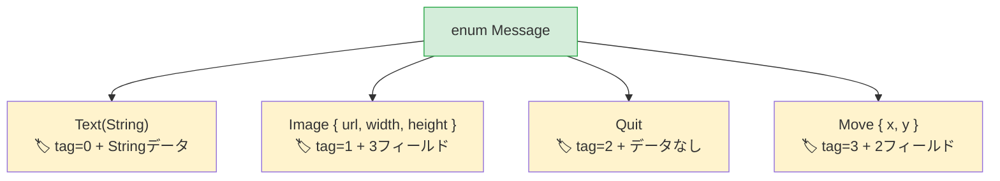

<a id="algebraic-data-types-vs-union-types"></a>
## 代数的データ型とユニオン型

> **学習内容：** データを持つRustのenumとPythonの`Union`型、網羅性が保証される`match`と`match/case`の違い、
> コンパイル時に`None`を安全に扱う`Option<T>`、ガードパターン。
>
> **難易度：** 🟡 中級

Python 3.10では`match`文とユニオン型が導入されました。Rustのenumはさらに強力で、
各バリアントに異なるデータを持たせられ、すべてのケースを処理しているかコンパイラーが確認します。

<a id="python-union-types-and-match"></a>
### Pythonのユニオン型とmatch
```python
# Python 3.10以降 — 構造的パターンマッチング
from typing import Union
from dataclasses import dataclass

@dataclass
class Circle:
    radius: float

@dataclass
class Rectangle:
    width: float
    height: float

@dataclass
class Triangle:
    base: float
    height: float

Shape = Union[Circle, Rectangle, Triangle]  # Type alias

def area(shape: Shape) -> float:
    match shape:
        case Circle(radius=r):
            return 3.14159 * r * r
        case Rectangle(width=w, height=h):
            return w * h
        case Triangle(base=b, height=h):
            return 0.5 * b * h
        # ケースを見落としてもコンパイラーは警告しない！
        # 新しい図形を追加する場合、コードベースをgrepしてmatchブロックをすべて探す必要がある。
```

<a id="rust-enums-data-carrying-variants"></a>
### Rustのenum：データを持つバリアント
```rust
// Rust — enumのバリアントはデータを保持でき、コンパイラーが網羅的なマッチングを強制する
enum Shape {
    Circle(f64),                // Circle carries radius
    Rectangle(f64, f64),        // Rectangle carries width, height
    Triangle { base: f64, height: f64 }, // Named fields also work
}

fn area(shape: &Shape) -> f64 {
    match shape {
        Shape::Circle(r) => std::f64::consts::PI * r * r,
        Shape::Rectangle(w, h) => w * h,
        Shape::Triangle { base, height } => 0.5 * base * height,
        // ❌ Shape::Pentagonを追加してここで処理し忘れると、
        //    コンパイラーがビルドを拒否する。grepで探す必要はない。
    }
}
```

> **重要なポイント：** Rustの`match`は**網羅的**です。コンパイラーがすべてのバリアントを処理しているか確認します。
> enumに新しいバリアントを追加すると、修正が必要な`match`ブロックをコンパイラーが正確に指摘します。
> Pythonの`match`にはこのような保証がありません。

<a id="enums-replace-multiple-python-patterns"></a>
### enumで置き換えられるPythonの複数のパターン

```python
# Python — Rustのenumで置き換えられるいくつかのパターン：

# 1. 文字列定数
STATUS_PENDING = "pending"
STATUS_ACTIVE = "active"
STATUS_CLOSED = "closed"

# 2. PythonのEnum（データなし）
from enum import Enum
class Status(Enum):
    PENDING = "pending"
    ACTIVE = "active"
    CLOSED = "closed"

# 3. タグ付きユニオン（クラス＋型フィールド）
class Message:
    def __init__(self, kind, **data):
        self.kind = kind
        self.data = data
# Message(kind="text", content="hello")
# Message(kind="image", url="...", width=100)
```

```rust
// Rust — 一つのenumですべてを実現し、さらに多くのことができる

// 1. 単純なenum（PythonのEnumに相当）
enum Status {
    Pending,
    Active,
    Closed,
}

// 2. データを持つenum（タグ付きユニオン — 型安全）
enum Message {
    Text(String),
    Image { url: String, width: u32, height: u32 },
    Quit,                    // No data
    Move { x: i32, y: i32 },
}
```



> **メモリーに関するポイント：** Rustのenumは「タグ付きユニオン」です。コンパイラーは識別タグと、最大のバリアントを格納できる領域を保持します。
> Pythonでの相当物（`Union[str, dict, None]`）には、これに相当するコンパクトな表現はありません。
>
> 📌 **関連項目：** [第9章：エラー処理](ch09-error-handling.md)ではenumを多用します。`Result<T, E>`と`Option<T>`も`match`で扱うenumです。

```rust
fn process(msg: &Message) {
    match msg {
        Message::Text(content) => println!("Text: {content}"),
        Message::Image { url, width, height } => {
            println!("Image: {url} ({width}x{height})")
        }
        Message::Quit => println!("Quitting"),
        Message::Move { x, y } => println!("Moving to ({x}, {y})"),
    }
}
```

***

<a id="exhaustive-pattern-matching"></a>
## 網羅的なパターンマッチング

<a id="pythons-match-not-exhaustive"></a>
### Pythonのmatch：網羅性は保証されない
```python
# Python — ワイルドカードケースは任意で、コンパイラーの支援もない
def describe(value):
    match value:
        case 0:
            return "zero"
        case 1:
            return "one"
        # defaultを忘れると、Pythonは何も知らせずNoneを返す。
        # 警告もエラーも出ない。

describe(42)  # Returns None — a silent bug
```

<a id="rusts-match-compiler-enforced"></a>
### Rustのmatch：コンパイラーが網羅性を強制
```rust
// Rust — すべてのケースを必ず処理する
fn describe(value: i32) -> &'static str {
    match value {
        0 => "zero",
        1 => "one",
        // ❌ コンパイルエラー：網羅されていないパターン：`i32::MIN..=-1_i32`
        //    と`2_i32..=i32::MAX`が処理されていない
        _ => "other",   // _ = catch-all (required for open-ended types)
    }
}

// enumではワイルドカードは不要 — コンパイラーがすべてのバリアントを把握している：
enum Color { Red, Green, Blue }

fn color_hex(c: Color) -> &'static str {
    match c {
        Color::Red => "#ff0000",
        Color::Green => "#00ff00",
        Color::Blue => "#0000ff",
        // _は不要 — すべてのバリアントを処理済み
        // 後からColor::Yellowを追加すると、ここでコンパイルエラーになる
    }
}
```

<a id="pattern-matching-features"></a>
### パターンマッチングの機能
```rust
// 複数の値（Pythonのcase 1 | 2 | 3:に相当）
match value {
    1 | 2 | 3 => println!("small"),
    4..=9 => println!("medium"),    // Range patterns
    _ => println!("large"),
}

// ガード（Pythonのcase x if x > 0:に相当）
match temperature {
    t if t > 100 => println!("boiling"),
    t if t < 0 => println!("freezing"),
    t => println!("normal: {t}°"),
}

// ネストした分配束縛
let point = (3, (4, 5));
match point {
    (0, _) => println!("on y-axis"),
    (_, (0, _)) => println!("y=0"),
    (x, (y, z)) => println!("x={x}, y={y}, z={z}"),
}
```

***

<a id="option-for-none-safety"></a>
## `Option`による`None`の安全な扱い

`Option<T>`は、Python開発者にとって最も重要なRustのenumです。`None`を型安全な仕組みに置き換えます。

<a id="python-none"></a>
### Pythonの`None`

```python
# Python — Noneはどこにでも現れる値
def find_user(user_id: int) -> dict | None:
    users = {1: {"name": "Alice"}}
    return users.get(user_id)

user = find_user(999)
# userはNoneだが、チェックを強制するものはない！
print(user["name"])  # 💥 TypeError at runtime
```

<a id="rust-option"></a>
### Rustの`Option`

```rust
// Rust — Option<T>によってNoneの場合の処理が必須になる
fn find_user(user_id: i64) -> Option<User> {
    let users = HashMap::from([(1, User { name: "Alice".into() })]);
    users.get(&user_id).cloned()
}

let user = find_user(999);
// userはOption<User> — Noneを処理せずに使うことはできない

// 方法1：match
match find_user(999) {
    Some(user) => println!("Found: {}", user.name),
    None => println!("Not found"),
}

// 方法2：if let（Pythonのif (x := expr) is not Noneに相当）
if let Some(user) = find_user(1) {
    println!("Found: {}", user.name);
}

// 方法3：unwrap_or
let name = find_user(999)
    .map(|u| u.name)
    .unwrap_or_else(|| "Unknown".to_string());

// 方法4：?演算子（Optionを返す関数内で使用）
fn get_user_name(id: i64) -> Option<String> {
    let user = find_user(id)?;     // Returns None early if not found
    Some(user.name)
}
```

<a id="option-methods-python-equivalents"></a>
### `Option`のメソッドとPythonでの対応

| パターン | Python | Rust |
|---------|--------|------|
| 存在確認 | `if x is not None:` | `if let Some(x) = opt {` |
| デフォルト値 | `x or default` | `opt.unwrap_or(default)` |
| デフォルト値の生成 | `x or compute()` | `opt.unwrap_or_else(\|\| compute())` |
| 値があれば変換 | `f(x) if x else None` | `opt.map(f)` |
| 連続した参照 | `x and x.attr and x.attr.method()` | `opt.and_then(\|x\| x.method())` |
| Noneでpanic | 防止できない | `opt.unwrap()`（panic）または`opt.expect("msg")` |
| 値がなければエラー | `x if x else raise` | `opt.ok_or(Error)?` |

---

<a id="exercises"></a>
## 練習問題

<details>
<summary><strong>🏋️ 練習問題：図形の面積計算</strong>（クリックして展開）</summary>

**課題：** `Circle(f64)`（半径）、`Rectangle(f64, f64)`（幅、高さ）、`Triangle(f64, f64)`（底辺、高さ）の各バリアントを持つenum `Shape`を定義してください。`match`を使って`fn area(&self) -> f64`メソッドを実装します。それぞれの図形を一つずつ作成し、面積を出力してください。

<details>
<summary>🔑 解答</summary>

```rust
use std::f64::consts::PI;

enum Shape {
    Circle(f64),
    Rectangle(f64, f64),
    Triangle(f64, f64),
}

impl Shape {
    fn area(&self) -> f64 {
        match self {
            Shape::Circle(r) => PI * r * r,
            Shape::Rectangle(w, h) => w * h,
            Shape::Triangle(b, h) => 0.5 * b * h,
        }
    }
}

fn main() {
    let shapes = [
        Shape::Circle(5.0),
        Shape::Rectangle(4.0, 6.0),
        Shape::Triangle(3.0, 8.0),
    ];
    for shape in &shapes {
        println!("Area: {:.2}", shape.area());
    }
}
```

**要点：** Rustのenumは、Pythonの`Union[Circle, Rectangle, Triangle]`と`isinstance()`による判定を置き換えます。コンパイラーがすべてのバリアントを処理しているか確認するため、新しい図形を追加したのに`area()`を更新し忘れるとコンパイルエラーになります。

</details>
</details>

***
