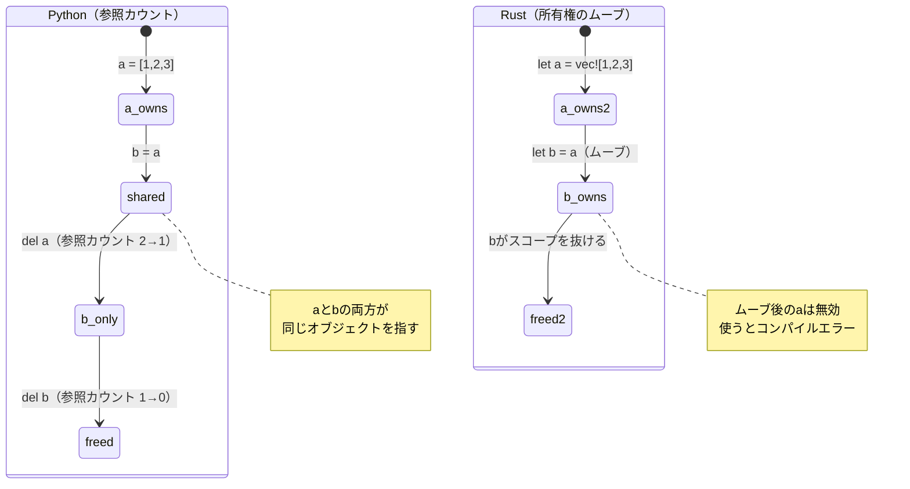
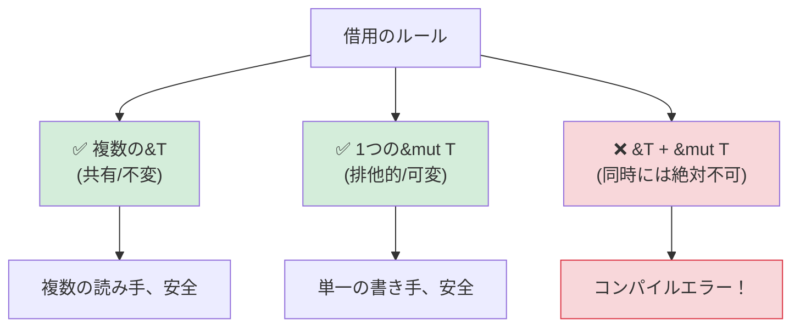

<a id="understanding-ownership"></a>

## 所有権を理解する

> **学習内容:** Rustに所有権がある理由（GCなし！）、Pythonの参照カウントとムーブセマンティクスの違い、
> 借用（`&` と `&mut`）、ライフタイムの基礎、スマートポインター（`Box`、`Rc`、`Arc`）。
>
> **難易度:** 🟡 中級

これはPython開発者にとって最も難しい概念です。Pythonでは、データを「所有」するのが誰かを意識することはありません。ガベージコレクターが処理するからです。Rustでは、すべての値に所有者が1つだけ存在し、コンパイラーがコンパイル時にそれを追跡します。

### Python：あらゆる場所で共有される参照
```python
# Python — すべてが参照であり、GCが後片付けする
a = [1, 2, 3]
b = a              # bとaは同じリストを指す
b.append(4)
print(a)            # [1, 2, 3, 4] — なんと、aまで変わった！

# このリストの所有者は誰？ aとbの両方が参照している。
# 参照がなくなるとガベージコレクターが解放する。
# 普段これを意識する必要はない。
```

### Rust：単一の所有権
```rust
// Rust — すべての値の所有者は1つだけ
let a = vec![1, 2, 3];
let b = a;           // 所有権がaからbへムーブする
// println!("{:?}", a); // ❌ コンパイルエラー：ムーブ後に値を使用

// aはもう使えない。唯一の所有者はb。
println!("{:?}", b); // ✅ [1, 2, 3]

// bがスコープを抜けるとVecが解放される。決定的で、GCは不要。
```

### 所有権の3つのルール
```rust
1. 各値の所有者となる変数は1つだけ。
2. 所有者がスコープを抜けると、値はドロップ（解放）される。
3. 所有権は移転（ムーブ）できるが、複製はできない（`Clone`を除く）。
```

### ムーブセマンティクス — Python開発者が最も驚く点
```python
# Python — 代入でコピーされるのはデータではなく参照
def process(data):
    data.append(42)
    # 元のリストが変更される！

my_list = [1, 2, 3]
process(my_list)
print(my_list)       # [1, 2, 3, 42] — modified by process!
```

```rust
// Rust — 関数に渡すと所有権がムーブする（Copy型以外の場合）
fn process(mut data: Vec<i32>) -> Vec<i32> {
    data.push(42);
    data  // 所有権を返すには値を返す必要がある！
}

let my_vec = vec![1, 2, 3];
let my_vec = process(my_vec);  // 所有権が関数に渡り、戻ってくる
println!("{:?}", my_vec);      // [1, 2, 3, 42]

// より良い方法：ムーブせずに借用する
fn process_borrowed(data: &mut Vec<i32>) {
    data.push(42);
}

let mut my_vec = vec![1, 2, 3];
process_borrowed(&mut my_vec);  // 一時的に貸し出す
println!("{:?}", my_vec);       // [1, 2, 3, 42] — still ours
```

### 所有権を図で見る

```text
Python:                              Rust:

  a ──────┐                           a ──→ [1, 2, 3]
           ├──→ [1, 2, 3]
  b ──────┘                           その後：let b = a;

  (aとbが1つのオブジェクトを共有)    a  (無効、ムーブ済み)
  (参照カウント = 2)                  b ──→ [1, 2, 3]
                                      (bだけがデータを所有)

  del a → 参照カウント = 1           drop(b) → データ解放
  del b → 参照カウント = 0 → 解放    (決定的、GC不要)
```



***

## ムーブセマンティクスと参照カウント

### コピーとムーブ
```rust
// 単純な型（整数、浮動小数点数、bool、char）はムーブではなくコピーされる
let x = 42;
let y = x;    // xがyにコピーされる（どちらも有効）
println!("{x} {y}");  // ✅ 42 42

// ヒープ確保される型（String、Vec、HashMap）はムーブされる
let s1 = String::from("hello");
let s2 = s1;  // s1がs2へムーブされる
// println!("{s1}");  // ❌ エラー：ムーブ後に値を使用

// ヒープ上のデータを明示的に複製するには.clone()を使う
let s1 = String::from("hello");
let s2 = s1.clone();  // ディープコピー
println!("{s1} {s2}");  // ✅ hello hello (both valid)
```

### Python開発者向けの考え方
```text
Python:                    Rust:
─────────                  ─────
int, float, bool           Copy types (i32, f64, bool, char)
→ 不変オブジェクトへの共有参照  → 代入時にビット単位でコピー
  （実際のコピーではない）       （常に独立した値）
                           （注：Pythonは小さい整数をキャッシュするが、Rustのコピーは常に予測可能）

list, dict, str            Move types (Vec, HashMap, String)
→ 共有参照                   → 所有権の移転（動作が異なる！）
→ GCが後片付け               → 所有者がデータをドロップ
→ list(x)で複製              → x.clone()で複製
   またはcopy.deepcopy(x)
```

### Pythonの共有モデルがバグを引き起こす場合

```python
# Python — 意図しない別名参照
def remove_duplicates(items):
    seen = set()
    result = []
    for item in items:
        if item not in seen:
            seen.add(item)
            result.append(item)
    return result

original = [1, 2, 2, 3, 3, 3]
alias = original          # コピーではなく別名
unique = remove_duplicates(alias)
# originalはまだ[1, 2, 2, 3, 3, 3] — 入力を変更していないため
# remove_duplicatesが入力を変更したら、originalにも影響する
```

```rust
use std::collections::HashSet;

// Rust — 所有権によって意図しない別名参照を防ぐ
fn remove_duplicates(items: &[i32]) -> Vec<i32> {
    let mut seen = HashSet::new();
    items.iter()
        .filter(|&&item| seen.insert(item))
        .copied()
        .collect()
}

let original = vec![1, 2, 2, 3, 3, 3];
let unique = remove_duplicates(&original); // 借用するため変更できない
// コンパイラーが&による変更を防ぎ、originalが変更されないことを保証
```

***

## 借用とライフタイム

### 借用は本を貸すこと
```rust
所有権を実際の本にたとえて考えてみましょう。

Python:  誰もがコピーを持つ（共有参照 + GC）
Rust:    1人が本を所有する。他の人は次のことができる：
         - &book     = 閲覧する（不変借用、複数可能）
         - &mut book = 書き込む（可変借用、排他的）
         - book      = 譲り渡す（ムーブ）
```

### 借用のルール



```rust
// ルール1：複数の不変借用、または1つの可変借用が可能（両方同時は不可）

let mut data = vec![1, 2, 3];

// 複数の不変借用 — 問題なし
let a = &data;
let b = &data;
println!("{:?} {:?}", a, b);  // ✅

// 可変借用 — 排他的でなければならない
let c = &mut data;
c.push(4);
// println!("{:?}", a);  // ❌ エラー：可変借用がある間は不変借用を使えない

// これによりデータ競合をコンパイル時に防げる！
// Pythonには同等の仕組みがない。そのため、反復中にPythonのdictを変更すると実行時にエラーになる。
```

### ライフタイム — 簡単な紹介
```rust
// ライフタイムが答える問い：「この参照はどれくらいの期間有効か？」
// 通常はコンパイラーが推論する。明示的に書く機会はほとんどない。

// 単純なケース — コンパイラーが処理する：
fn first_word(s: &str) -> &str {
    s.split_whitespace().next().unwrap_or("")
}
// コンパイラーは、返される&strが入力の&strと同じ期間有効だと判断する

// ライフタイムを明示する必要がある場合（まれ）：
fn longest<'a>(a: &'a str, b: &'a str) -> &'a str {
    if a.len() > b.len() { a } else { b }
}
// 'aは「戻り値は両方の入力と同じ期間有効」と示す
```

> **Python開発者へ**：最初はライフタイムを心配しなくて大丈夫です。必要なときはコンパイラーが教えてくれますし、95%のケースでは自動推論されます。
> ライフタイム注釈は、参照同士の関係をコンパイラーが判断できないときに、その手掛かりを与えるものだと考えてください。

***

## スマートポインター

単一の所有権では制約が強すぎる場合に備え、Rustにはスマートポインターがあります。
Pythonの参照モデルに近いものですが、明示的に選択して使います。

```rust
// Box<T> — 単一所有者によるヒープ確保（Pythonの通常の確保に近い）
let boxed = Box::new(42);  // ヒープ上に確保されたi32

// Rc<T> — 参照カウント方式（Pythonの参照カウントに似ている！）
use std::rc::Rc;
let shared = Rc::new(vec![1, 2, 3]);
let clone1 = Rc::clone(&shared);  // 参照カウントを増やす
let clone2 = Rc::clone(&shared);  // 参照カウントを増やす
// 3つとも同じVecを指す。すべてがドロップされるとVecが解放される。
// Pythonの参照カウントに似ているが、Rcは循環参照を処理しない。
// Weak<T>で循環を断つ（PythonのGCは循環参照を自動処理する）

// Arc<T> — アトミックな参照カウント（マルチスレッド向けのRc）
use std::sync::Arc;
let thread_safe = Arc::new(vec![1, 2, 3]);
// スレッド間で共有する場合はArcを使う（Rcは単一スレッド用）

// RefCell<T> — 実行時の借用チェック（Pythonの「何でもあり」モデルに近い）
use std::cell::RefCell;
let cell = RefCell::new(42);
*cell.borrow_mut() = 99;  // 実行時に可変借用（借用が重複するとパニック）
```

### 使い分け

| スマートポインター | Pythonでの類似物 | 用途 |
|---------------|----------------|----------|
| `Box<T>` | 通常のメモリー確保 | 大きなデータ、再帰型、トレイトオブジェクト |
| `Rc<T>` | Pythonの標準的な参照カウント | 共有所有権、単一スレッド |
| `Arc<T>` | スレッドセーフな参照カウント | 共有所有権、マルチスレッド |
| `RefCell<T>` | Pythonの「そのまま変更」 | 内部可変性（例外的な手段） |
| `Rc<RefCell<T>>` | Pythonの通常のオブジェクトモデル | 共有 + 可変（グラフ構造） |

> **重要なポイント**：`Rc<RefCell<T>>`を使うとPythonに似た意味論（共有可能で変更可能なデータ）を得られますが、明示的に選ぶ必要があります。Rustの標準（所有してムーブする方式）はより高速で、参照カウントのオーバーヘッドもありません。循環を含むグラフ状の構造では、Pythonと異なりRustの`Rc`には循環参照コレクターがないため、`Weak<T>`で参照ループを断ちます。

> 📌 **関連項目**：[第13章 — 並行性](ch13-concurrency.md)では、マルチスレッドで状態を共有するための`Arc<Mutex<T>>`を扱います。

---

## 練習問題

<details>
<summary><strong>🏋️ 練習問題：借用チェッカーのエラーを見つける</strong>（クリックして展開）</summary>

**課題**：次のコードには借用チェッカーのエラーが3つあります。それぞれを特定し、`.clone()`を使わずに修正してください。

```rust
fn main() {
    let mut names = vec!["Alice".to_string(), "Bob".to_string()];
    let first = &names[0];
    names.push("Charlie".to_string());
    println!("First: {first}");

    let greeting = make_greeting(names[0]);
    println!("{greeting}");
}

fn make_greeting(name: String) -> String {
    format!("Hello, {name}!")
}
```

<details>
<summary>🔑 解答</summary>

```rust
fn main() {
    let mut names = vec!["Alice".to_string(), "Bob".to_string()];
    let first = &names[0];
    println!("First: {first}"); // 変更する前に借用を使う
    names.push("Charlie".to_string()); // 不変借用が有効でないため、これで安全

    let greeting = make_greeting(&names[0]); // 所有権ではなく参照を渡す
    println!("{greeting}");
}

fn make_greeting(name: &str) -> String { // Stringではなく&strを受け取る
    format!("Hello, {name}!")
}
```

**修正したエラー**：
1. **不変借用と変更の競合**：`first`が`names`を借用したまま、`push`で変更しようとしています。修正：追加する前に`first`を使います。
2. **Vecからのムーブ**：`names[0]`でStringをVecからムーブしようとしています（許可されません）。修正：`&names[0]`で借用します。
3. **関数による所有権の取得**：`make_greeting(String)`は値を消費します。修正：代わりに`&str`を受け取ります。

</details>
</details>

***
