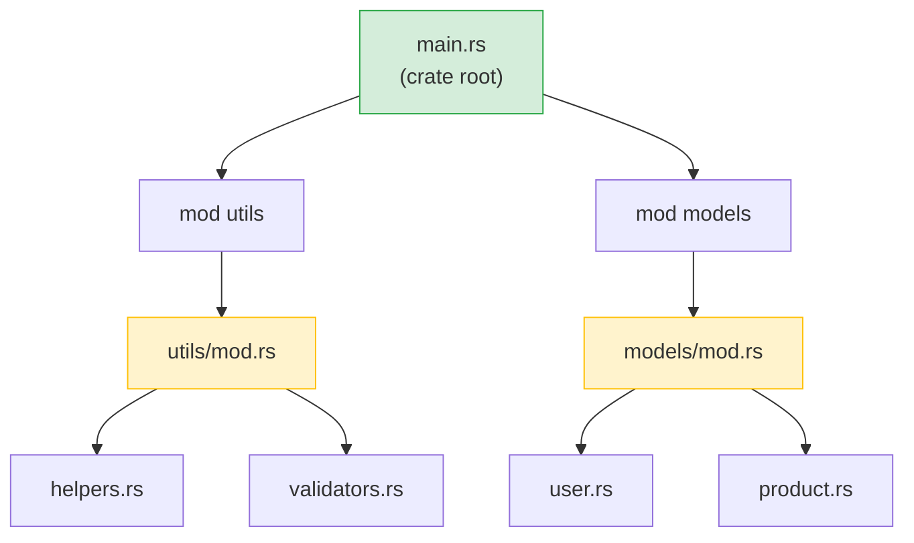

<a id="rust-modules-vs-python-packages"></a>

## RustのモジュールとPythonのパッケージ

> **学習内容:** `mod`や`use`と`import`の違い、可視性（`pub`）とPythonの慣習に基づく非公開扱いの違い、
> Cargo.tomlとpyproject.toml、crates.ioとPyPI、ワークスペースとモノレポの違い。
>
> **難易度:** 🟢 初級

### Pythonのモジュールシステム
```python
# Python — ファイルがモジュール、__init__.pyのあるディレクトリがパッケージ

# myproject/
# ├── __init__.py          # パッケージにする
# ├── main.py
# ├── utils/
# │   ├── __init__.py      # utilsをサブパッケージにする
# │   ├── helpers.py
# │   └── validators.py
# └── models/
#     ├── __init__.py
#     ├── user.py
#     └── product.py

# インポート：
from myproject.utils.helpers import format_name
from myproject.models.user import User
import myproject.utils.validators as validators
```

### Rustのモジュールシステム
```rust
// Rust — mod宣言でモジュールツリーを作り、ファイルで内容を定義する

// src/
// ├── main.rs             # クレートルート — モジュールを宣言
// ├── utils/
// │   ├── mod.rs           # モジュール宣言（__init__.pyに相当）
// │   ├── helpers.rs
// │   └── validators.rs
// └── models/
//     ├── mod.rs
//     ├── user.rs
//     └── product.rs

// src/main.rs内：
mod utils;       // src/utils/mod.rsを探すようRustに伝える
mod models;      // src/models/mod.rsを探すようRustに伝える

use utils::helpers::format_name;
use models::user::User;

// src/utils/mod.rs内：
pub mod helpers;      // helpers.rsを宣言して公開する
pub mod validators;   // validators.rsを宣言して公開する
```



> **Pythonでの相当物**：`mod.rs`は、モジュールが公開するものを宣言する`__init__.py`のようなものです。クレートルート（`main.rs` / `lib.rs`）は、最上位パッケージの`__init__.py`に相当します。

### 主な違い

| 概念 | Python | Rust |
|---------|--------|------|
| モジュール = ファイル | ✅ 自動 | `mod`で宣言が必要 |
| パッケージ = ディレクトリ | `__init__.py` | `mod.rs` |
| デフォルトで公開 | ✅ すべて | ❌ デフォルトで非公開 |
| 公開にする方法 | `_`接頭辞の慣習 | `pub`キーワード |
| インポート構文 | `from x import y` | `use x::y;` |
| ワイルドカードインポート | `from x import *` | `use x::*;`（非推奨） |
| 相対インポート | `from . import sibling` | `use super::sibling;` |
| 再公開 | `__all__`または明示指定 | `pub use inner::Thing;` |

### 可視性 — デフォルトでは非公開
```python
# Python —「大人同士なのだから」という考え方
class User:
    def __init__(self):
        self.name = "Alice"       # 公開（慣習上）
        self._age = 30            # 「非公開」（慣習として先頭にアンダースコア1つ）
        self.__secret = "shhh"    # 名前修飾される（真の非公開ではない）

# _ageや__secretにアクセスすることを止めるものはない
print(user._age)                  # Works fine
print(user._User__secret)        # Works too (name mangling)
```

```rust
// Rust — 非公開性はコンパイラーによって強制される
pub struct User {
    pub name: String,      // 公開 — 誰でもアクセス可能
    age: i32,              // 非公開 — このモジュール内からのみアクセス可能
}

impl User {
    pub fn new(name: &str, age: i32) -> Self {
        User { name: name.to_string(), age }
    }

    pub fn age(&self) -> i32 {   // 公開ゲッター
        self.age
    }

    fn validate(&self) -> bool { // 非公開メソッド
        self.age > 0
    }
}

// モジュールの外側：
let user = User::new("Alice", 30);
println!("{}", user.name);        // ✅ 公開
// println!("{}", user.age);      // ❌ コンパイルエラー：フィールドは非公開
println!("{}", user.age());       // ✅ 公開メソッド（ゲッター）
```

***

## クレートとPyPIパッケージ

### Pythonパッケージ（PyPI）
```bash
# Python
pip install requests           # PyPIからインストール
pip install "requests>=2.28"   # バージョン制約
pip freeze > requirements.txt  # バージョンを固定
pip install -r requirements.txt # 環境を再現
```

### Rustクレート（crates.io）
```bash
# Rust
cargo add reqwest              # crates.ioからインストール（Cargo.tomlに追加）
cargo add reqwest@0.12         # バージョン制約
# Cargo.lockは自動生成される — 手作業は不要
cargo build                    # 依存関係をダウンロードしてコンパイル
```

### Cargo.tomlとpyproject.toml
```toml
# Rust — Cargo.toml
[package]
name = "my-project"
version = "0.1.0"
edition = "2021"

[dependencies]
serde = { version = "1.0", features = ["derive"] }  # With feature flags
reqwest = { version = "0.12", features = ["json"] }
tokio = { version = "1", features = ["full"] }
log = "0.4"

[dev-dependencies]
mockall = "0.13"
```

### Python開発者に役立つ主要クレート

| Pythonライブラリー | Rustクレート | 用途 |
|---------------|------------|---------|
| `requests` | `reqwest` | HTTPクライアント |
| `json`（標準ライブラリー） | `serde_json` | JSON解析 |
| `pydantic` | `serde` | シリアライズ・検証 |
| `pathlib` | `std::path`（標準ライブラリー） | パス処理 |
| `os` / `shutil` | `std::fs`（標準ライブラリー） | ファイル操作 |
| `re` | `regex` | 正規表現 |
| `logging` | `tracing` / `log` | ロギング |
| `click` / `argparse` | `clap` | CLI引数の解析 |
| `asyncio` | `tokio` | 非同期ランタイム |
| `datetime` | `chrono` | 日時 |
| `pytest` | 組み込み + `rstest` | テスト |
| `dataclasses` | `#[derive(...)]` | データ構造 |
| `typing.Protocol` | トレイト | 構造的型付け |
| `subprocess` | `std::process`（標準ライブラリー） | 外部コマンドの実行 |
| `sqlite3` | `rusqlite` | SQLite |
| `sqlalchemy` | `diesel` / `sqlx` | ORM・SQLツールキット |
| `fastapi` | `axum` / `actix-web` | Webフレームワーク |

***

## ワークスペースとモノレポ

### Pythonのモノレポ（一般的な例）
```text
# Pythonのモノレポ（手法はさまざまで、標準はない）
myproject/
├── pyproject.toml           # Root project
├── packages/
│   ├── core/
│   │   ├── pyproject.toml   # Each package has its own config
│   │   └── src/core/...
│   ├── api/
│   │   ├── pyproject.toml
│   │   └── src/api/...
│   └── cli/
│       ├── pyproject.toml
│       └── src/cli/...
# ツール：poetry workspaces、pip -e .、uv workspaces — 標準はない
```

### Rustのワークスペース
```toml
# Rust — ルートにCargo.tomlを置く
[workspace]
members = [
    "core",
    "api",
    "cli",
]

# ワークスペース内で依存関係を共有
[workspace.dependencies]
serde = { version = "1.0", features = ["derive"] }
tokio = { version = "1", features = ["full"] }
```

```text
# Rustワークスペースの構成 — 標準化され、Cargoに組み込まれている
myproject/
├── Cargo.toml               # ワークスペースルート
├── Cargo.lock               # すべてのクレートで共有するロックファイル
├── core/
│   ├── Cargo.toml            # [dependencies] serde.workspace = true
│   └── src/lib.rs
├── api/
│   ├── Cargo.toml
│   └── src/lib.rs
└── cli/
    ├── Cargo.toml
    └── src/main.rs
```

```bash
# ワークスペースのコマンド
cargo build                  # Build everything
cargo test                   # Test everything
cargo build -p core          # Build just the core crate
cargo test -p api            # Test just the api crate
cargo clippy --all           # Lint everything
```

> **重要なポイント**：RustのワークスペースはCargoに組み込まれた主要機能です。Pythonのモノレポでは、サポート状況がさまざまなサードパーティーツール（poetry、uv、pants）が必要です。
> Rustのワークスペースでは、すべてのクレートが単一の`Cargo.lock`を共有するため、プロジェクト全体で依存関係のバージョンを統一できます。

---

## 練習問題

<details>
<summary><strong>🏋️ 練習問題：モジュールの可視性</strong>（クリックして展開）</summary>

**課題**：次のモジュール構造を見て、どの行がコンパイルできるか予想してください。

```rust
mod kitchen {
    fn secret_recipe() -> &'static str { "42 spices" }
    pub fn menu() -> &'static str { "Today's special" }

    pub mod staff {
        pub fn cook() -> String {
            format!("Cooking with {}", super::secret_recipe())
        }
    }
}

fn main() {
    println!("{}", kitchen::menu());             // Line A
    println!("{}", kitchen::secret_recipe());     // Line B
    println!("{}", kitchen::staff::cook());       // Line C
}
```

<details>
<summary>🔑 解答</summary>

- **行A**：✅ コンパイルできる — `menu()`は`pub`
- **行B**：❌ コンパイルエラー — `secret_recipe()`は`kitchen`内で非公開
- **行C**：✅ コンパイルできる — `staff::cook()`は`pub`であり、`cook()`は`super::`を使って`secret_recipe()`にアクセスできる（子モジュールは親の非公開項目にアクセス可能）

**要点**：Rustでは子モジュールから親の非公開項目が見えます（Pythonの`_private`の慣習に似ていますが、Rustでは強制されます）。外部からは見えません。`_private`が単なる目安にすぎないPythonとは逆です。

</details>
</details>

***
