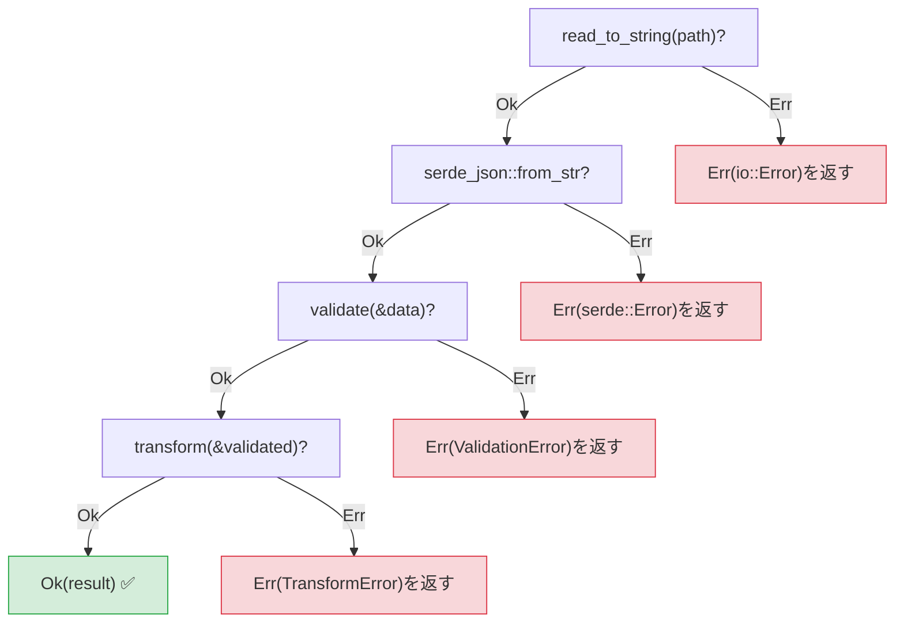
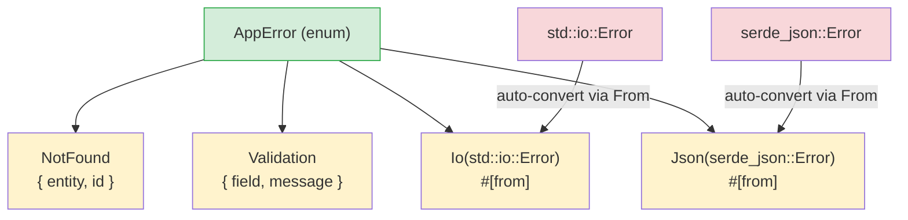

<a id="exceptions-vs-result"></a>

## 例外とResult

> **学習内容:** `Result<T, E>`と`try`/`except`の違い、簡潔なエラー伝播のための`?`演算子、
> `thiserror`による独自エラー型、アプリケーション向けの`anyhow`、明示的なエラーが隠れたバグを防ぐ理由。
>
> **難易度:** 🟡 中級

これはPython開発者にとって大きな考え方の転換の1つです。Pythonはエラー処理に例外を使い、どこからでも送出し、どこでも（あるいはどこでもなく）捕捉できます。
Rustは`Result<T, E>`を使います。エラーは値であり、明示的に処理しなければなりません。

### Pythonの例外処理
```python
# Python — 例外はどこからでも送出される
import json

def load_config(path: str) -> dict:
    try:
        with open(path) as f:
            data = json.load(f)     # JSONDecodeErrorが発生する可能性がある
            if "version" not in data:
                raise ValueError("Missing version field")
            return data
    except FileNotFoundError:
        print(f"Config file not found: {path}")
        return {}
    except json.JSONDecodeError as e:
        print(f"Invalid JSON: {e}")
        return {}
    # ほかにどんな例外が発生するだろう？
    # IOError？ PermissionError？ UnicodeDecodeError？
    # 関数シグネチャからは分からない！
```

### RustのResultベースのエラー処理
```rust
// Rust — エラーは戻り値であり、関数シグネチャから分かる
use std::fs;
use serde_json::Value;

fn load_config(path: &str) -> Result<Value, ConfigError> {
    let contents = fs::read_to_string(path)    // Resultを返す
        .map_err(|e| ConfigError::FileError(e.to_string()))?;

    let data: Value = serde_json::from_str(&contents)  // Resultを返す
        .map_err(|e| ConfigError::ParseError(e.to_string()))?;

    if data.get("version").is_none() {
        return Err(ConfigError::MissingField("version".to_string()));
    }

    Ok(data)
}

#[derive(Debug)]
enum ConfigError {
    FileError(String),
    ParseError(String),
    MissingField(String),
}
```

### 主な違い

```text
Python:                                 Rust:
─────────                               ─────
- エラーは例外（送出される）             - エラーは値（返される）
- 制御フローが隠れる（スタック巻き戻し） - 制御フローが明示的（?演算子）
- シグネチャからエラーが分からない       - 戻り値の型にエラーが必ず示される
- 未捕捉例外は実行時にクラッシュ         - 未処理Resultはコンパイル警告（必ず処理する）
- try/exceptは任意                     - Resultの処理が必要
- 広範なexceptは何でも捕捉              - matchの分岐は網羅的
```

### Resultの2つのバリアント
```rust
// Result<T, E>には2つのバリアントがある：
enum Result<T, E> {
    Ok(T),    // 成功 — 値を含む（Pythonの戻り値に相当）
    Err(E),   // 失敗 — エラーを含む（Pythonで送出される例外に相当）
}

// Resultの使用例：
fn divide(a: f64, b: f64) -> Result<f64, String> {
    if b == 0.0 {
        Err("Division by zero".to_string())  // raise ValueError("...")に相当
    } else {
        Ok(a / b)                             // return a / bに相当
    }
}

// Resultの処理 — try/exceptに似ているが明示的
match divide(10.0, 0.0) {
    Ok(result) => println!("Result: {result}"),
    Err(msg) => println!("Error: {msg}"),
}
```

***

## ?演算子

`?`演算子は、例外を呼び出しスタック上へ伝播させるPythonの仕組みに相当しますが、Rustではそれが明示されます。

### Python — 暗黙の伝播
```python
# Python — 例外は呼び出しスタックを暗黙に伝播する
def read_username() -> str:
    with open("config.txt") as f:      # FileNotFoundError propagates
        return f.readline().strip()    # IOErrorが伝播する

def greet():
    name = read_username()             # ここで例外が起きると、greet()からも送出される
    print(f"Hello, {name}!")           # エラー時は実行されない

# エラー伝播は見えない — どの例外が外に出る可能性があるか知るには
# 実装を読む必要がある。
```

### Rust — ?による明示的な伝播
```rust
// Rust — ?でエラーを伝播するが、コードとシグネチャの両方に明示される
use std::fs;
use std::io;

fn read_username() -> Result<String, io::Error> {
    let contents = fs::read_to_string("config.txt")?;  // ? = Errの場合に伝播
    Ok(contents.lines().next().unwrap_or("").to_string())
}

fn greet() -> Result<(), io::Error> {
    let name = read_username()?;       // ? = Errなら直ちにErrを返す
    println!("Hello, {name}!");        // Okの場合のみ実行
    Ok(())
}

// ?は「Errなら、この関数から直ちに返す」という意味。
// Pythonの例外伝播に似ているが、次の点が異なる：
// 1. 明示されている（?が見える）
// 2. 戻り値の型に含まれる（Result<..., io::Error>）
// 3. どこかで処理するようコンパイラーが促す
```

### ?による連鎖
```python
# Python — 失敗する可能性がある複数の処理
def process_file(path: str) -> dict:
    with open(path) as f:                    # Might fail
        text = f.read()                       # 失敗する可能性がある
    data = json.loads(text)                   # 失敗する可能性がある
    validate(data)                            # 失敗する可能性がある
    return transform(data)                    # 失敗する可能性がある
    # どの処理も例外を送出しうる — 例外の型もさまざま！
```

```rust
// Rust — 同じ処理の連鎖だが、明示的
fn process_file(path: &str) -> Result<Data, AppError> {
    let text = fs::read_to_string(path)?;     // ?でio::Errorを伝播
    let data: Value = serde_json::from_str(&text)?;  // ?でserdeのエラーを伝播
    let validated = validate(&data)?;          // ?で検証エラーを伝播
    let result = transform(&validated)?;       // ?で変換エラーを伝播
    Ok(result)
}
// ?はそれぞれ早期リターンの可能性を示し、すべて目に見える！
```



> `?`はそれぞれが終了ポイントです。Pythonのtry/exceptでは、ドキュメントを読まないとどの行で例外が起きるか分かりません。
>
> 📌 **関連項目**：[第15章 — 移行パターン](ch15-migration-patterns.md)では、実際のコードベースでPythonのtry/exceptパターンをRustに移す方法を扱います。

***

## thiserrorによる独自エラー型



> `#[from]`属性は`impl From<io::Error> for AppError`を自動生成するため、`?`によってライブラリーのエラーがアプリケーションのエラーに自動変換されます。

### Pythonの独自例外
```python
# Python — 独自の例外クラス
class AppError(Exception):
    pass

class NotFoundError(AppError):
    def __init__(self, entity: str, id: int):
        self.entity = entity
        self.id = id
        super().__init__(f"{entity} with id {id} not found")

class ValidationError(AppError):
    def __init__(self, field: str, message: str):
        self.field = field
        super().__init__(f"Validation error on {field}: {message}")

# 使用例：
def find_user(user_id: int) -> dict:
    if user_id not in users:
        raise NotFoundError("User", user_id)
    return users[user_id]
```

### thiserrorによるRustの独自エラー
```rust
// Rust — thiserrorを使ったエラーenum（最も一般的な方法）
// Cargo.toml：thiserror = "2"

use thiserror::Error;

#[derive(Debug, Error)]
enum AppError {
    #[error("{entity} with id {id} not found")]
    NotFound { entity: String, id: i64 },

    #[error("Validation error on {field}: {message}")]
    Validation { field: String, message: String },

    #[error("IO error: {0}")]
    Io(#[from] std::io::Error),        // io::Errorから自動変換

    #[error("JSON error: {0}")]
    Json(#[from] serde_json::Error),   // serdeのエラーから自動変換
}

// 使用例：
fn find_user(user_id: i64) -> Result<User, AppError> {
    users.get(&user_id)
        .cloned()
        .ok_or(AppError::NotFound {
            entity: "User".to_string(),
            id: user_id,
        })
}

// #[from]属性により、?はio::ErrorをAppError::Ioへ自動変換する
fn load_users(path: &str) -> Result<Vec<User>, AppError> {
    let data = fs::read_to_string(path)?;  // io::Error → AppError::Ioへ自動変換
    let users: Vec<User> = serde_json::from_str(&data)?;  // → AppError::Json
    Ok(users)
}
```

### エラー処理の早見表

| Python | Rust | 備考 |
|--------|------|-------|
| `raise ValueError("msg")` | `return Err(AppError::Validation {...})` | 明示的なreturn |
| `try: ... except:` | `match result { Ok(v) => ..., Err(e) => ... }` | 網羅的な分岐 |
| `except ValueError as e:` | `Err(AppError::Validation { .. }) =>` | パターンマッチ |
| `raise ... from e` | `#[from]`属性または`.map_err()` | エラーの連鎖 |
| `finally:` | `Drop`トレイト（自動） | 決定的な後片付け |
| `with open(...):` | スコープによるdrop（自動） | RAIIパターン |
| 例外が暗黙に伝播 | `?`で明示的に伝播 | 常に戻り値の型に含まれる |
| `isinstance(e, ValueError)` | `matches!(e, AppError::Validation {..})` | 型検査 |

---

## 練習問題

<details>
<summary><strong>🏋️ 練習問題：設定値の解析</strong>（クリックして展開）</summary>

**課題**：次の動作をする関数`parse_port(s: &str) -> Result<u16, String>`を書いてください。
1. 空文字列をエラー`"empty input"`として拒否する
2. 文字列を`u16`に解析し、解析エラーを`"invalid number: {original_error}"`に対応付ける
3. 1024未満のポートを`"port {n} is privileged"`として拒否する

`""`、`"hello"`、`"80"`、`"8080"`を渡して呼び出し、結果を表示してください。

<details>
<summary>🔑 解答</summary>

```rust
fn parse_port(s: &str) -> Result<u16, String> {
    if s.is_empty() {
        return Err("empty input".to_string());
    }
    let port: u16 = s.parse().map_err(|e| format!("invalid number: {e}"))?;
    if port < 1024 {
        return Err(format!("port {port} is privileged"));
    }
    Ok(port)
}

fn main() {
    for input in ["", "hello", "80", "8080"] {
        match parse_port(input) {
            Ok(port) => println!("✅ {input} → {port}"),
            Err(e) => println!("❌ {input:?} → {e}"),
        }
    }
}
```

**要点**：`.map_err()`と組み合わせた`?`は、Rustにおける`try/except ValueError as e: raise ConfigError(...) from e`の代替です。すべてのエラーパスが戻り値の型に明示されます。

</details>
</details>

***
