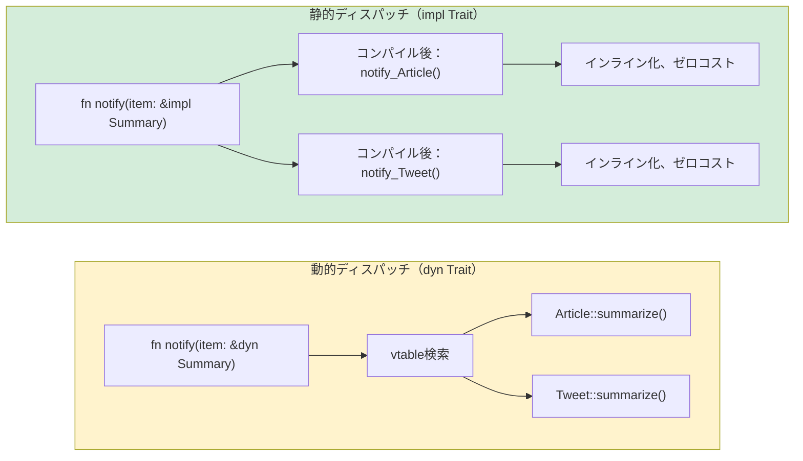

<a id="traits-vs-duck-typing"></a>

## トレイトとダックタイピング

> **学習内容:** 明示的な契約としてのトレイト（Pythonのダックタイピングとの比較）、`Protocol`（PEP 544）とトレイトの類似点、
> `where`句によるジェネリック型境界、トレイトオブジェクト（`dyn Trait`）と静的ディスパッチの違い、標準的なトレイト。
>
> **難易度:** 🟡 中級

ここは、Python開発者にとってRustの型システムが真価を発揮するところです。Pythonの「ダックタイピング」は、「アヒルのように歩き、アヒルのように鳴くなら、それはアヒルだ」と考えます。
Rustのトレイトは、「必要なアヒルの振る舞いをコンパイル時に正確に指定する」と考えます。

### Pythonのダックタイピング
```python
# Python — ダックタイピング：必要なメソッドを持つものなら何でも使える
def total_area(shapes):
    """area()メソッドを持つものなら何でも使える。"""
    return sum(shape.area() for shape in shapes)

class Circle:
    def __init__(self, radius): self.radius = radius
    def area(self): return 3.14159 * self.radius ** 2

class Rectangle:
    def __init__(self, w, h): self.w, self.h = w, h
    def area(self): return self.w * self.h

# 実行時に動作する — 継承は不要！
shapes = [Circle(5), Rectangle(3, 4)]
print(total_area(shapes))  # 90.54

# では、.area()を持たないものを渡すとどうなる？
class Dog:
    def bark(self): return "Woof!"

total_area([Dog()])  # 💥 AttributeError: 'Dog' has no attribute 'area'
# エラーは定義時ではなく実行時に発生する
```

### Rustのトレイト — 明示的なダックタイピング
```rust
// Rust — トレイトによって「アヒル」の契約を明示する
trait HasArea {
    fn area(&self) -> f64;      // このトレイトを実装する型はすべて.area()を持つ
}

struct Circle { radius: f64 }
struct Rectangle { width: f64, height: f64 }

impl HasArea for Circle {
    fn area(&self) -> f64 {
        std::f64::consts::PI * self.radius * self.radius
    }
}

impl HasArea for Rectangle {
    fn area(&self) -> f64 {
        self.width * self.height
    }
}

// トレイト制約は明示的 — コンパイラーがコンパイル時に検査する
fn total_area(shapes: &[&dyn HasArea]) -> f64 {
    shapes.iter().map(|s| s.area()).sum()
}

// 使用例：
let shapes: Vec<&dyn HasArea> = vec![&Circle { radius: 5.0 }, &Rectangle { width: 3.0, height: 4.0 }];
println!("{}", total_area(&shapes));  // 90.54

// struct Dog;
// total_area(&[&Dog {}]);  // ❌ コンパイルエラー：DogはHasAreaを実装していない
```

> **重要なポイント**：Pythonのダックタイピングではエラー検出が実行時まで遅れます。Rustのトレイトならコンパイル時に検出できます。
> 柔軟性は同じまま、より早くエラーが分かります。

***

## Protocol（PEP 544）とトレイト

Python 3.8では、構造的部分型付けのために`Protocol`（PEP 544）が導入されました。Pythonの概念の中ではRustのトレイトに最も近いものです。

### PythonのProtocol
```python
# Python — Protocol（Rustのトレイトに似た構造的型付け）
from typing import Protocol, runtime_checkable

@runtime_checkable
class Printable(Protocol):
    def to_string(self) -> str: ...

class User:
    def __init__(self, name: str):
        self.name = name
    def to_string(self) -> str:
        return f"User({self.name})"

class Product:
    def __init__(self, name: str, price: float):
        self.name = name
        self.price = price
    def to_string(self) -> str:
        return f"Product({self.name}, ${self.price:.2f})"

def print_all(items: list[Printable]) -> None:
    for item in items:
        print(item.to_string())

# UserとProductの両方がto_string()を持つため動作する
print_all([User("Alice"), Product("Widget", 9.99)])

# ただし、これを検査するのはmypyであり、Pythonの実行時には強制されない
# print_all([42])  # mypyは警告するが、Pythonは実行してクラッシュする
```

### Rustのトレイト（相当する仕組みだが、強制される！）
```rust
// Rust — トレイトはコンパイル時に強制される
trait Printable {
    fn to_string(&self) -> String;
}

struct User { name: String }
struct Product { name: String, price: f64 }

impl Printable for User {
    fn to_string(&self) -> String {
        format!("User({})", self.name)
    }
}

impl Printable for Product {
    fn to_string(&self) -> String {
        format!("Product({}, ${:.2})", self.name, self.price)
    }
}

fn print_all(items: &[&dyn Printable]) {
    for item in items {
        println!("{}", item.to_string());
    }
}

// print_all(&[&42i32]);  // ❌ コンパイルエラー：i32はPrintableを実装していない
```

### 比較表

| 特徴 | PythonのProtocol | Rustのトレイト |
|---------|-----------------|------------|
| 構造的型付け | ✅（暗黙） | ❌（`impl`で明示） |
| 検査される時点 | 実行時（またはmypy） | コンパイル時（常に） |
| デフォルト実装 | ❌ | ✅ |
| 外部の型への追加実装 | ❌ | ✅（制限あり） |
| 複数のプロトコル | ✅ | ✅（複数のトレイト） |
| 関連型 | ❌ | ✅ |
| ジェネリック制約 | ✅（`TypeVar`を使用） | ✅（トレイト境界） |

***

## ジェネリック制約

### Pythonのジェネリクス
```python
# Python — ジェネリック関数に使うTypeVar
from typing import TypeVar, Sequence

T = TypeVar('T')

def first(items: Sequence[T]) -> T | None:
    return items[0] if items else None

# 境界付きTypeVar
from typing import SupportsFloat
T = TypeVar('T', bound=SupportsFloat)

def average(items: Sequence[T]) -> float:
    return sum(float(x) for x in items) / len(items)
```

### トレイト境界を持つRustのジェネリクス
```rust
// Rust — トレイト境界を持つジェネリクス
fn first<T>(items: &[T]) -> Option<&T> {
    items.first()
}

// トレイト境界を指定 —「Tはこれらのトレイトを実装する必要がある」
fn average<T>(items: &[T]) -> f64
where
    T: Into<f64> + Copy,   // Tはf64に変換でき、コピー可能であること
{
    let sum: f64 = items.iter().map(|&x| x.into()).sum();
    sum / items.len() as f64
}

// 複数の境界 —「TはDisplayとDebugとCloneを実装する必要がある」
fn log_and_clone<T: std::fmt::Display + std::fmt::Debug + Clone>(item: &T) -> T {
    println!("Display: {}", item);
    println!("Debug: {:?}", item);
    item.clone()
}

// impl Traitによる省略形（単純なケース向け）
fn print_it(item: &impl std::fmt::Display) {
    println!("{}", item);
}
```

### ジェネリクス早見表

| Python | Rust | 備考 |
|--------|------|-------|
| `TypeVar('T')` | `<T>` | 境界のないジェネリック |
| `TypeVar('T', bound=X)` | `<T: X>` | 境界付きジェネリック |
| `Union[int, str]` | `enum`またはトレイトオブジェクト | Rustに共用体型はない |
| `Sequence[T]` | `&[T]`（スライス） | 借用されたシーケンス |
| `Callable[[A], R]` | `Fn(A) -> R` | 関数トレイト |
| `Optional[T]` | `Option<T>` | 言語に組み込み |

***

## 標準ライブラリーでよく使うトレイト

これらはPythonの「ダンダーメソッド」に相当し、一般的な場面で型がどのように振る舞うかを定義します。

### DisplayとDebug（出力）
```rust
use std::fmt;

// Debug — __repr__に相当（自動derive可能）
#[derive(Debug)]
struct Point { x: f64, y: f64 }
// これで可能：println!("{:?}", point);

// Display — __str__に相当（手動実装が必要）
impl fmt::Display for Point {
    fn fmt(&self, f: &mut fmt::Formatter<'_>) -> fmt::Result {
        write!(f, "({}, {})", self.x, self.y)
    }
}
// これで可能：println!("{}", point);
```

### 比較トレイト
```rust
// PartialEq — __eq__に相当
// Eq — 全域的な等価性（f64はNaN != NaNのためPartialEqだがEqではない）
// PartialOrd — __lt__、__le__などに相当
// Ord — 全域順序

#[derive(Debug, PartialEq, Eq, PartialOrd, Ord, Hash, Clone)]
struct Student {
    name: String,
    grade: i32,
}

// Studentは比較、ソート、HashMapのキーとしての使用、複製が可能になる
let mut students = vec![
    Student { name: "Charlie".into(), grade: 85 },
    Student { name: "Alice".into(), grade: 92 },
];
students.sort();  // Ordを使い、構造体フィールド順（name、次にgrade）でソート
```

### Iteratorトレイト
```rust
// Iteratorの実装 — Pythonの__iter__/__next__に相当
struct Countdown { value: i32 }

impl Iterator for Countdown {
    type Item = i32;       // イテレーターが生成する値

    fn next(&mut self) -> Option<Self::Item> {
        if self.value > 0 {
            self.value -= 1;
            Some(self.value + 1)
        } else {
            None             // 反復の終了
        }
    }
}

// 使用例：
for n in (Countdown { value: 5 }) {
    println!("{n}");  // 5, 4, 3, 2, 1
}
```

### よく使うトレイト一覧

| Rustのトレイト | Pythonでの相当物 | 用途 |
|-----------|-------------------|---------|
| `Display` | `__str__` | 人が読む文字列 |
| `Debug` | `__repr__` | デバッグ用文字列（derive可能） |
| `Clone` | `copy.deepcopy` | ディープコピー |
| `Copy` | （int/floatの自動コピー） | 単純な型の暗黙コピー |
| `PartialEq` / `Eq` | `__eq__` | 等価性の比較 |
| `PartialOrd` / `Ord` | `__lt__`など | 順序比較 |
| `Hash` | `__hash__` | ハッシュ可能（dictのキー用） |
| `Default` | デフォルトの`__init__` | デフォルト値 |
| `From` / `Into` | `__init__`のオーバーロード | 型変換 |
| `Iterator` | `__iter__` / `__next__` | 反復処理 |
| `Drop` | `__del__` / `__exit__` | 後片付け |
| `Add`、`Sub`、`Mul` | `__add__`、`__sub__`、`__mul__` | 演算子オーバーロード |
| `Index` | `__getitem__` | `[]`によるインデックスアクセス |
| `Deref` | （相当物なし） | スマートポインターの参照外し |
| `Send` / `Sync` | （相当物なし） | スレッド安全性を示すマーカー |



> **Pythonでの相当物**：Pythonは常に動的ディスパッチ（実行時の`getattr`）を使います。Rustは静的ディスパッチがデフォルトです（単相化により、コンパイラーが具体型ごとのコードを生成します）。実行時ポリモーフィズムが必要な場合に限り`dyn Trait`を使います。
>
> 📌 **関連項目**：[第11章 — From/Intoトレイト](ch11-from-and-into-traits.md)では、変換トレイト（`From`、`Into`、`TryFrom`）を詳しく扱います。

### 関連型

Rustのトレイトでは*関連型*を定義できます。これは実装する型がそれぞれ埋める型のプレースホルダーです。Pythonに相当する仕組みはありません。

```rust
// Iteratorは関連型'Item'を定義する
trait Iterator {
    type Item;
    fn next(&mut self) -> Option<Self::Item>;
}

struct Countdown { remaining: u32 }

impl Iterator for Countdown {
    type Item = u32;  // このイテレーターはu32値を生成する
    fn next(&mut self) -> Option<u32> {
        if self.remaining > 0 {
            self.remaining -= 1;
            Some(self.remaining)
        } else {
            None
        }
    }
}
```

Pythonでは`__iter__` / `__next__`は`Any`を返します。「このイテレーターは`int`を生成する」と宣言して強制する方法はありません（`Iterator[int]`の型ヒントは参考情報にすぎません）。

### 演算子オーバーロード：`__add__`から`impl Add`へ

Pythonではマジックメソッド（`__add__`、`__mul__`）を使います。Rustではトレイトを実装します。同じ考え方ですが、コンパイル時に型検査されます。

```python
# Python
class Vec2:
    def __init__(self, x, y):
        self.x, self.y = x, y
    def __add__(self, other):
        return Vec2(self.x + other.x, self.y + other.y)  # otherの型検査は行われない
```

```rust
use std::ops::Add;

#[derive(Debug, Clone, Copy)]
struct Vec2 { x: f64, y: f64 }

impl Add for Vec2 {
    type Output = Vec2;  // 関連型：+演算子が返す型
    fn add(self, rhs: Vec2) -> Vec2 {
        Vec2 { x: self.x + rhs.x, y: self.y + rhs.y }
    }
}

let a = Vec2 { x: 1.0, y: 2.0 };
let b = Vec2 { x: 3.0, y: 4.0 };
let c = a + b;  // 型安全：Vec2 + Vec2のみ許可される
```

大きな違いは、Pythonの`__add__`は実行時に*任意の*`other`を受け取ることです（型を自分で確認するか、`TypeError`が発生します）。Rustの`Add`トレイトはコンパイル時にオペランドの型を強制します。`impl Add<i32> for Vec2`を明示しない限り、`Vec2 + i32`はコンパイルエラーです。

---

## 練習問題

<details>
<summary><strong>🏋️ 練習問題：ジェネリックなSummaryトレイト</strong>（クリックして展開）</summary>

**課題**：`fn summarize(&self) -> String`メソッドを持つ`Summary`トレイトを定義してください。2つの構造体`Article { title: String, body: String }`と`Tweet { username: String, content: String }`に実装し、要約を表示する関数`fn notify(item: &impl Summary)`を書いてください。

<details>
<summary>🔑 解答</summary>

```rust
trait Summary {
    fn summarize(&self) -> String;
}

struct Article { title: String, body: String }
struct Tweet { username: String, content: String }

impl Summary for Article {
    fn summarize(&self) -> String {
        format!("{} — {}...", self.title, &self.body[..20.min(self.body.len())])
    }
}

impl Summary for Tweet {
    fn summarize(&self) -> String {
        format!("@{}: {}", self.username, self.content)
    }
}

fn notify(item: &impl Summary) {
    println!("📢 {}", item.summarize());
}

fn main() {
    let article = Article {
        title: "Rust is great".into(),
        body: "Here is why Rust beats Python for systems...".into(),
    };
    let tweet = Tweet {
        username: "rustacean".into(),
        content: "Just shipped my first crate!".into(),
    };
    notify(&article);
    notify(&tweet);
}
```

**要点**：`&impl Summary`は、`summarize`メソッドを持つPythonの`Protocol`に相当します。ただしRustはコンパイル時に検査するため、`Summary`を実装していない型を渡すと、実行時の`AttributeError`ではなくコンパイルエラーになります。

</details>
</details>

***
