<a id="no-gil-true-parallelism"></a>
## GILなし：真の並列処理

> **学習内容：** GILがPythonの並行処理を制限する理由、コンパイル時のスレッド安全性を保証するRustの`Send`/`Sync`トレイト、
> `Arc<Mutex<T>>`とPythonの`threading.Lock`の違い、チャネルと`queue.Queue`の比較、async/awaitの違い。
>
> **難易度：** 🔴 上級

GIL（グローバルインタープリターロック）は、CPU負荷の高い処理におけるPython最大の制約です。
RustにはGILがありません。スレッドは真に並列実行され、型システムがデータ競合を
コンパイル時に防ぎます。

```mermaid
gantt
    title CPU負荷の高い処理：PythonのGILとRustのスレッド
    dateFormat X
    axisFormat %s
    section Python（GILあり）
        スレッド1 :a1, 0, 4
        スレッド2 :a2, 4, 8
        スレッド3 :a3, 8, 12
        スレッド4 :a4, 12, 16
    section Rust（GILなし）
        スレッド1 :b1, 0, 4
        スレッド2 :b2, 0, 4
        スレッド3 :b3, 0, 4
        スレッド4 :b4, 0, 4
```



> **重要なポイント：** PythonのスレッドはCPU処理では順番に実行されます（GILが直列化します）。Rustのスレッドは真に並列実行され、4スレッドなら約4倍の高速化が見込めます。
>
> 📌 **前提知識：** この章に取り組む前に、[第7章 — 所有権と借用](ch07-ownership-and-borrowing.md)を十分に理解しておきましょう。`Arc`、`Mutex`、moveクロージャはいずれも所有権の概念に基づいています。

### PythonにおけるGILの問題
```python
# Python — CPU負荷の高い処理ではスレッドを使っても効果がない
import threading
import time

counter = 0

def increment(n):
    global counter
    for _ in range(n):
        counter += 1  # スレッド安全ではない！ただしGILが単純な操作を「保護」する

threads = [threading.Thread(target=increment, args=(1_000_000,)) for _ in range(4)]
start = time.perf_counter()
for t in threads:
    t.start()
for t in threads:
    t.join()
elapsed = time.perf_counter() - start

print(f"Counter: {counter}")    # 4,000,000にならないこともある！
print(f"Time: {elapsed:.2f}s")  # シングルスレッドとほぼ同じ時間（GIL）

# 真の並列処理には、Pythonではmultiprocessingが必要：
from multiprocessing import Pool
with Pool(4) as pool:
    results = pool.map(cpu_work, data)  # プロセスを分離するため、pickleのオーバーヘッドが発生
```

### Rust — 真の並列処理とコンパイル時の安全性
```rust
use std::sync::atomic::{AtomicI64, Ordering};
use std::sync::Arc;
use std::thread;

fn main() {
    let counter = Arc::new(AtomicI64::new(0));

    let handles: Vec<_> = (0..4).map(|_| {
        let counter = Arc::clone(&counter);
        thread::spawn(move || {
            for _ in 0..1_000_000 {
                counter.fetch_add(1, Ordering::Relaxed);
            }
        })
    }).collect();

    for h in handles {
        h.join().unwrap();
    }

    println!("Counter: {}", counter.load(Ordering::Relaxed)); // 常に4,000,000
    // すべてのコアで実行される — GILのない真の並列処理
}
```

***

<a id="thread-safety-type-system-guarantees"></a>
## スレッド安全性：型システムによる保証

### Python — 実行時エラー
```python
# Python — データ競合は実行時に検出される（あるいは検出されない）
import threading

shared_list = []

def append_items(items):
    for item in items:
        shared_list.append(item)  # appendはGILにより「スレッド安全」
        # ただし、複雑な操作は安全ではない：
        # if item not in shared_list:
        #     shared_list.append(item)  # 競合状態！

# 安全のためにLockを使用：
lock = threading.Lock()
def safe_append(items):
    for item in items:
        with lock:
            if item not in shared_list:
                shared_list.append(item)
# ロックを忘れてもコンパイラの警告はない。バグは本番環境で発覚する。
```

### Rust — コンパイル時エラー
```rust
use std::sync::{Arc, Mutex};
use std::thread;

fn main() {
    // 保護せずにVecをスレッド間で共有しようとする：
    // let shared = vec![];
    // thread::spawn(move || shared.push(1));
    // ❌ コンパイルエラー：保護なしのVecはSend/Syncではない

    // Mutexを使う場合（Rustでthreading.Lockに相当）：
    let shared = Arc::new(Mutex::new(Vec::new()));

    let handles: Vec<_> = (0..4).map(|i| {
        let shared = Arc::clone(&shared);
        thread::spawn(move || {
            let mut data = shared.lock().unwrap(); // アクセスにはロックが必須
            data.push(i);
            // `data`がスコープを抜けるとロックは自動的に解放される
            // 「ロック解除を忘れる」ことはない — RAIIが保証する
        })
    }).collect();

    for h in handles {
        h.join().unwrap();
    }

    println!("{:?}", shared.lock().unwrap()); // [0, 1, 2, 3]（順序は変わる場合がある）
}
```

### SendトレイトとSyncトレイト
```rust
// Rustはスレッド安全性を強制するために2つのマーカートレイトを使用する：

// Send —「この型は別のスレッドに移動できる」
// ほとんどの型はSend。Rc<T>は該当しない（スレッドではArc<T>を使う）。

// Sync —「この型は複数のスレッドから参照できる」
// ほとんどの型はSync。Cell<T>/RefCell<T>は該当しない（Mutex<T>を使う）。

// コンパイラがこれらを自動的に検査する：
// thread::spawn(move || { ... })
//   ↑ クロージャがキャプチャする値はSendでなければならない
//   ↑ 共有参照はSyncでなければならない
//   ↑ 該当しない場合 → コンパイルエラー

// Pythonには同等の仕組みがない。スレッド安全性のバグは実行時に発覚する。
// Rustはコンパイル時に検出する。これが「恐れ知らずの並行処理」。
```

### 並行処理プリミティブの比較

| Python | Rust | 用途 |
|--------|------|---------|
| `threading.Lock()` | `Mutex<T>` | 相互排他 |
| `threading.RLock()` | `Mutex<T>`（再入不可） | 再入可能ロック（別の方法で実現） |
| `threading.RWLock`（該当なし） | `RwLock<T>` | 複数の読み取り、または1つの書き込み |
| `threading.Event()` | `Condvar` | 条件変数 |
| `queue.Queue()` | `mpsc::channel()` | スレッドセーフなチャネル |
| `multiprocessing.Pool` | `rayon::ThreadPool` | スレッドプール |
| `concurrent.futures` | `rayon` / `tokio::spawn` | タスクベースの並列処理 |
| `threading.local()` | `thread_local!` | スレッドローカルストレージ |
| 該当なし | `Atomic*`型 | ロックフリーのカウンターとフラグ |

### Mutexのポイズニング

スレッドが`Mutex`を保持したまま**パニック**すると、ロックは*ポイズン状態*になります。Pythonには同等の仕組みがありません。スレッドが`threading.Lock()`を保持したままクラッシュすると、ロックは取得されたままになります。

```rust
use std::sync::{Arc, Mutex};
use std::thread;

let data = Arc::new(Mutex::new(vec![1, 2, 3]));
let data2 = Arc::clone(&data);

let _ = thread::spawn(move || {
    let mut guard = data2.lock().unwrap();
    guard.push(4);
    panic!("oops!");  // ロックはポイズン状態になる
}).join();

// 以降のロック取得はErr(PoisonError)を返す
match data.lock() {
    Ok(guard) => println!("Data: {guard:?}"),
    Err(poisoned) => {
        println!("Lock was poisoned! Recovering...");
        let guard = poisoned.into_inner();
        println!("Recovered: {guard:?}");  // [1, 2, 3, 4]
    }
}
```

### アトミック操作のメモリ順序（概要）

アトミック操作の`Ordering`パラメーターは、メモリ可視性の保証を制御します。

| Ordering | 用途 |
|----------|-------------|
| `Relaxed` | 順序が重要でない単純なカウンター |
| `Acquire`/`Release` | プロデューサー・コンシューマー：書き込み側は`Release`、読み取り側は`Acquire`を使用 |
| `SeqCst` | 迷ったとき — 最も厳密で直感的な順序 |

Pythonの`threading`モジュールでは、こうした詳細はGILの背後に隠れています。Rustでは明示的に選択します。プロファイリングでより弱い順序が必要と分かるまでは`SeqCst`を使いましょう。

***

<a id="asyncawait-comparison"></a>
## async/awaitの比較

PythonとRustにはどちらも`async`/`await`構文がありますが、内部の仕組みは大きく異なります。

### Pythonのasync/await
```python
# Python — I/Oの並行処理にはasyncioを使用
import asyncio
import aiohttp

async def fetch_url(session, url):
    async with session.get(url) as resp:
        return await resp.text()

async def main():
    urls = ["https://example.com", "https://httpbin.org/get"]

    async with aiohttp.ClientSession() as session:
        tasks = [fetch_url(session, url) for url in urls]
        results = await asyncio.gather(*tasks)

    for url, result in zip(urls, results):
        print(f"{url}: {len(result)} bytes")

asyncio.run(main())

# Pythonのasyncはシングルスレッド（GILの制約も受ける）！
# 効果があるのはI/O待ち（ネットワークやディスク待ち）の処理だけ。
# asyncでもCPU負荷の高い処理はイベントループをブロックする。
```

### Rustのasync/await
```rust
// Rust — I/Oの並行処理（およびCPUの並列処理）にはtokioを使用！
use reqwest;
use tokio;
use futures::future::join_all;  // Cargo.tomlに`futures`を追加

async fn fetch_url(url: &str) -> Result<String, reqwest::Error> {
    reqwest::get(url).await?.text().await
}

#[tokio::main]
async fn main() -> Result<(), Box<dyn std::error::Error>> {
    let urls = vec!["https://example.com", "https://httpbin.org/get"];

    let tasks: Vec<_> = urls.iter()
        .map(|url| tokio::spawn(fetch_url(url)))  // GILの制約なし
        .collect();                                 // すべてのCPUコアを使用可能

    let results = futures::future::join_all(tasks).await;

    for (url, result) in urls.iter().zip(results) {
        match result {
            Ok(Ok(body)) => println!("{url}: {} bytes", body.len()),
            Ok(Err(e)) => println!("{url}: error {e}"),
            Err(e) => println!("{url}: task failed {e}"),
        }
    }

    Ok(())
}
```

### 主な違い

| 項目 | Python asyncio | Rust tokio |
|--------|---------------|------------|
| GIL | 引き続き適用 | GILなし |
| CPU並列処理 | ❌ シングルスレッド | ✅ マルチスレッド |
| ランタイム | 組み込み（asyncio） | 外部クレート（tokio） |
| エコシステム | aiohttp、asyncpgなど | reqwest、sqlxなど |
| 性能 | I/O処理に適する | I/OとCPUの両方に優れる |
| エラー処理 | 例外 | `Result<T, E>` |
| キャンセル | `task.cancel()` | futureを破棄 |
| 色分けの問題 | 同期・非同期の境界 | 同じ問題がある |

### Rayonによる簡単な並列処理
```python
# Python — CPUの並列処理にはmultiprocessingを使用
from multiprocessing import Pool

def process_item(item):
    return heavy_computation(item)

with Pool(8) as pool:
    results = pool.map(process_item, items)
```

```rust
// Rust — 手軽なCPU並列処理にはrayonを使用（変更は1行だけ！）
use rayon::prelude::*;

// 逐次処理：
let results: Vec<_> = items.iter().map(|item| heavy_computation(item)).collect();

// 並列処理（.iter()を.par_iter()に変えるだけ！）：
let results: Vec<_> = items.par_iter().map(|item| heavy_computation(item)).collect();

// pickle不要、プロセスのオーバーヘッドなし、シリアライズ不要。
// rayonがコア間に処理を自動分配する。
```

---

## 💼 ケーススタディ：画像処理パイプラインの並列化

あるデータサイエンスチームは、毎晩5万枚の衛星画像を処理しています。Pythonのパイプラインでは`multiprocessing.Pool`を使用しています。

```python
# Python — CPU負荷の高い画像処理にmultiprocessingを使用
import multiprocessing
from PIL import Image
import numpy as np

def process_image(path: str) -> dict:
    img = np.array(Image.open(path))
    # CPU負荷の高い処理：ヒストグラム平坦化、エッジ検出、分類
    histogram = np.histogram(img, bins=256)[0]
    edges = detect_edges(img)       # 画像1枚あたり約200ミリ秒
    label = classify(edges)          # 約100ミリ秒
    return {"path": path, "label": label, "edge_count": len(edges)}

# 問題点：各サブプロセスがPythonインタープリター全体を複製する
# メモリ：ワーカー1つあたり50MB × 16ワーカー = 800MBのオーバーヘッド
# 起動：forkと引数のpickle化に2～3秒かかる
with multiprocessing.Pool(16) as pool:
    results = pool.map(process_image, image_paths)  # 5万枚で約4.5時間
```

**問題点：** forkによる800MBのメモリオーバーヘッド、引数・結果のpickleシリアライズ、GILによるスレッド利用の制限、分かりにくいエラー処理（ワーカー内の例外はデバッグしにくい）。

```rust
use rayon::prelude::*;
use image::GenericImageView;

struct ImageResult {
    path: String,
    label: String,
    edge_count: usize,
}

fn process_image(path: &str) -> Result<ImageResult, image::ImageError> {
    let img = image::open(path)?;
    // 用途に合わせて実装するアプリケーション固有の関数
    let histogram = compute_histogram(&img);       // 約50ミリ秒（numpyのオーバーヘッドなし）
    let edges = detect_edges(&img);                // 約40ミリ秒（SIMD最適化）
    let label = classify(&edges);                  // 約20ミリ秒
    Ok(ImageResult {
        path: path.to_string(),
        label,
        edge_count: edges.len(),
    })
}

fn main() -> Result<(), Box<dyn std::error::Error>> {
    let paths: Vec<String> = load_image_paths()?;

    // rayonがすべてのCPUコアを自動利用 — forkもpickleもGILも不要
    let results: Vec<ImageResult> = paths
        .par_iter()                                // 並列イテレーター
        .filter_map(|p| process_image(p).ok())     // エラーを適切にスキップ
        .collect();                                // 並列に収集

    println!("Processed {} images", results.len());
    Ok(())
}
// 5万枚を約35分で処理（Pythonでは4.5時間）
// メモリ：約50MB（スレッド間で共有、forkなし）
```

**結果：**
| 指標 | Python（multiprocessing） | Rust（rayon） |
|--------|------------------------|--------------|
| 処理時間（5万枚） | 約4.5時間 | 約35分 |
| メモリのオーバーヘッド | 800MB（16ワーカー） | 約50MB（共有） |
| エラー処理 | 分かりにくいpickleエラー | 各段階で`Result<T, E>` |
| 起動コスト | 2～3秒（fork + pickle） | なし（スレッド） |

> **重要な教訓：** CPU負荷の高い並列処理では、Rustのスレッドとrayonを使うことで、Pythonの`multiprocessing`をシリアライズのオーバーヘッドなし、メモリ共有、コンパイル時の安全性を保ったまま置き換えられます。

---

## 演習

<details>
<summary><strong>🏋️ 演習：スレッドセーフなカウンター</strong>（クリックして展開）</summary>

**課題：** Pythonでは共有カウンターを保護するために`threading.Lock`を使うことがあります。これをRustに書き換えましょう。10個のスレッドを起動し、それぞれが共有カウンターを1000回ずつ増やします。最終値（10000になるはずです）を表示してください。`Arc<Mutex<u64>>`を使います。

<details>
<summary>🔑 解答</summary>

```rust
use std::sync::{Arc, Mutex};
use std::thread;

fn main() {
    let counter = Arc::new(Mutex::new(0u64));
    let mut handles = vec![];

    for _ in 0..10 {
        let counter = Arc::clone(&counter);
        handles.push(thread::spawn(move || {
            for _ in 0..1000 {
                let mut num = counter.lock().unwrap();
                *num += 1;
            }
        }));
    }

    for handle in handles {
        handle.join().unwrap();
    }

    println!("Final count: {}", *counter.lock().unwrap());
}
```

**要点：** `Arc<Mutex<T>>`は、Pythonの`lock = threading.Lock()`と共有変数に相当します。ただしRustでは`Arc`や`Mutex`を忘れると*コンパイルできません*。Pythonでは競合のあるプログラムも実行され、誤った結果が何も告げずに返ることがあります。

</details>
</details>

***
