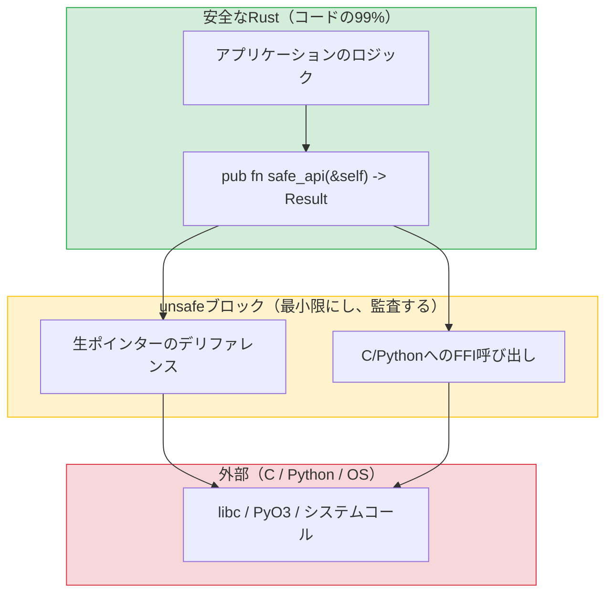

<a id="when-and-why-to-use-unsafe"></a>
## unsafeを使う場面と理由

> **学習内容：** `unsafe`で可能になることとその存在理由、PyO3を使ったPython拡張機能の作成（Python開発者にとっての強力な機能）、
> Rustのテストフレームワークとpytestの比較、mockallによるモック、ベンチマーク。
>
> **難易度：** 🔴 上級

Rustの`unsafe`は安全性検査を回避するための仕組みです。コンパイラに「検証できない操作を行うが、正しいことは保証する」と伝えます。
Pythonには直接メモリにアクセスする手段がないため、同等の仕組みはありません。



> **基本パターン：** 安全なAPIで小さな`unsafe`ブロックを包みます。呼び出し側から`unsafe`は見えません。Pythonの`ctypes`にはこのような境界がなく、FFI呼び出しはすべて暗黙的に安全ではありません。
>
> 📌 **関連項目：** [第13章 — 並行処理](ch13-concurrency.md)では、コンパイラがスレッド安全性を検査する`unsafe`な自動トレイト、`Send`/`Sync`について説明しています。

### unsafeで可能になること
```rust
// unsafeを使うと、安全なRustでは禁止されている次の5つの操作が可能になる：
// 1. 生ポインターをデリファレンスする
// 2. unsafe関数・メソッドを呼び出す
// 3. 可変なstatic変数にアクセスする
// 4. unsafeトレイトを実装する
// 5. unionのフィールドにアクセスする

// 例：C関数を呼び出す
extern "C" {
    fn abs(input: i32) -> i32;
}

fn main() {
    // SAFETY: abs()は仕様が明確に定義されたC標準ライブラリ関数である。
    let result = unsafe { abs(-42) };  // 安全なRustではCコードを検証できない
    println!("{result}");               // 42
}
```

### unsafeを使う場面
```rust
// 1. FFI — Cライブラリの呼び出し（最も一般的な理由）
// 2. 性能が重要な内部ループ（まれ）
// 3. 借用チェッカーでは表現できないデータ構造（まれ）

// Python開発者がunsafeに遭遇するのは、主に次のような場面：
// - PyO3の内部処理（PythonとRustの橋渡し）
// - Cライブラリのバインディング
// - 低レベルのシステムコール

// 目安：アプリケーションコード（ライブラリコードではなく）を書く場合、
// unsafeが必要になることはほとんどない。必要だと思ったら、まずRustコミュニティで相談しよう。
// たいていの場合、安全な代替手段がある。
```

***

<a id="pyo3-rust-extensions-for-python"></a>
## PyO3：Python向けRust拡張機能

PyO3はPythonとRustをつなぐ橋渡しです。Pythonから呼び出せるRustの関数やクラスを書けるため、Pythonの遅い処理を置き換えるのに最適です。

### RustでPython拡張機能を作成する
```bash
# セットアップ
pip install maturin    # Rust製Python拡張機能のビルドツール
maturin init           # プロジェクト構成を作成

# プロジェクト構成：
# my_extension/
# ├── Cargo.toml
# ├── pyproject.toml
# └── src/
#     └── lib.rs
```

```toml
# Cargo.toml
[package]
name = "my_extension"
version = "0.1.0"
edition = "2021"

[lib]
crate-type = ["cdylib"]    # Python用の共有ライブラリ

[dependencies]
pyo3 = { version = "0.22", features = ["extension-module"] }
```

```rust
// src/lib.rs — Pythonから呼び出せるRust関数
use pyo3::prelude::*;

/// Rustで実装した高速なフィボナッチ関数。
#[pyfunction]
fn fibonacci(n: u64) -> u64 {
    let (mut a, mut b) = (0u64, 1u64);
    for _ in 0..n {
        let temp = b;
        b = a.wrapping_add(b);
        a = temp;
    }
    a
}

/// エラトステネスの篩でn以下の素数をすべて求める。
#[pyfunction]
fn primes_up_to(n: usize) -> Vec<usize> {
    let mut is_prime = vec![true; n + 1];
    is_prime[0] = false;
    if n > 0 { is_prime[1] = false; }
    for i in 2..=((n as f64).sqrt() as usize) {
        if is_prime[i] {
            for j in (i * i..=n).step_by(i) {
                is_prime[j] = false;
            }
        }
    }
    (2..=n).filter(|&i| is_prime[i]).collect()
}

/// Pythonから使用できるRustのクラス。
#[pyclass]
struct Counter {
    value: i64,
}

#[pymethods]
impl Counter {
    #[new]
    fn new(start: i64) -> Self {
        Counter { value: start }
    }

    fn increment(&mut self) {
        self.value += 1;
    }

    fn get_value(&self) -> i64 {
        self.value
    }

    fn __repr__(&self) -> String {
        format!("Counter(value={})", self.value)
    }
}

/// Pythonモジュールの定義。
#[pymodule]
fn my_extension(m: &Bound<'_, PyModule>) -> PyResult<()> {
    m.add_function(wrap_pyfunction!(fibonacci, m)?)?;
    m.add_function(wrap_pyfunction!(primes_up_to, m)?)?;
    m.add_class::<Counter>()?;
    Ok(())
}
```

### Pythonから使用する
```bash
# ビルドしてインストール：
maturin develop --release   # 現在の仮想環境にビルドしてインストール
```

```python
# Python — Rust拡張機能を通常のPythonモジュールと同じように使う
import my_extension

# Rust関数を呼び出す
result = my_extension.fibonacci(50)
print(result)  # 12586269025 — マイクロ秒単位で計算

# Rustのクラスを使う
counter = my_extension.Counter(0)
counter.increment()
counter.increment()
print(counter.get_value())  # 2
print(counter)              # Counter(value=2)

# 性能を比較：
import time

# Python版
def py_primes(n):
    sieve = [True] * (n + 1)
    for i in range(2, int(n**0.5) + 1):
        if sieve[i]:
            for j in range(i*i, n+1, i):
                sieve[j] = False
    return [i for i in range(2, n+1) if sieve[i]]

start = time.perf_counter()
py_result = py_primes(10_000_000)
py_time = time.perf_counter() - start

start = time.perf_counter()
rs_result = my_extension.primes_up_to(10_000_000)
rs_time = time.perf_counter() - start

print(f"Python: {py_time:.3f}s")    # 約3.5秒
print(f"Rust:   {rs_time:.3f}s")    # 約0.05秒 — 70倍高速！
print(f"Same results: {py_result == rs_result}")  # True
```

### PyO3クイックリファレンス

| Pythonの概念 | PyO3属性 | 説明 |
|---------------|----------------|-------|
| 関数 | `#[pyfunction]` | Pythonに公開 |
| クラス | `#[pyclass]` | Pythonから見えるクラス |
| メソッド | `#[pymethods]` | pyclassのメソッド |
| `__init__` | `#[new]` | コンストラクター |
| `__repr__` | `fn __repr__()` | 文字列表現 |
| `__str__` | `fn __str__()` | 表示用文字列 |
| `__len__` | `fn __len__()` | 長さ |
| `__getitem__` | `fn __getitem__()` | インデックスアクセス |
| プロパティ | `#[getter]` / `#[setter]` | 属性アクセス |
| 静的メソッド | `#[staticmethod]` | selfを取らない |
| クラスメソッド | `#[classmethod]` | clsを受け取る |

### FFIの安全性パターン

（PyO3または生のC FFIを介して）RustをPythonに公開する際は、次のルールでよくあるバグを防げます。

1. **パニックをFFI境界の外へ伝播させない** — RustのパニックがPython（またはC）まで巻き戻ると、**未定義動作**になります。PyO3は`#[pyfunction]`でこれを自動処理しますが、生の`extern "C"`関数では明示的な保護が必要です。
    ```rust
    #[no_mangle]
    pub extern "C" fn raw_ffi_function() -> i32 {
        match std::panic::catch_unwind(|| {
            // 実際の処理
            42
        }) {
            Ok(result) => result,
            Err(_) => -1,  // C/Pythonへパニックを伝播させず、エラーコードを返す
        }
    }
    ```

2. **共有構造体には`#[repr(C)]`を使う** — Python/Cが構造体のフィールドを直接読む場合、C互換のメモリ配置を保証するために`#[repr(C)]`が**必須**です。不透明なポインター（PyO3が`#[pyclass]`で使う方式）を渡す場合は不要です。

3. **`extern "C"`** — 呼び出し規約をC/Python側の期待に合わせるため、生のFFI関数に必要です。PyO3の`#[pyfunction]`がこれを処理します。

> **PyO3の利点：** PyO3はパニックの捕捉、型変換、GIL管理など、安全性に関する懸念の大部分を処理します。特別な理由がない限り、生のFFIよりPyO3を選びましょう。

***


<!-- ch14a: Testing -->
<a id="unit-tests-vs-pytest"></a>
## ユニットテストとpytestの比較

### pytestによるPythonのテスト
```python
# test_calculator.py
import pytest
from calculator import add, divide

def test_add():
    assert add(2, 3) == 5

def test_add_negative():
    assert add(-1, 1) == 0

def test_divide():
    assert divide(10, 2) == 5.0

def test_divide_by_zero():
    with pytest.raises(ZeroDivisionError):
        divide(1, 0)

# パラメーター化テスト
@pytest.mark.parametrize("a,b,expected", [
    (1, 2, 3),
    (0, 0, 0),
    (-1, -1, -2),
    (100, 200, 300),
])
def test_add_parametrized(a, b, expected):
    assert add(a, b) == expected

# フィクスチャ
@pytest.fixture
def sample_data():
    return [1, 2, 3, 4, 5]

def test_sum(sample_data):
    assert sum(sample_data) == 15
```

```bash
# テストを実行する
pytest                      # すべてのテストを実行
pytest test_calculator.py   # 1つのファイルを実行
pytest -k "test_add"        # 一致するテストを実行
pytest -v                   # 詳細な出力
pytest --tb=short           # 短いトレースバック
```

### Rust組み込みのテスト機能
```rust
// src/calculator.rs — テストは同じファイル内に記述する！
fn add(a: i32, b: i32) -> i32 {
    a + b
}

fn divide(a: f64, b: f64) -> Result<f64, String> {
    if b == 0.0 {
        Err("Division by zero".to_string())
    } else {
        Ok(a / b)
    }
}

// テストは#[cfg(test)]モジュールに記述する — `cargo test`のときだけコンパイルされる
#[cfg(test)]
mod tests {
    use super::*;  // 親モジュールからすべてをインポート

    #[test]
    fn test_add() {
        assert_eq!(add(2, 3), 5);
    }

    #[test]
    fn test_add_negative() {
        assert_eq!(add(-1, 1), 0);
    }

    #[test]
    fn test_divide() {
        assert_eq!(divide(10.0, 2.0), Ok(5.0));
    }

    #[test]
    fn test_divide_by_zero() {
        assert!(divide(1.0, 0.0).is_err());
    }

    // pytest.raisesのように、パニックが起きることをテストする
    #[test]
    #[should_panic(expected = "out of bounds")]
    fn test_out_of_bounds() {
        let v = vec![1, 2, 3];
        let _ = v[99];  // パニックする
    }
}
```

```bash
# テストを実行する
cargo test                         # すべてのテストを実行
cargo test test_add                # 一致するテストを実行
cargo test -- --nocapture          # println!の出力を表示
cargo test -p my_crate             # ワークスペース内の1つのクレートをテスト
cargo test -- --test-threads=1     # 順次実行（副作用のあるテスト向け）
```

### テストのクイックリファレンス

| pytest | Rust | 説明 |
|--------|------|-------|
| `assert x == y` | `assert_eq!(x, y)` | 等価性 |
| `assert x != y` | `assert_ne!(x, y)` | 非等価性 |
| `assert condition` | `assert!(condition)` | 真偽値 |
| `assert condition, "msg"` | `assert!(condition, "msg")` | メッセージ付き |
| `pytest.raises(E)` | `#[should_panic]` | パニックを想定 |
| `@pytest.fixture` | テスト内またはヘルパー関数でセットアップ | 組み込みfixtureなし |
| `@pytest.mark.parametrize` | `rstest`クレート | パラメーター化テスト |
| `conftest.py` | `tests/common/mod.rs` | テストヘルパーの共有 |
| `pytest.skip()` | `#[ignore]` | テストをスキップ |
| `tmp_path` fixture | `tempfile`クレート | 一時ディレクトリ |

***

## rstestによるパラメーター化テスト
```rust
// Cargo.toml：rstest = "0.23"

use rstest::rstest;

// @pytest.mark.parametrizeに相当
#[rstest]
#[case(1, 2, 3)]
#[case(0, 0, 0)]
#[case(-1, -1, -2)]
#[case(100, 200, 300)]
fn test_add(#[case] a: i32, #[case] b: i32, #[case] expected: i32) {
    assert_eq!(add(a, b), expected);
}

// @pytest.fixtureに相当
use rstest::fixture;

#[fixture]
fn sample_data() -> Vec<i32> {
    vec![1, 2, 3, 4, 5]
}

#[rstest]
fn test_sum(sample_data: Vec<i32>) {
    assert_eq!(sample_data.iter().sum::<i32>(), 15);
}
```

***

## mockallによるモック
```python
# Python — unittest.mockによるモック
from unittest.mock import Mock, patch

def test_fetch_user():
    mock_db = Mock()
    mock_db.get_user.return_value = {"name": "Alice"}

    result = fetch_user_name(mock_db, 1)
    assert result == "Alice"
    mock_db.get_user.assert_called_once_with(1)
```

```rust
// Rust — mockallクレートによるモック
// Cargo.toml：mockall = "0.13"

use mockall::{automock, predicate::*};

#[automock]                          // MockDatabaseを自動生成する
trait Database {
    fn get_user(&self, id: i64) -> Option<User>;
}

fn fetch_user_name(db: &dyn Database, id: i64) -> Option<String> {
    db.get_user(id).map(|u| u.name)
}

#[test]
fn test_fetch_user() {
    let mut mock = MockDatabase::new();
    mock.expect_get_user()
        .with(eq(1))                   // assert_called_with(1)に相当
        .times(1)                      // assert_called_onceに相当
        .returning(|_| Some(User { name: "Alice".into() }));

    let result = fetch_user_name(&mock, 1);
    assert_eq!(result, Some("Alice".to_string()));
}
```

---

## 演習

<details>
<summary><strong>🏋️ 演習：unsafeを包む安全なラッパー</strong>（クリックして展開）</summary>

**課題：** `&mut [i32]`を受け取り、中央で分割した2つの可変スライス`(&mut [i32], &mut [i32])`を返す安全な関数`split_at_mid`を書きましょう。内部では生ポインターを使った`unsafe`を使用し（`split_at_mut`の動作を模倣）、安全なAPIで包みます。

<details>
<summary>🔑 解答</summary>

```rust
fn split_at_mid(slice: &mut [i32]) -> (&mut [i32], &mut [i32]) {
    let mid = slice.len() / 2;
    let ptr = slice.as_mut_ptr();
    let len = slice.len();

    assert!(mid <= len); // unsafeブロックに入る前に安全性を確認

    // SAFETY: mid <= len（上で確認済み）であり、ptrは有効な&mutスライスに由来するため、
    // どちらの部分スライスも範囲内にあり、互いに重ならない。
    unsafe {
        (
            std::slice::from_raw_parts_mut(ptr, mid),
            std::slice::from_raw_parts_mut(ptr.add(mid), len - mid),
        )
    }
}

fn main() {
    let mut data = vec![1, 2, 3, 4, 5, 6];
    let (left, right) = split_at_mid(&mut data);
    left[0] = 99;
    right[0] = 88;
    println!("left: {left:?}, right: {right:?}");
    // left: [99, 2, 3], right: [88, 5, 6]
}
```

**要点：** `unsafe`ブロックは小さく、`assert!`で保護されています。公開APIは完全に安全で、呼び出し側に`unsafe`は見えません。これがRustの基本パターン、つまり内部はunsafeでもインターフェースは安全、という考え方です。Pythonの`ctypes`にはこのような保証がありません。

</details>
</details>

***
