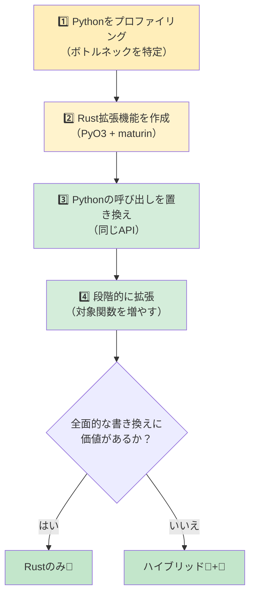

<a id="common-python-patterns-in-rust"></a>
## Rustでの一般的なPythonパターン

> **学習内容：** dictからstruct、classからstruct+impl、リスト内包表記からイテレーターチェーン、
> デコレーターからトレイト、コンテキストマネージャーからDrop/RAIIへの置き換え方。さらに、必須クレートと段階的な導入方法も学びます。
>
> **難易度：** 🟡 中級

### 辞書から構造体へ
```python
# Python — データコンテナーとしてのdict（よく使われる）
user = {
    "name": "Alice",
    "age": 30,
    "email": "alice@example.com",
    "active": True,
}
print(user["name"])
```

```rust
// Rust — 名前付きフィールドを持つstruct
#[derive(Debug, Clone, serde::Serialize, serde::Deserialize)]
struct User {
    name: String,
    age: i32,
    email: String,
    active: bool,
}

let user = User {
    name: "Alice".into(),
    age: 30,
    email: "alice@example.com".into(),
    active: true,
};
println!("{}", user.name);
```

### コンテキストマネージャーからRAII（Drop）へ
```python
# Python — リソース解放に使うコンテキストマネージャー
class FileManager:
    def __init__(self, path):
        self.file = open(path, 'w')

    def __enter__(self):
        return self.file

    def __exit__(self, *args):
        self.file.close()

with FileManager("output.txt") as f:
    f.write("hello")
# `with`を抜けるとファイルが自動的に閉じられる
```

```rust
// Rust — RAII：値がスコープを抜けるとDropトレイトが実行される
use std::fs::File;
use std::io::Write;

fn write_file() -> std::io::Result<()> {
    let mut file = File::create("output.txt")?;
    file.write_all(b"hello")?;
    Ok(())
    // `file`がスコープを抜けるとファイルは自動的に閉じられる
    // `with`は不要 — RAIIが処理する！
}
```

### デコレーターから高階関数またはマクロへ
```python
# Python — 実行時間を計測するデコレーター
import functools, time

def timed(func):
    @functools.wraps(func)
    def wrapper(*args, **kwargs):
        start = time.perf_counter()
        result = func(*args, **kwargs)
        elapsed = time.perf_counter() - start
        print(f"{func.__name__} took {elapsed:.4f}s")
        return result
    return wrapper

@timed
def slow_function():
    time.sleep(1)
```

```rust
// Rust — デコレーターはないため、ラッパー関数またはマクロを使う
use std::time::Instant;

fn timed<F, R>(name: &str, f: F) -> R
where
    F: FnOnce() -> R,
{
    let start = Instant::now();
    let result = f();
    println!("{} took {:.4?}", name, start.elapsed());
    result
}

// 使用例：
let result = timed("slow_function", || {
    std::thread::sleep(std::time::Duration::from_secs(1));
    42
});
```

### イテレーターパイプライン（データ処理）
```python
# Python — 変換処理を連鎖させる
import csv
from collections import Counter

def analyze_sales(filename):
    with open(filename) as f:
        reader = csv.DictReader(f)
        sales = [
            row for row in reader
            if float(row["amount"]) > 100
        ]
    by_region = Counter(sale["region"] for sale in sales)
    top_regions = by_region.most_common(5)
    return top_regions
```

```rust
// Rust — 強い型付けを備えたイテレーターチェーン
use std::collections::HashMap;

#[derive(Debug, serde::Deserialize)]
struct Sale {
    region: String,
    amount: f64,
}

fn analyze_sales(filename: &str) -> Vec<(String, usize)> {
    let data = std::fs::read_to_string(filename).unwrap();
    let mut reader = csv::Reader::from_reader(data.as_bytes());

    let mut by_region: HashMap<String, usize> = HashMap::new();
    for sale in reader.deserialize::<Sale>().flatten() {
        if sale.amount > 100.0 {
            *by_region.entry(sale.region).or_insert(0) += 1;
        }
    }

    let mut top: Vec<_> = by_region.into_iter().collect();
    top.sort_by(|a, b| b.1.cmp(&a.1));
    top.truncate(5);
    top
}
```

### グローバル設定／シングルトン
```python
# Python — モジュールレベルのシングルトン（よく使われるパターン）
# config.py
import json

class Config:
    _instance = None

    def __new__(cls):
        if cls._instance is None:
            cls._instance = super().__new__(cls)
            with open("config.json") as f:
                cls._instance.data = json.load(f)
        return cls._instance

config = Config()  # モジュールレベルのシングルトン
```

```rust
// Rust — 遅延static初期化にはOnceLockを使う（Rust 1.70以降）
use std::sync::OnceLock;
use serde_json::Value;

static CONFIG: OnceLock<Value> = OnceLock::new();

fn get_config() -> &'static Value {
    CONFIG.get_or_init(|| {
        let data = std::fs::read_to_string("config.json")
            .expect("Failed to read config");
        serde_json::from_str(&data)
            .expect("Failed to parse config")
    })
}

// どこからでも使用できる：
let db_host = get_config()["database"]["host"].as_str().unwrap();
```

***

## Python開発者に必須のクレート

### データ処理とシリアライズ

| 用途 | Python | Rustクレート | 説明 |
|------|--------|-----------|-------|
| JSON | `json` | `serde_json` | 型安全なシリアライズ |
| CSV | `csv`、`pandas` | `csv` | ストリーミング、低メモリ |
| YAML | `pyyaml` | `serde_yaml` | 設定ファイル |
| TOML | `tomllib` | `toml` | 設定ファイル |
| データ検証 | `pydantic` | `serde` + 独自実装 | コンパイル時の検証 |
| 日時 | `datetime` | `chrono` | 完全なタイムゾーン対応 |
| 正規表現 | `re` | `regex` | 非常に高速 |
| UUID | `uuid` | `uuid` | 同じ概念 |

### Webとネットワーク

| 用途 | Python | Rustクレート | 説明 |
|------|--------|-----------|-------|
| HTTPクライアント | `requests` | `reqwest` | 非同期を優先 |
| Webフレームワーク | `FastAPI`/`Flask` | `axum` / `actix-web` | 非常に高速 |
| WebSocket | `websockets` | `tokio-tungstenite` | 非同期 |
| gRPC | `grpcio` | `tonic` | 完全対応 |
| データベース（SQL） | `sqlalchemy` | `sqlx` / `diesel` | SQLをコンパイル時に検査 |
| Redis | `redis-py` | `redis` | 非同期対応 |

### CLIとシステム

| 用途 | Python | Rustクレート | 説明 |
|------|--------|-----------|-------|
| CLI引数 | `argparse`/`click` | `clap` | deriveマクロ |
| 色付き出力 | `colorama` | `colored` | ターミナルの色 |
| プログレスバー | `tqdm` | `indicatif` | 同じ使い勝手 |
| ファイル監視 | `watchdog` | `notify` | クロスプラットフォーム |
| ロギング | `logging` | `tracing` | 構造化、非同期対応 |
| 環境変数 | `os.environ` | `std::env` + `dotenvy` | .env対応 |
| サブプロセス | `subprocess` | `std::process::Command` | 組み込み |
| 一時ファイル | `tempfile` | `tempfile` | 名前も同じ！ |

### テスト

| 用途 | Python | Rustクレート | 説明 |
|------|--------|-----------|-------|
| テストフレームワーク | `pytest` | 組み込み + `rstest` | `cargo test` |
| モック | `unittest.mock` | `mockall` | トレイトベース |
| プロパティテスト | `hypothesis` | `proptest` | 類似したAPI |
| スナップショットテスト | `syrupy` | `insta` | スナップショットの承認 |
| ベンチマーク | `pytest-benchmark` | `criterion` | 統計的分析 |
| コードカバレッジ | `coverage.py` | `cargo-tarpaulin` | LLVMベース |

***

<a id="incremental-adoption-strategy"></a>
## 段階的な導入戦略



> 📌 **関連項目：** [第14章 — unsafeなRustとFFI](ch14-unsafe-rust-and-ffi.md)では、PyO3バインディングに必要な低レベルFFIの詳細を説明しています。

### ステップ1：ボトルネックを特定する

```python
# まずPythonコードをプロファイリングする
import cProfile
cProfile.run('main()')  # CPU負荷の高い関数を見つける

# またはサンプリングプロファイラーのpy-spyを使う：
# py-spy top --pid <python-pid>
# py-spy record -o profile.svg -- python main.py
```

### ステップ2：ボトルネックをRust拡張機能に置き換える

```bash
# maturinでRust拡張機能を作成する
cd my_python_project
maturin init --bindings pyo3

# ボトルネックの関数をRustで書く（上のPyO3の節を参照）
# ビルドしてインストール：
maturin develop --release
```

### ステップ3：Pythonの呼び出しをRustの呼び出しに置き換える

```python
# 変更前：
result = python_hot_function(data)  # 遅い

# 変更後：
import my_rust_extension
result = my_rust_extension.hot_function(data)  # 高速！

# APIもテストも同じまま、10～100倍高速
```

### ステップ4：段階的に対象を広げる

```rust
1～2週目：CPU負荷の高い関数を1つRustに置き換える
3～4週目：データの解析・検証レイヤーを置き換える
2か月目：中核となるデータパイプラインを置き換える
3か月目以降：効果が見合えば、全面的なRustへの書き換えを検討する

基本原則：処理の制御にはPythonを残し、計算にはRustを使う。
```

---

## 💼 ケーススタディ：PyO3によるデータパイプラインの高速化

あるフィンテックのスタートアップでは、毎日2GBの取引CSVファイルを処理するPythonデータパイプラインを運用しています。最大のボトルネックは検証と変換の処理です。

```python
# Python — 時間のかかる部分（2GBの処理に約12分）
import csv
from decimal import Decimal
from datetime import datetime

def validate_and_transform(filepath: str) -> list[dict]:
    results = []
    with open(filepath) as f:
        reader = csv.DictReader(f)
        for row in reader:
            # 各フィールドを解析して検証する
            amount = Decimal(row["amount"])
            if amount < 0:
                raise ValueError(f"Negative amount: {amount}")
            date = datetime.strptime(row["date"], "%Y-%m-%d")
            category = categorize(row["merchant"])  # 文字列照合、約50個のルール

            results.append({
                "amount_cents": int(amount * 100),
                "date": date.isoformat(),
                "category": category,
                "merchant": row["merchant"].strip().lower(),
            })
    return results
# 1500万行で約12分。pandasも試したが、約8分になった代わりにRAMを6GB使用した。
```

**ステップ1：** プロファイリングでボトルネックを特定します（CSV解析、Decimal変換、文字列照合に処理時間の95%を費やしています）。

**ステップ2：** Rust拡張機能を作成します。

```rust
// src/lib.rs — PyO3拡張機能
use pyo3::prelude::*;
use pyo3::types::PyList;
use std::fs::File;
use std::io::BufReader;

#[derive(Debug)]
struct Transaction {
    amount_cents: i64,
    date: String,
    category: String,
    merchant: String,
}

fn categorize(merchant: &str) -> &'static str {
    // Aho-Corasickまたは単純なルール — 一度コンパイルすれば非常に高速
    if merchant.contains("amazon") { "shopping" }
    else if merchant.contains("uber") || merchant.contains("lyft") { "transport" }
    else if merchant.contains("starbucks") { "food" }
    else { "other" }
}

#[pyfunction]
fn process_transactions(path: &str) -> PyResult<Vec<(i64, String, String, String)>> {
    let file = File::open(path).map_err(|e| pyo3::exceptions::PyIOError::new_err(e.to_string()))?;
    let mut reader = csv::Reader::from_reader(BufReader::new(file));

    let mut results = Vec::with_capacity(15_000_000); // あらかじめメモリを確保

    for record in reader.records() {
        let record = record.map_err(|e| pyo3::exceptions::PyValueError::new_err(e.to_string()))?;
        let amount_str = &record[0];
        let amount_cents = parse_amount_cents(amount_str)?;  // 独自パーサーを使う（Decimalは不要）
        let date = &record[1];  // すでにISO形式なので検証のみ
        let merchant = record[2].trim().to_lowercase();
        let category = categorize(&merchant).to_string();

        results.push((amount_cents, date.to_string(), category, merchant));
    }
    Ok(results)
}

#[pymodule]
fn fast_pipeline(m: &Bound<'_, PyModule>) -> PyResult<()> {
    m.add_function(wrap_pyfunction!(process_transactions, m)?)?;
    Ok(())
}
```

**ステップ3：** Python側の1行を置き換えます。

```python
# 変更前：
results = validate_and_transform("transactions.csv")  # 12分

# 変更後：
import fast_pipeline
results = fast_pipeline.process_transactions("transactions.csv")  # 45秒

# Python側の制御、テスト、デプロイ方法はそのまま
# 置き換えたのは関数1つだけ
```

**結果：**
| 指標 | Python（csv + Decimal） | Rust（PyO3 + csvクレート） |
|--------|----------------------|------------------------|
| 処理時間（2GB／1500万行） | 12分 | 45秒 |
| 最大メモリ使用量 | 6GB（pandas）／2GB（csv） | 200MB |
| Pythonの変更行数 | — | 1行（importと呼び出し） |
| Rustのコード量 | — | 約60行 |
| テスト成功数 | 47/47 | 47/47（変更なし） |

> **重要な教訓：** アプリケーション全体を書き直す必要はありません。処理時間の95%を占めるコードの5%を見つけ、PyO3を使ってRustに書き換え、それ以外はPythonのままにします。このチームは「サーバーを増やさなければ」から「1台で十分」へと変わりました。

---

## 演習

<details>
<summary><strong>🏋️ 演習：移行判断マトリックス</strong>（クリックして展開）</summary>

**課題：** 次のコンポーネントで構成されたPython製Webアプリケーションがあります。それぞれについて、**Pythonのままにする**、**Rustで書き直す**、**PyO3で橋渡しする**のいずれかを選び、理由を説明してください。

1. Flaskのルートハンドラー（リクエスト解析、JSON応答）
2. 画像サムネイルの生成（CPU負荷が高く、1日1万枚を処理）
3. データベースのORMクエリ（SQLAlchemy）
4. 2GBの財務ファイル用CSVパーサー（毎晩実行）
5. 管理ダッシュボード（Jinja2テンプレート）

<details>
<summary>🔑 解答</summary>

| コンポーネント | 判断 | 理由 |
|---|---|---|
| Flaskのルートハンドラー | 🐍 Pythonのまま | I/O中心でフレームワーク依存が強く、Rustにする利点が少ない |
| 画像サムネイルの生成 | 🦀 PyO3で橋渡し | CPU負荷の高い処理をRustにしつつ、Python APIを維持できる |
| データベースのORMクエリ | 🐍 Pythonのまま | SQLAlchemyは成熟しており、クエリはI/O中心 |
| CSVパーサー（2GB） | 🦀 PyO3で橋渡し、または全面的にRust化 | CPUとメモリがボトルネックで、Rustのゼロコピー解析が効果的 |
| 管理ダッシュボード | 🐍 Pythonのまま | UI／テンプレートのコードであり、性能上の懸念がない |

**要点：** 移行に最適なのは、境界が明確で、CPU負荷が高く、性能が重要なコードです。接着コードやI/O中心のハンドラーは書き換えないでください。得られる効果がコストに見合いません。

</details>
</details>

***
