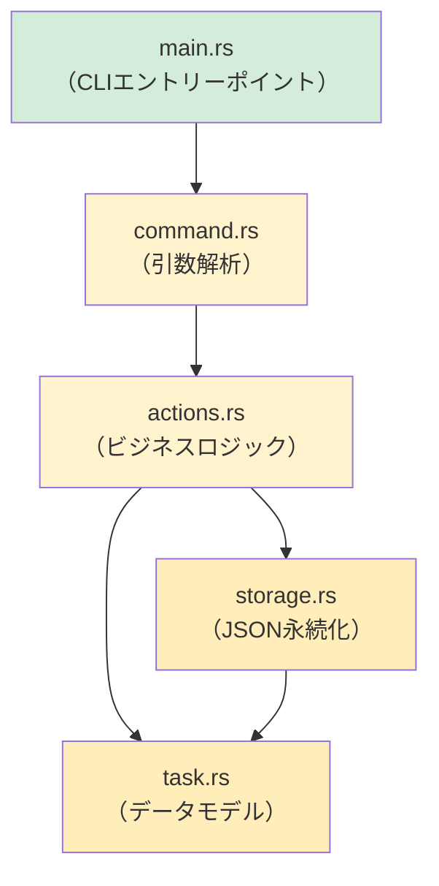

## 総合プロジェクト：CLIタスク管理ツールを作る

> **学習内容：** Python開発者なら通常`argparse` + `json` + `pathlib`で作るような、完全なRust製CLIアプリケーションを開発し、
> これまでに学んだ内容をすべて活用します。
>
> **難易度：** 🔴 上級

この総合プロジェクトでは、主要な各章の概念を活用します。
- **第3章**：型と変数（構造体、enum）
- **第5章**：コレクション（`Vec`、`HashMap`）
- **第6章**：enumとパターンマッチング（タスクの状態、コマンド）
- **第7章**：所有権と借用（参照の受け渡し）
- **第9章**：エラー処理（`Result`、`?`、独自エラー）
- **第10章**：トレイト（`Display`、`FromStr`）
- **第11章**：型変換（`From`、`TryFrom`）
- **第12章**：イテレーターとクロージャ（フィルタリング、マッピング）
- **第8章**：モジュール（整理されたプロジェクト構成）

***

<a id="the-project-rustdo"></a>
## プロジェクト：`rustdo`

タスクをJSONファイルに保存するコマンドラインのタスク管理ツールです（Pythonの`todo.txt`ツールのようなもの）。

### Pythonでの実装例

```python
#!/usr/bin/env python3
"""簡単なCLIタスク管理ツール — Python版。"""
import json
import sys
from pathlib import Path
from datetime import datetime
from enum import Enum

TASK_FILE = Path.home() / ".rustdo.json"

class Priority(Enum):
    LOW = "low"
    MEDIUM = "medium"
    HIGH = "high"

class Task:
    def __init__(self, id: int, title: str, priority: Priority, done: bool = False):
        self.id = id
        self.title = title
        self.priority = priority
        self.done = done
        self.created = datetime.now().isoformat()

def load_tasks() -> list[Task]:
    if not TASK_FILE.exists():
        return []
    data = json.loads(TASK_FILE.read_text())
    return [Task(**t) for t in data]

def save_tasks(tasks: list[Task]):
    TASK_FILE.write_text(json.dumps([t.__dict__ for t in tasks], indent=2))

# コマンド：add、list、done、remove、stats
# ...（Pythonならおなじみの実装）
```

### Rustで実装する

順を追って実装していきましょう。各ステップは特定の章で学んだ概念に対応しています。

***

<a id="step-1"></a>
<a id="step-1-define-the-data-model-ch-3-6-10-11"></a>
## ステップ1：データモデルを定義する（第3、6、10、11章）

```rust
// src/task.rs
use std::fmt;
use std::str::FromStr;
use serde::{Deserialize, Serialize};
use chrono::Local;

/// タスクの優先度 — PythonのPriority(Enum)に相当
#[derive(Debug, Clone, Copy, PartialEq, Eq, Serialize, Deserialize)]
#[serde(rename_all = "lowercase")]
pub enum Priority {
    Low,
    Medium,
    High,
}

// Displayトレイト（Pythonの__str__に相当）
impl fmt::Display for Priority {
    fn fmt(&self, f: &mut fmt::Formatter<'_>) -> fmt::Result {
        match self {
            Priority::Low => write!(f, "low"),
            Priority::Medium => write!(f, "medium"),
            Priority::High => write!(f, "high"),
        }
    }
}

// FromStrトレイト（"high"をPriority::Highに解析）
impl FromStr for Priority {
    type Err = String;

    fn from_str(s: &str) -> Result<Self, Self::Err> {
        match s.to_lowercase().as_str() {
            "low" | "l" => Ok(Priority::Low),
            "medium" | "med" | "m" => Ok(Priority::Medium),
            "high" | "h" => Ok(Priority::High),
            other => Err(format!("unknown priority: '{other}' (use low/medium/high)")),
        }
    }
}

/// 1つのタスク — PythonのTaskクラスに相当
#[derive(Debug, Clone, Serialize, Deserialize)]
pub struct Task {
    pub id: u32,
    pub title: String,
    pub priority: Priority,
    pub done: bool,
    pub created: String,
}

impl Task {
    pub fn new(id: u32, title: String, priority: Priority) -> Self {
        Self {
            id,
            title,
            priority,
            done: false,
            created: Local::now().format("%Y-%m-%dT%H:%M:%S").to_string(),
        }
    }
}

impl fmt::Display for Task {
    fn fmt(&self, f: &mut fmt::Formatter<'_>) -> fmt::Result {
        let status = if self.done { "✅" } else { "⬜" };
        let priority_icon = match self.priority {
            Priority::Low => "🟢",
            Priority::Medium => "🟡",
            Priority::High => "🔴",
        };
        write!(f, "{} {} [{}] {} ({})", status, self.id, priority_icon, self.title, self.created)
    }
}
```

> **Pythonとの比較：** Pythonでは`@dataclass`と`Enum`を使います。Rustでは`struct`、`enum`、`derive`マクロにより、シリアライズ、表示、解析の機能を簡単に追加できます。

***

## ステップ2：ストレージ層（第9、7章）

```rust
// src/storage.rs
use std::fs;
use std::path::PathBuf;
use crate::task::Task;

/// タスクファイル（~/.rustdo.json）のパスを取得する
fn task_file_path() -> PathBuf {
    let home = dirs::home_dir().expect("Could not determine home directory");
    home.join(".rustdo.json")
}

/// ディスクからタスクを読み込む — ファイルがない場合は空のVecを返す
pub fn load_tasks() -> Result<Vec<Task>, Box<dyn std::error::Error>> {
    let path = task_file_path();
    if !path.exists() {
        return Ok(Vec::new());
    }
    let content = fs::read_to_string(&path)?;  // ?がio::Errorを伝播する
    let tasks: Vec<Task> = serde_json::from_str(&content)?;  // ?がserdeのエラーを伝播する
    Ok(tasks)
}

/// タスクをディスクに保存する
pub fn save_tasks(tasks: &[Task]) -> Result<(), Box<dyn std::error::Error>> {
    let path = task_file_path();
    let json = serde_json::to_string_pretty(tasks)?;
    fs::write(&path, json)?;
    Ok(())
}
```

> **Pythonとの比較：** Pythonでは`Path.read_text()`と`json.loads()`を使います。Rustでは`fs::read_to_string()`と`serde_json::from_str()`を使います。`?`に注目してください。すべてのエラーが明示され、呼び出し元に伝播します。

***

## ステップ3：コマンドenum（第6章）

```rust
// src/command.rs
use crate::task::Priority;

/// 実行可能なすべてのコマンド — アクションごとにenumバリアントを1つ定義
pub enum Command {
    Add { title: String, priority: Priority },
    List { show_done: bool },
    Done { id: u32 },
    Remove { id: u32 },
    Stats,
    Help,
}

impl Command {
    /// コマンドライン引数をCommandに解析する
    /// （実際の開発では`clap`を使う — ここでは学習用に実装する）
    pub fn parse(args: &[String]) -> Result<Self, String> {
        match args.first().map(|s| s.as_str()) {
            Some("add") => {
                let title = args.get(1)
                    .ok_or("usage: rustdo add <title> [priority]")?
                    .clone();
                let priority = args.get(2)
                    .map(|p| p.parse::<Priority>())
                    .transpose()
                    .map_err(|e| e.to_string())?
                    .unwrap_or(Priority::Medium);
                Ok(Command::Add { title, priority })
            }
            Some("list") => {
                let show_done = args.get(1).map(|s| s == "--all").unwrap_or(false);
                Ok(Command::List { show_done })
            }
            Some("done") => {
                let id: u32 = args.get(1)
                    .ok_or("usage: rustdo done <id>")?
                    .parse()
                    .map_err(|_| "id must be a number")?;
                Ok(Command::Done { id })
            }
            Some("remove") => {
                let id: u32 = args.get(1)
                    .ok_or("usage: rustdo remove <id>")?
                    .parse()
                    .map_err(|_| "id must be a number")?;
                Ok(Command::Remove { id })
            }
            Some("stats") => Ok(Command::Stats),
            _ => Ok(Command::Help),
        }
    }
}
```

> **Pythonとの比較：** Pythonでは`argparse`や`click`を使います。この手書きのパーサーでは、enumのようなパターンに対する`match`がPythonのif/elif連鎖を置き換える様子を示しています。実際のプロジェクトでは`clap`クレートを使いましょう。

***

## ステップ4：ビジネスロジック（第5、12、7章）

```rust
// src/actions.rs
use crate::task::{Task, Priority};
use crate::storage;

pub fn add_task(title: String, priority: Priority) -> Result<(), Box<dyn std::error::Error>> {
    let mut tasks = storage::load_tasks()?;
    let next_id = tasks.iter().map(|t| t.id).max().unwrap_or(0) + 1;
    let task = Task::new(next_id, title.clone(), priority);
    println!("Added: {task}");
    tasks.push(task);
    storage::save_tasks(&tasks)?;
    Ok(())
}

pub fn list_tasks(show_done: bool) -> Result<(), Box<dyn std::error::Error>> {
    let tasks = storage::load_tasks()?;
    let filtered: Vec<&Task> = tasks.iter()
        .filter(|t| show_done || !t.done)   // イテレーターとクロージャ（第12章）
        .collect();

    if filtered.is_empty() {
        println!("No tasks! 🎉");
        return Ok(());
    }

    for task in &filtered {
        println!("  {task}");   // Displayトレイトを使用（第10章）
    }
    println!("\n{} task(s) shown", filtered.len());
    Ok(())
}

pub fn complete_task(id: u32) -> Result<(), Box<dyn std::error::Error>> {
    let mut tasks = storage::load_tasks()?;
    let task = tasks.iter_mut()
        .find(|t| t.id == id)                // Iterator::find（第12章）
        .ok_or(format!("No task with id {id}"))?;
    task.done = true;
    println!("Completed: {task}");
    storage::save_tasks(&tasks)?;
    Ok(())
}

pub fn remove_task(id: u32) -> Result<(), Box<dyn std::error::Error>> {
    let mut tasks = storage::load_tasks()?;
    let len_before = tasks.len();
    tasks.retain(|t| t.id != id);            // Vec::retain（第5章）
    if tasks.len() == len_before {
        return Err(format!("No task with id {id}").into());
    }
    println!("Removed task {id}");
    storage::save_tasks(&tasks)?;
    Ok(())
}

pub fn show_stats() -> Result<(), Box<dyn std::error::Error>> {
    let tasks = storage::load_tasks()?;
    let total = tasks.len();
    let done = tasks.iter().filter(|t| t.done).count();
    let pending = total - done;

    // イテレーターで優先度別に集計する（第12章）
    let high = tasks.iter().filter(|t| !t.done && t.priority == Priority::High).count();
    let medium = tasks.iter().filter(|t| !t.done && t.priority == Priority::Medium).count();
    let low = tasks.iter().filter(|t| !t.done && t.priority == Priority::Low).count();

    println!("📊 Task Statistics");
    println!("   Total:   {total}");
    println!("   Done:    {done} ✅");
    println!("   Pending: {pending}");
    println!("   🔴 High:   {high}");
    println!("   🟡 Medium: {medium}");
    println!("   🟢 Low:    {low}");
    Ok(())
}
```

> **使用した主なRustのパターン：** `iter().map().max()`、`iter().filter().collect()`、`iter_mut().find()`、`retain()`、`iter().filter().count()`。これらはPythonのリスト内包表記、`next(x for x in ...)`、`Counter`に相当します。

***

## ステップ5：各部を組み合わせる（第8章）

```rust
// src/main.rs
mod task;
mod storage;
mod command;
mod actions;

use command::Command;

fn main() {
    let args: Vec<String> = std::env::args().skip(1).collect();
    let command = match Command::parse(&args) {
        Ok(cmd) => cmd,
        Err(e) => {
            eprintln!("Error: {e}");
            std::process::exit(1);
        }
    };

    let result = match command {
        Command::Add { title, priority } => actions::add_task(title, priority),
        Command::List { show_done } => actions::list_tasks(show_done),
        Command::Done { id } => actions::complete_task(id),
        Command::Remove { id } => actions::remove_task(id),
        Command::Stats => actions::show_stats(),
        Command::Help => {
            print_help();
            Ok(())
        }
    };

    if let Err(e) = result {
        eprintln!("Error: {e}");
        std::process::exit(1);
    }
}

fn print_help() {
    println!("rustdo — a task manager for Pythonistas learning Rust\n");
    println!("USAGE:");
    println!("  rustdo add <title> [low|medium|high]   Add a task");
    println!("  rustdo list [--all]                    List pending tasks");
    println!("  rustdo done <id>                       Mark task complete");
    println!("  rustdo remove <id>                     Remove a task");
    println!("  rustdo stats                           Show statistics");
}
```



***

## ステップ6：Cargo.tomlの依存関係

```toml
[package]
name = "rustdo"
version = "0.1.0"
edition = "2021"

[dependencies]
serde = { version = "1", features = ["derive"] }
serde_json = "1"
chrono = "0.4"
dirs = "5"
```

> **Pythonでの相当物：** `pyproject.toml`の`[project.dependencies]`に相当します。`cargo add serde serde_json chrono dirs`は`pip install`のようなものです。

***

<a id="step-7"></a>
<a id="step-7-tests-ch-14"></a>
## ステップ7：テスト（第14章）

```rust
// src/task.rs — ファイル末尾に追加
#[cfg(test)]
mod tests {
    use super::*;

    #[test]
    fn parse_priority() {
        assert_eq!("high".parse::<Priority>().unwrap(), Priority::High);
        assert_eq!("H".parse::<Priority>().unwrap(), Priority::High);
        assert_eq!("med".parse::<Priority>().unwrap(), Priority::Medium);
        assert!("invalid".parse::<Priority>().is_err());
    }

    #[test]
    fn task_display() {
        let task = Task::new(1, "Write Rust".to_string(), Priority::High);
        let display = format!("{task}");
        assert!(display.contains("Write Rust"));
        assert!(display.contains("🔴"));
        assert!(display.contains("⬜")); // まだ未完了
    }

    #[test]
    fn task_serialization_roundtrip() {
        let task = Task::new(1, "Test".to_string(), Priority::Low);
        let json = serde_json::to_string(&task).unwrap();
        let recovered: Task = serde_json::from_str(&json).unwrap();
        assert_eq!(recovered.title, "Test");
        assert_eq!(recovered.priority, Priority::Low);
    }
}
```

> **Pythonでの相当物：** `pytest`のテストです。`pytest`の代わりに`cargo test`で実行します。テストの自動検出に頼る必要はなく、`#[test]`でテスト関数を明示します。

***

## 発展課題

基本版が動作したら、次の機能拡張に挑戦してみましょう。

1. **引数解析に`clap`を追加する** — 手書きのパーサーを`clap`のderiveマクロに置き換える：
   ```rust
   #[derive(Parser)]
   enum Command {
       Add { title: String, #[arg(default_value = "medium")] priority: Priority },
       List { #[arg(long)] all: bool },
       Done { id: u32 },
       Remove { id: u32 },
       Stats,
   }
   ```

2. **色付き出力を追加する** — Pythonの`colorama`のように、`colored`クレートでターミナルに色を付ける。

3. **期限日を追加する** — `Option<NaiveDate>`フィールドを追加し、期限切れタスクを抽出する。

4. **タグ／カテゴリを追加する** — タグに`Vec<String>`を使い、`.iter().any()`で絞り込む。

5. **ライブラリとバイナリに分ける** — `lib.rs`と`main.rs`に分けて、ロジックを再利用できるようにする（第8章のモジュール構成）。

***

## 実践した内容

| 章 | 概念 | 使用箇所 |
|---------|---------|-------------------|
| 第3章 | 型と変数 | `Task`の構造体フィールド、`u32`、`String`、`bool` |
| 第5章 | コレクション | `Vec<Task>`、`retain()`、`push()` |
| 第6章 | enumとmatch | `Priority`、`Command`、網羅的なマッチング |
| 第7章 | 所有権と借用 | `&[Task]`と`Vec<Task>`の比較、完了処理に使う`&mut` |
| 第8章 | モジュール | `mod task; mod storage; mod command; mod actions;` |
| 第9章 | エラー処理 | `Result<T, E>`、`?`演算子、`.ok_or()` |
| 第10章 | トレイト | `Display`、`FromStr`、`Serialize`、`Deserialize` |
| 第11章 | From/Into | Priority用の`FromStr`、エラー変換用の`.into()` |
| 第12章 | イテレーター | `filter`、`map`、`find`、`count`、`collect` |
| 第14章 | テスト | `#[test]`、`#[cfg(test)]`、アサーションマクロ |

> 🎓 **おめでとうございます！** このプロジェクトを完成させたなら、本書で扱ったRustの主要な概念をすべて使ったことになります。あなたはもうRustを学ぶPython開発者ではなく、Pythonも知っているRust開発者です。

***
